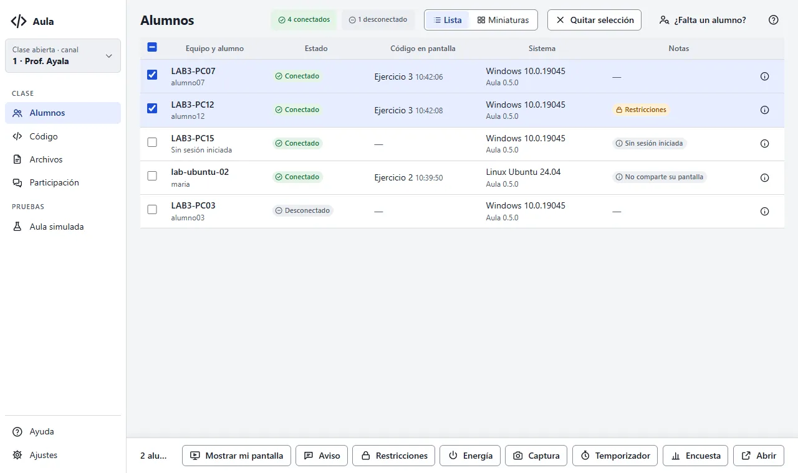
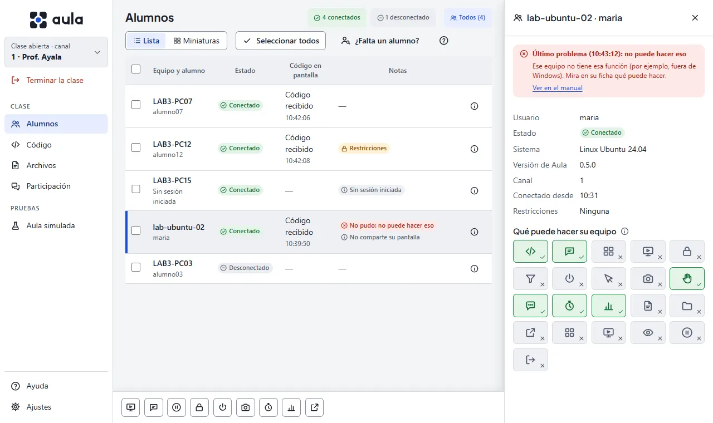

# La pantalla Alumnos

Es la pantalla de inicio: muestra a los alumnos de tu canal y desde aquí aplicas acciones a todos
o solo a algunos.

## Lista o miniaturas

- **Lista**: una fila por equipo con su estado, el código que tiene en pantalla, su sistema y
  versión de Aula, y notas (por ejemplo, «No comparte su pantalla», «Restricciones» o «No pudo: …»
  si su equipo contestó con un problema).
- **Miniaturas**: la pantalla de cada alumno, como un monitor, actualizada cada segundo. Haz clic
  en una para verla en grande. Con **Tamaño** las haces más chicas o más grandes (Pequeño, Mediano,
  Grande, Extra grande) o eliges **Ajustar a la pantalla** para ver a todos sin desplazarte; la
  consola recuerda tu elección.

Mientras ves las miniaturas, cada alumno tiene en su pantalla el aviso «Tu pantalla está siendo
vista por el profesor». Las imágenes no se guardan: al salir de Miniaturas se dejan de pedir.

## La ficha de un alumno

El botón de información al final de cada fila abre su **ficha** a la derecha: usuario, estado,
sistema, versión de Aula, canal, desde qué hora está conectado y sus restricciones. Abajo dice
**qué puede hacer su equipo** (recibir código, mostrar su pantalla, energía, control remoto…), y
arriba, si su equipo contestó con un problema, cuál fue y qué hacer.

Mientras la ficha está abierta, su fila queda marcada con una línea a la izquierda, y la ficha dice
arriba su equipo y su usuario («LAB3-PC07 · alumno07»). La ficha solo informa: lo que haces con un
alumno está en su **pantalla en grande**.

## Acciones sobre un alumno

En **Miniaturas**, haz clic en la pantalla de un alumno para verla en grande. Arriba están sus
acciones (al pasar el mouse, cada una dice qué hace):

- **Tomar control**: ves su pantalla en vivo y manejas su mouse y su teclado (ver
  [Tareas frecuentes](tareas-frecuentes#ayudar-a-un-alumno-tomando-el-control)).
- **Mensaje privado**: se abre un diálogo para escribirle solo a él; le llega como «Mensaje para
  ti» (ver [Tareas frecuentes](tareas-frecuentes#mandar-un-mensaje-privado-a-un-alumno)).
- **Tomar captura**: una foto de su pantalla; solo se guarda si pulsas **Guardar** (ver
  [Tareas frecuentes](tareas-frecuentes#tomar-una-captura-de-la-pantalla-de-un-alumno)).
- **Proyectar a la clase**: sus compañeros ven su pantalla en grande (ver
  [Tareas frecuentes](tareas-frecuentes#proyectar-la-pantalla-de-un-alumno)).
- **Pausar pantalla**: cubre su pantalla con un aviso hasta que pulses **Reanudar pantalla** (ver
  [Tareas frecuentes](tareas-frecuentes#pausar-las-pantallas)).
- **Abrir página o app**: se abre un diálogo para abrirle una página o una app permitida (ver
  [Tareas frecuentes](tareas-frecuentes#abrir-una-página-o-una-app-en-los-equipos)).

Solo salen las que su equipo permite; los alumnos simulados no tienen Tomar control, Mensaje
privado, Proyectar, Pausar ni Abrir.

## Seleccionar alumnos

Haz clic en una fila o su casilla, o usa **Seleccionar todos** (también con Ctrl+A). Arriba, junto
a los conectados, dice **Todos (n)** o **n seleccionados** (al pasar el mouse explica a quién van).
**Sin selección, las acciones van a todos los conectados.**

## Acciones sobre la selección

La barra de abajo abre un panel a la derecha, sin tapar la lista:

| Acción | Qué hace | Más |
|---|---|---|
| Mostrar mi pantalla | Tus alumnos ven tu pantalla con tu nombre arriba, en una ventana encima de las suyas o en pantalla completa. | [Tareas frecuentes](tareas-frecuentes#mostrar-tu-pantalla) |
| Aviso | Un mensaje que aparece en su pantalla. | [Tareas frecuentes](tareas-frecuentes#mandar-un-aviso) |
| Pausar | Cubre sus pantallas con un aviso para que te pongan atención, hasta que las reanudes. | [Tareas frecuentes](tareas-frecuentes#pausar-las-pantallas) |
| Restricciones | Bloquea aplicaciones o sitios web durante la clase. | [Tareas frecuentes](tareas-frecuentes#bloquear-aplicaciones-o-sitios) |
| Energía | Apaga, reinicia o cierra la sesión de los equipos. | [Tareas frecuentes](tareas-frecuentes#apagar-o-reiniciar-los-equipos) |
| Captura | Toma una foto de la pantalla de cada uno; guardas las que elijas. | [Tareas frecuentes](tareas-frecuentes#tomar-una-captura-de-la-pantalla-de-un-alumno) |
| Abrir | Abre una página en su navegador o una app permitida en su equipo. | [Tareas frecuentes](tareas-frecuentes#abrir-una-página-o-una-app-en-los-equipos) |

## Estados de un alumno

- **Conectado**: Aula está abierta en su equipo y te escucha.
- **Desconectado**: el equipo dejó de responder (se apagó, se fue la red o cerró Aula). Vuelve
  solo cuando se recupera.
- **Sin sesión iniciada**: el equipo está encendido pero nadie inició sesión; solo puede recibir
  órdenes de energía.
- **En pausa** (insignia en Notas): su pantalla está cubierta por la pausa. **Pausando…** o **Sin
  acusar la pausa** dicen que su equipo aún no la confirma; **No se pudo pausar**, que su equipo no
  pudo mostrarla.

Si un alumno no aparece, abre [¿Falta un alumno?](pantalla:falta).
