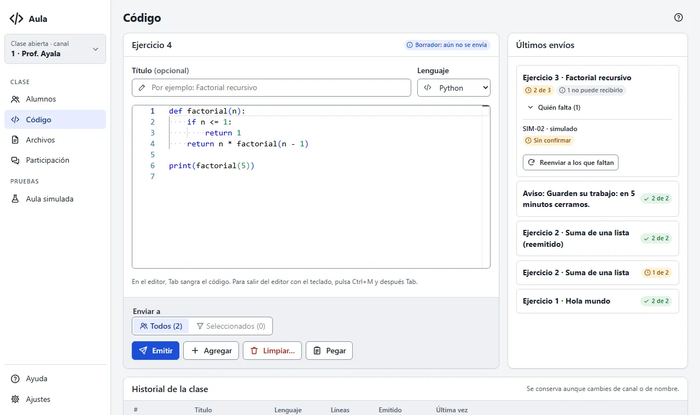

# La pantalla Código

Aquí preparas el código que verán tus alumnos y sigues quién ya lo tiene en pantalla.

## El editor

Escribe o pega tu código. Arriba eliges el **lenguaje** (para los colores) y un **título**
opcional. Cada envío es un ejercicio numerado: Ejercicio 1, 2, 3…

Para traer código de otro programa, cópialo (Ctrl+C) y pulsa **Pegar**. También
funciona con el atajo de teclado desde cualquier programa (lo ves en
[Ajustes](ajustes#acerca-de)).

> **Teclado:** dentro del editor, Tab sangra el código. Para salir del editor con el teclado,
> pulsa Ctrl+M y después Tab.

## Enviar

Los botones van en una fila; al pasar el mouse, cada uno explica qué hace.

- **Emitir**: reemplaza lo que ven; los alumnos ven solo este código.
- **Agregar**: lo agrega debajo de lo que ya tienen, sin borrar nada.
- **Limpiar…**: borra el código que ven en Aula (lo que copiaron a su editor no se toca). Pide
  confirmación.
- **Pegar**: carga en el editor lo que copiaste.

En **Enviar a** eliges **Todos** (los conectados) o **Seleccionados** (los que marcaste en
[Alumnos](alumnos#seleccionar-alumnos)); entre paréntesis, cuántos son.

Si el código pasa de 256 KiB, divídelo en partes y envíalas con **Agregar**.

## Últimos envíos

Cada envío dice cuántos alumnos ya lo tienen en pantalla, por ejemplo «7 de 8». Que lo tengan en
pantalla no quiere decir que lo hayan leído o copiado.

- **Quién falta** muestra a los que no han confirmado y por qué (sin confirmar, desconectado…).
- **Reenviar a los que faltan** lo manda otra vez solo a ellos.

Los alumnos simulados se cuentan aparte, con su propia insignia.

## Historial de la clase

Todo lo que emites queda en el historial, aunque cambies de canal o de nombre. Para cada
ejercicio:

- **Abrir en el editor**: lo carga para corregirlo y emitirlo como uno nuevo.
- **Reemitir**: lo envía otra vez tal cual, con su mismo número. Pide confirmación porque
  reemplaza lo que ven.
