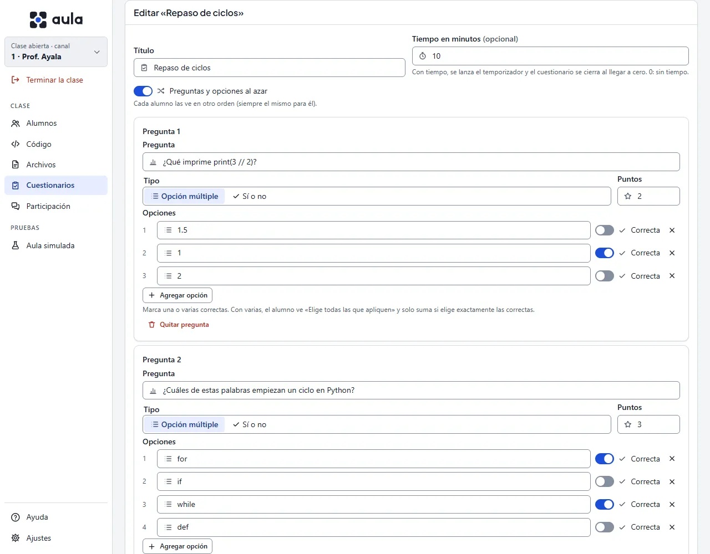

# La pantalla Cuestionarios

Un **cuestionario** es una encuesta de varias preguntas con su **respuesta correcta** y sus
**puntos**: sirve para un repaso rápido o un examen corto. Aquí guardas tus cuestionarios para
usarlos en otras clases y los lanzas. Lo que responden tus alumnos lo ves en
[Participación › Encuestas](participacion#encuestas).

## Cuestionarios guardados

La lista muestra tus cuestionarios con cuántas preguntas tienen, cuántos puntos valen y si
llevan tiempo. Se guardan como archivos en **Documentos\Aula\cuestionarios** de tu equipo
(**Abrir carpeta** la muestra en el Explorador): son tu material, con las respuestas correctas, y
nunca salen de tu equipo así.

- **Lanzar**: lo manda a los alumnos (ver [Lanzar un cuestionario](#lanzar-un-cuestionario)).
- **Editar**: lo abre en el editor; al guardar, reemplaza el archivo.
- **Eliminar**: borra su archivo. Los resultados de la clase no cambian.

Un archivo que Aula no puede leer (por ejemplo, si se editó a mano y quedó roto) aparece con
**No se puede leer** y solo se puede eliminar.

## Crear un cuestionario

Pulsa **Nuevo cuestionario**: el editor se abre en su propio diálogo, con los **datos del
cuestionario** arriba y las **preguntas** debajo. **Cancelar**, la X o Esc lo cierran sin guardar.

1. Escribe el **título** (hasta 80 caracteres): es lo que ve el alumno arriba de su tarjeta.
2. Si quieres, pon un **tiempo en minutos** (hasta 120). Al lanzarlo se pone en marcha el
   [temporizador](participacion#temporizador) para los mismos alumnos y el cuestionario **se cierra
   solo al llegar a cero**. Si extiendes el temporizador, se cierra cuando termine; si lo detienes,
   lo cierras tú.
3. Marca **Preguntas y opciones al azar** si quieres que cada alumno las vea en otro orden (siempre
   el mismo para el mismo alumno, aunque se reconecte).
4. Para cada pregunta escribe el **texto** (hasta 200 caracteres), elige el **tipo** y sus
   **puntos** (de 1 a 100):
   - **Opción múltiple**: de 2 a 6 opciones. Enciende el interruptor de la columna **Correcta** en
     una o varias; el 🗑 al final de la fila quita la opción. Con varias correctas, el alumno ve
     «Elige todas las que apliquen».
   - **Sí o no**: elige si **la correcta** es Sí o No.
5. **Agregar pregunta** suma otra (hasta 30). **Quitar pregunta** quita la suya.
6. Pulsa **Guardar**, o **Guardar y lanzar** para mandarlo ahora mismo.

La calificación es **todo o nada**: una pregunta suma sus puntos solo si el alumno eligió
**exactamente** las correctas. Con varias correctas, elegir solo una de ellas no suma.

## Lanzar un cuestionario

Elige a quién en **Lanzar a**: **todos** los conectados o **la selección** que marcaste en Alumnos.
Pulsa **Lanzar** en su fila.

- Solo hay **una encuesta o cuestionario abierto a la vez**: si hay otro abierto, Aula te pregunta
  antes de cerrarlo.
- Los equipos con una versión de Aula anterior no pueden mostrar cuestionarios: Aula te dice
  cuántos son y no se lo manda.
- La respuesta correcta **nunca viaja** al equipo del alumno mientras el cuestionario está
  abierto.

Al alumno le llega como una tarjeta arriba de su lista, con «Nuevo», **sin quitarle el teclado**.
La tarjeta le dice antes de empezar que **verás sus respuestas y su puntaje con su nombre**.
Responde una pregunta a la vez con **Anterior** y **Siguiente**, ve cuántas lleva y puede cambiar
sus respuestas hasta pulsar **Entregar**. Si le faltan preguntas, Aula le pide confirmar con
**Entregar así**. Lo que marca se guarda en tu consola al momento: si se le va la red, al volver
sigue donde iba.

{{diagrama:20-encuestas}}

## Ver los resultados

Lanzado, el cuestionario aparece en [Participación › Encuestas](participacion#encuestas) y en la
franja de arriba («Cuestionario abierto: …», con cuántos entregaron):

- **Por pregunta**: cuántos acertaron de los que la respondieron, para saber **qué reforzar**. Pasa
  el puntero sobre la pregunta para ver cuál era la correcta.
- **Por alumno**: equipo, usuario, puntaje y si entregó (o cuántas lleva).

Los puntajes **solo se ven en Participación**: nunca en la lista de Alumnos ni en la Pantalla
grande, que se proyectan en el aula. Los de los alumnos simulados se marcan y se cuentan aparte.

Pulsa **Cerrar encuesta** (o deja que el tiempo lo cierre). Lo que el alumno no entregó se
califica con las respuestas que ya habían llegado.

## Compartir los resultados personales

Ya cerrado, **Compartir resultados personales** manda a **cada alumno solo su resultado**: qué
acertó, cuál era la correcta y su puntaje. Nadie ve el de otro, ni el promedio de la clase, ni una
tabla de posiciones. Si un alumno está desconectado, le llega al volver.

## Exportar calificaciones

Ya cerrado, **Exportar calificaciones** guarda un archivo CSV en
**Documentos\Aula\calificaciones\<fecha>\** con una fila por alumno: **equipo, usuario, puntaje,
máximo, si entregó y los puntos de cada pregunta**. Ábrelo en Excel o en Hojas de cálculo. Los
alumnos simulados **nunca** se exportan.

Aula no guarda calificaciones por su cuenta: sin exportar, se borran al cerrar la clase o cambiar
de canal. El archivo exportado es tuyo: guárdalo o bórralo según las reglas de tu escuela. Cuando
Aula conozca el número de cuenta y el nombre de cada alumno, el archivo los incluirá.

## Lo que no es obvio

- **Un cuestionario no es anónimo**: siempre ves quién respondió qué. Para una pregunta anónima usa
  una [encuesta](participacion#encuestas).
- **Al azar** cambia el orden en la tarjeta del alumno, no en tus resultados: ahí las preguntas van
  siempre en el orden en que las escribiste.
- Los **alumnos simulados** responden al azar y entregan solos: sirven para probar el cuestionario
  antes de la clase ([Probar sin laboratorio](probar-sin-laboratorio)).
