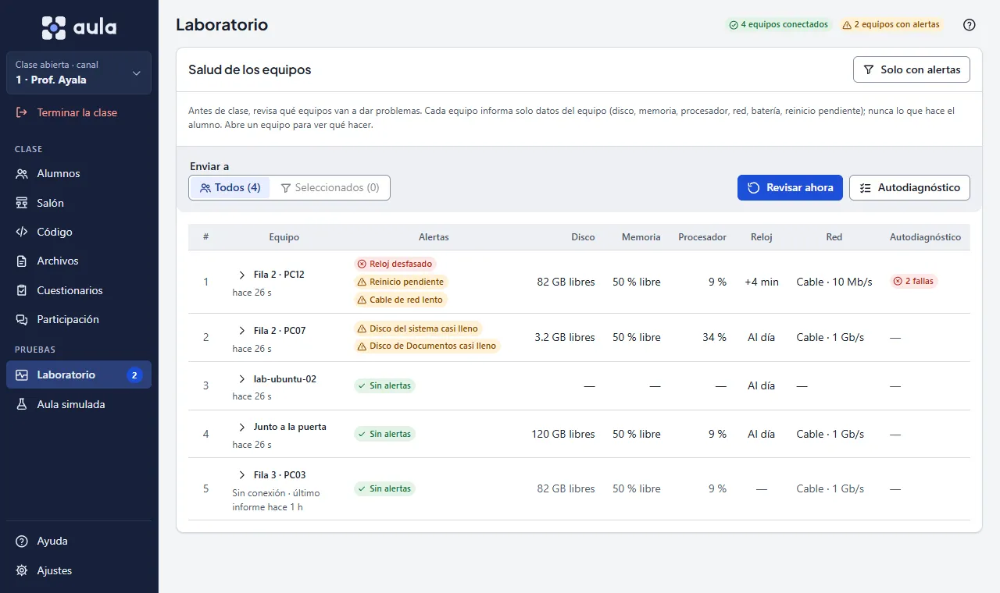

# La pantalla Laboratorio

Hoy un equipo con problemas se descubre cuando un alumno dice «a mí no me jala». En
**Laboratorio** (menú, grupo Pruebas) lo ves **antes de clase**: cada equipo informa unos pocos
datos **del equipo** y la consola los convierte en **alertas** con qué hacer. El número junto a
**Laboratorio** en el menú cuenta los equipos conectados con alguna alerta, y en **Alumnos** cada
equipo con alertas lleva su insignia.

Aula **solo informa**: nunca limpia el disco, reinicia ni cambia nada del equipo. Lo que se
informa es una lista cerrada y no incluye lo que hace el alumno (ver
[Qué informa cada equipo](#qué-informa-cada-equipo)).

## La tabla

Una fila por equipo, primero los que tienen alertas (las rojas antes que las amarillas):

| Columna | Qué dice |
|---|---|
| **Equipo** | Su etiqueta del salón y cuándo llegó su último informe. Un equipo apagado sigue en la lista con «Sin conexión» y su último informe, mientras la consola esté abierta. |
| **Alertas** | Cada alerta con su título. Roja: el equipo no va a funcionar bien en clase. Amarilla: va a molestar. |
| **Disco** | Lo libre en la unidad de Windows (y en la de Documentos, si es otra). |
| **Memoria** | Lo libre de la memoria. |
| **Procesador** | Su uso promedio en el último minuto. |
| **Reloj** | Cuánto se adelanta (+) o se atrasa (−) frente al reloj de tu equipo. |
| **Red** | Cable o Wi‑Fi, su velocidad y la señal del Wi‑Fi. |
| **Batería** | Solo si alguno tiene batería: su carga y si está conectado a la corriente. |
| **Autodiagnóstico** | El resultado del último autodiagnóstico. |

Haz clic en el nombre de un equipo para abrir su fila: cada alerta con **qué hacer** y su enlace
**Cómo arreglarlo**, todos sus datos y, si hiciste el autodiagnóstico, cada prueba. Con **Solo con
alertas** ves solo los que tienen algo.

La misma información de un alumno está en su ficha, en **Salud del equipo**: abre la ficha desde
Alumnos.

## Revisar ahora

Cada equipo manda su informe solo, cada minuto, y antes si algo cambia mucho (el disco se llena,
se desconecta el cable). **Revisar ahora** pide el informe en ese momento a **todos** o a la
**selección** de Alumnos (con «Enviar a»). Se puede usar una vez cada 10 segundos.

Si dice que ningún equipo informa su salud, los equipos conectados tienen una versión anterior de
Aula: actualízalos.

## Autodiagnóstico

El autodiagnóstico es una prueba más completa que **no** corre sola: la lanzas tú antes del
semestre o de una práctica, a todos o a la selección. Cada equipo tarda unos segundos y responde
qué pasó con cada prueba:

| Prueba | Qué revisa |
|---|---|
| **Escribir en el disco** | Escribe 4 MB en un archivo temporal, lo vuelve a leer y lo borra. Falla si el disco no deja escribir o está lleno. Nunca toca los archivos del alumno. |
| **DNS** y **Conexión** | Que encuentre y alcance la dirección de internet y cada servicio de [Ajustes › Salud](ajustes#salud). |
| **Salida de audio** | Que haya bocinas o audífonos activos. |
| **Tarjeta de red** | Que haya una tarjeta de red funcionando. |
| **Tarjeta de video** | Que la tarjeta de video tenga su driver y no el «Adaptador de pantalla básico de Microsoft» (sin él, todo va lento y no hay aceleración). |
| **Teclado** y **Mouse** | Que estén conectados. |

Si una prueba falla, su motivo sale junto a ella. Qué hacer:

- **Escribir en el disco:** si no deja escribir, el disco o su controladora pueden estar fallando;
  revisa [El disco de un equipo tiene fallas](solucion-de-problemas#el-disco-de-un-equipo-tiene-fallas).
  Si no hay espacio, [libéralo](solucion-de-problemas#un-equipo-tiene-el-disco-casi-lleno).
- **DNS o Conexión:** ver [Un equipo no tiene internet](solucion-de-problemas#un-equipo-no-tiene-internet).
  Si solo falla un servicio, revisa que su dirección y su puerto en Ajustes › Salud sean los
  correctos y que el firewall del laboratorio lo deje pasar.
- **Tarjeta de video «sin su driver»:** instala el driver del fabricante de la tarjeta.
- **Audio, teclado o mouse:** revisa que estén conectados y encendidos.

«No respondió» quiere decir que el equipo no contestó en 30 segundos: revisa que siga conectado y
vuelve a lanzarlo. «Ocupado» quiere decir que hizo uno hace menos de un minuto.

## Qué informa cada equipo

Solo datos **del equipo**, nunca del alumno (es una lista cerrada; ver también
[Qué puede hacer cada equipo](conceptos#qué-puede-hacer-cada-equipo)):

- espacio libre del disco de Windows y del de Documentos, y si el disco avisa de fallas
  (S.M.A.R.T.);
- memoria total y libre;
- uso del procesador en el último minuto y si está limitado (casi siempre por calor);
- cuánto lleva encendido y si espera un reinicio por actualizaciones;
- si es cable o Wi‑Fi, su velocidad y la señal del Wi‑Fi;
- si llega a internet (solo si pusiste una dirección en Ajustes › Salud);
- su batería, si tiene.

**Nunca** informa qué programas están abiertos, qué sitios visita, sus archivos, su usuario ni
dónde está. El reloj no viaja: la consola lo calcula con las señales de vida que ya manda cada
equipo. El alumno ve en **Qué puede hacer Aula en este equipo** que su equipo informa su salud.

Si un dato no se puede leer en un equipo (por ejemplo, el estado del disco en un equipo donde Aula
no corre como servicio, o cualquier dato fuera de Windows), su fila dice «No se puede leer en este
equipo» y no hay alerta por él.

Los informes viven solo en la memoria de la consola: al cerrarla o cambiar de canal se olvidan.

## Alumnos simulados

En el [aula simulada](probar-sin-laboratorio) los alumnos informan una salud inventada, con
algunas alertas (un disco casi lleno, un cable lento, Wi‑Fi teniendo cable, una laptop sin
corriente), para que pruebes esta pantalla sin laboratorio. Van marcados como simulados.
