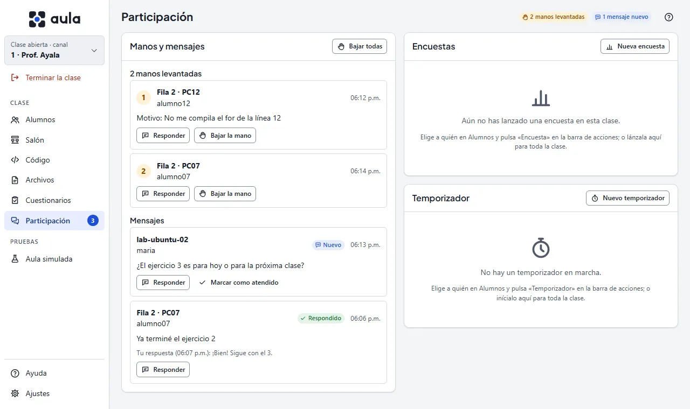
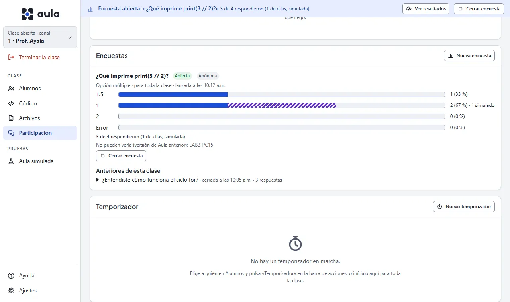

# La pantalla Participación

Aquí llega lo que tus alumnos te mandan durante la clase: las **manos levantadas** y los
**mensajes** que te escriben desde su ventana de Aula, y sus respuestas a las **encuestas**. Aquí
sigues también el **temporizador** del ejercicio. El número junto a **Participación** en
el menú cuenta lo que espera tu atención: las manos levantadas y los mensajes que aún no
respondes.

Cuando llega una mano o un mensaje, aparece un aviso abajo a la derecha con el nombre del equipo.
El aviso no dice qué escribió el alumno: eso solo lo lees aquí. En **Alumnos**, la columna
**Notas** muestra «Mano levantada · 2» (el 2 es su lugar en la fila) o «1 mensaje», y al hacer
clic llegas a esta pantalla.

## Manos levantadas

Las manos aparecen **en el orden en que se levantaron**: el número de la izquierda es su lugar en
la fila. Si el alumno escribió un motivo («No me compila el for»), se ve debajo de su nombre.

- **Bajar la mano**: la quita de la fila y, en el equipo del alumno, el botón vuelve a «Levantar
  la mano» con el aviso «Tu profesor bajó tu mano».
- **Bajar todas**: al terminar una explicación, por ejemplo. Te pide confirmación.

Si el alumno baja su mano, desaparece sola de la fila. Si se le va la red, su mano **conserva su
lugar** (verás «Desconectado») y vuelve a estar al día cuando reconecta.

## Mensajes de los alumnos

Los mensajes aparecen del más reciente al más viejo, con la hora y su estado:

| Estado | Qué significa |
|---|---|
| Nuevo | Aún no lo respondes. Cuenta en el número del menú. |
| Respondido | Le contestaste con **Responder**; debajo ves tu respuesta. |
| Atendido | Lo marcaste con **Marcar como atendido** (por ejemplo, porque fuiste a su lugar). |

Al alumno le llega «Recibido» en cuanto el mensaje está en tu consola. Eso no significa que ya lo
leíste.

## Responder a un alumno

**Responder** abre un campo debajo del mensaje o de la mano. Escribe y pulsa **Enter** (o
**Enviar**); **Shift+Enter** pasa a otra línea y **Esc** cancela. La respuesta le llega **solo a
ese alumno** como «Respuesta a tu mensaje», con lo que te escribió, sin quitarle el teclado. Si
respondes a una mano, la casilla **Bajar también su mano** la baja al enviar.

Solo puedes responder a un alumno conectado. El envío aparece también en **Código › Últimos
envíos**, con su confirmación, como cualquier aviso.

{{diagrama:18-manos-mensajes}}

## Encuestas

Una pregunta rápida para saber si se entendió («¿Qué imprime `print(3 // 2)`?»). Elige a quién en
**Alumnos** (o a nadie, para toda la clase) y pulsa **Encuesta** en la barra de acciones. También
puedes lanzarla desde aquí con **Nueva encuesta**.

1. Escribe la **pregunta** (hasta 200 caracteres).
2. Elige el **tipo de respuesta**:
   - **Opción múltiple**: de 2 a 6 opciones, de hasta 80 caracteres cada una.
   - **Sí o no**: los alumnos ven dos botones, «Sí» y «No».
   - **Respuesta corta**: los alumnos escriben hasta 140 caracteres.
3. Decide si quieres **ver quién respondió qué**. Sin marcar, la encuesta es **anónima**: ves solo
   cuántos eligieron cada opción. El alumno ve en su tarjeta cuál de las dos es **antes** de
   responder.
4. Pulsa **Lanzar**.

Mientras está abierta, una franja arriba de la consola dice «Encuesta abierta: …» y cuántos han
respondido, en cualquier pantalla, con **Ver resultados** y **Cerrar encuesta**. Aquí ves las
respuestas llegar: una barra por opción, con el número y el porcentaje. Las respuestas de los
alumnos simulados se ven en un tramo rayado y se cuentan aparte.

- En una encuesta **anónima** de respuesta corta ves los textos en orden alfabético, sin nombre ni
  hora.
- En una **nominal** ves quién respondió qué y quién **aún no responde**.

Cada alumno cuenta **una vez**: si cambia su respuesta antes de que cierres, cuenta la última. Al
alumno le llega como una tarjeta arriba de su lista, con «Nuevo», **sin quitarle el teclado**. Si
estaba con la ventana encogida, la cuenta como algo nuevo. Si se le va la red, al volver le llega
otra vez.

Solo hay **una encuesta abierta a la vez**: si lanzas otra, la anterior se cierra (el panel te
avisa). Las cerradas quedan debajo, en **Anteriores de esta clase**.

{{diagrama:20-encuestas}}

### Compartir los resultados

Cuando cierras una encuesta de **opción múltiple** o de **sí o no**, puedes pulsar **Compartir
resultados**. Los alumnos que la recibieron ven en su tarjeta **solo el total**: cuántos eligieron
cada opción y su propia respuesta marcada. **Nunca quién eligió qué**, aunque la encuesta haya
sido nominal. Las respuestas de los alumnos simulados no entran en ese total.

Las respuestas **cortas no se comparten** con la clase: son texto de cada alumno.

## Temporizador

Para dar un tiempo a un ejercicio («Ejercicio 1 · 10 min»), elige a quién en **Alumnos** (o a
nadie, para toda la clase) y pulsa **Temporizador** en la barra de acciones. Escribe un nombre (lo
ven los alumnos; vacío dice «Tiempo») y, si quieres, una **Descripción** con lo que tienen que
hacer (hasta 1000 caracteres). Elige la duración (1, 5, 10, 15, 20, 30, 45 o 60 minutos, u
**Otro…** para escribir de 1 a 240; **Volver a las opciones** regresa a los botones) y pulsa
**Iniciar**. También puedes empezarlo desde aquí, con **Nuevo temporizador**.

Mientras corre, una franja azul arriba de la consola dice «Ejercicio 1 · 4:32 · 18 de 20 lo ven»,
en cualquier pantalla:

- **Extender** muestra **+1 min**, **+5 min** y **+10 min**. Sirve también cuando ya terminó: lo
  vuelve a poner en marcha.
- **Detener** lo quita de todas las pantallas. Cuando ya terminó, el botón dice **Quitar**.

En esta sección ves lo mismo con más detalle: cuánto queda, para quién es, quién **aún no lo
confirma** (por ejemplo, un equipo que se acaba de desconectar) y quién **no puede verlo** (una
versión de Aula anterior). Un temporizador nuevo reemplaza al que estaba corriendo; el panel te
avisa antes.

Si escribiste una descripción, el alumno la lee en una tarjeta «Qué hacer: Ejercicio 1» arriba
de su lista, con «Nuevo» y el tiempo; se va con el temporizador.

En el equipo del alumno aparece como una insignia en su barra de arriba, «Ejercicio 1 · 4:32»,
también con la ventana encogida. **No tapa su trabajo ni le quita el teclado.** En el último
minuto la insignia cambia de color, y al llegar a cero recibe un aviso suave en la esquina,
«Se acabó el tiempo». Al terminar no pasa nada más: nada se bloquea ni se recoge.

## Probarlo sin laboratorio

En **Aula simulada**, cada alumno de prueba tiene **Levantar la mano** y **Escribir**: su mano y su
mensaje llegan aquí como los de un alumno real, marcados como «Simulado». Al cerrar el aula
simulada se borran. Los alumnos simulados también reciben el temporizador y lo confirman (salvo
el que tiene la falla «No confirma lo que recibe»). Y **responden las encuestas solos**, cada uno
una opción distinta, para que veas moverse las barras: sus respuestas se marcan como simuladas,
se cuentan aparte y se borran al cerrar el aula simulada.

## Lo que no es obvio

- Nada de esto se guarda: las manos, los mensajes y las encuestas viven en la consola mientras la
  clase está abierta y se borran al cerrarla o al cambiar de canal. Aula no escribe en ningún
  registro el texto de un mensaje, de una pregunta ni de una respuesta.
- Un alumno puede tener una sola mano levantada. Si la vuelve a levantar con otro motivo, conserva
  su lugar.
- Para que nadie llene la lista, un alumno puede mandar un mensaje cada 3 segundos y la consola
  guarda sus últimos 20.
- Los equipos con una versión de Aula anterior no tienen estos botones; en su ficha, «Levantar la
  mano» dice «No».
- El temporizador cuenta lo mismo en todos los equipos aunque sus relojes no coincidan: la consola
  manda cuánto falta, no la hora de terminar. Si un alumno se reconecta a mitad de la cuenta, le
  llega otra vez con lo que falta. Dura como mucho 4 horas.
- Una encuesta no cambia nada en el equipo del alumno: no lleva banda ni aviso fijo, y por eso
  también la reciben los alumnos simulados. La consola guarda las 20 últimas de la clase.
- Los equipos con una versión de Aula anterior no muestran encuestas: el panel te dice cuántos, y
  en su ficha, «Responder encuestas» dice «No».
