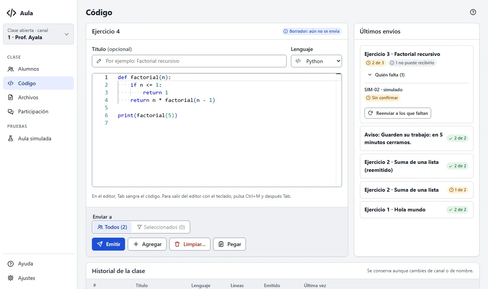

# Primeros pasos

Con Aula Consola compartes código con tus alumnos: ellos lo ven en su pantalla y lo copian con
un clic. Esta página te lleva de la consola recién instalada a tu primer código recibido.

## Abrir tu primera clase

Al abrir Aula Consola, tu clase se abre sola en el **canal** de tu sala (el que eligió el
administrador al instalar). Lo ves arriba a la izquierda, en la tarjeta «Clase abierta · canal».

Si no se pudo abrir, la consola te dice por qué y qué hacer. Lo más común es que ya haya otra
copia de Aula Consola abierta: ciérrala y pulsa **Abrir la clase**. Más en
[Solución de problemas](solucion-de-problemas#la-consola-no-abre).

> **¿Qué es un canal?** El número de tu sala. Cada computadora de alumno tiene el suyo y tú ves a
> los alumnos de ese número. Más en [Conceptos](conceptos#el-canal).

## Ver a tus alumnos

La pantalla **Alumnos** es la de inicio. Los equipos del laboratorio aparecen solos cuando se
encienden, con su estado: **Conectado** o **Desconectado**.

Si no aparece nadie y no tienes laboratorio a mano, pulsa **Probar con alumnos simulados**: la
consola abre dos alumnos de prueba para que veas todo funcionando. Más en
[Probar sin laboratorio](probar-sin-laboratorio).

## Enviar tu primer código

1. Ve a **Código** en el menú.
2. Escribe o pega tu código en el editor. También puedes copiarlo en otro programa y pulsar
   **Pegar**.
3. Revisa el lenguaje y, si quieres, ponle un título.
4. Pulsa **Emitir** (reemplaza lo que ven).

Los alumnos lo ven al instante, con colores y un botón para copiarlo.

## Ver quién lo recibió

A la derecha de Código, en **Últimos envíos**, cada envío dice cuántos alumnos ya lo tienen en
pantalla, por ejemplo «7 de 8». Si falta alguien, abre **Quién falta** y, si hace falta, pulsa
**Reenviar a los que faltan**. Más en [Código](codigo#últimos-envíos).

## Al terminar la hora

Pulsa **Terminar la clase**, debajo de la tarjeta «Clase abierta · canal»: detiene lo que dejaste
activo y limpia la ventana de cada alumno, sin borrar archivos. Más en
[Tareas frecuentes](tareas-frecuentes#terminar-la-clase).
