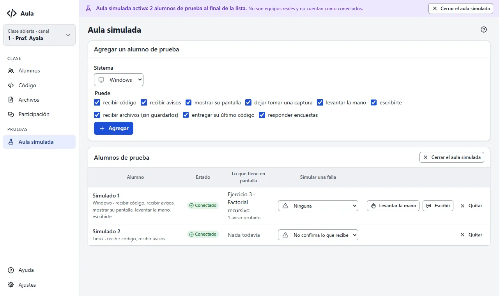

# Probar sin laboratorio

El **aula simulada** abre alumnos de prueba dentro de la consola. Sirve para aprender a usar
Aula, preparar una clase o comprobar que todo funciona antes de llegar al laboratorio.

## Abrir el aula simulada

Pulsa **Probar con alumnos simulados** (en Alumnos, cuando no hay nadie, o en **Aula simulada**
del menú). Aparecen «Simulado 1» y «Simulado 2» al final de la lista de Alumnos, en su propio
grupo, y una franja morada arriba te recuerda que el aula simulada está abierta.

## Qué hacen los alumnos simulados

Se comportan como equipos reales para lo que no tiene efecto en una computadora:

- reciben tu código y lo confirman;
- reciben tus avisos;
- muestran una pantalla de prueba en **Miniaturas**, con el aviso «Tu pantalla está siendo vista
  por el profesor», como un equipo real.

No reciben órdenes de energía, restricciones ni tu pantalla: no tendría sentido apagar una
computadora que no existe.

## Agregar alumnos y simular fallas

En **Aula simulada** puedes agregar alumnos (con Windows, Linux o macOS, y lo que pueden hacer) y
quitarlos. En la columna **Simular una falla** eliges cómo se porta cada uno:

| Falla | Qué hace |
|---|---|
| Ninguna | Se porta bien. |
| Lento | Contesta 3 segundos tarde, sin desconectarse. |
| No confirma lo que recibe | Muestra el código pero no avisa que lo recibió: verás que falta en «Quién falta». |
| Desconectado | Se va de la clase hasta que le quites la falla. |

## Por qué no se confunden con alumnos reales

- Siempre llevan la insignia **Simulado** y se cuentan aparte: «7 conectados · 2 simulados».
- Se conectan por dentro de tu propio equipo; ninguna computadora del laboratorio los ve.
- Nada se guarda: desaparecen al cerrar el aula simulada, al cambiar de canal o de nombre y al
  cerrar la consola.

Para cerrarla, pulsa **Cerrar el aula simulada** en la franja morada. Los alumnos reales no se
tocan. Más detalle en [Cómo funciona Aula](como-funciona#el-aula-simulada).
