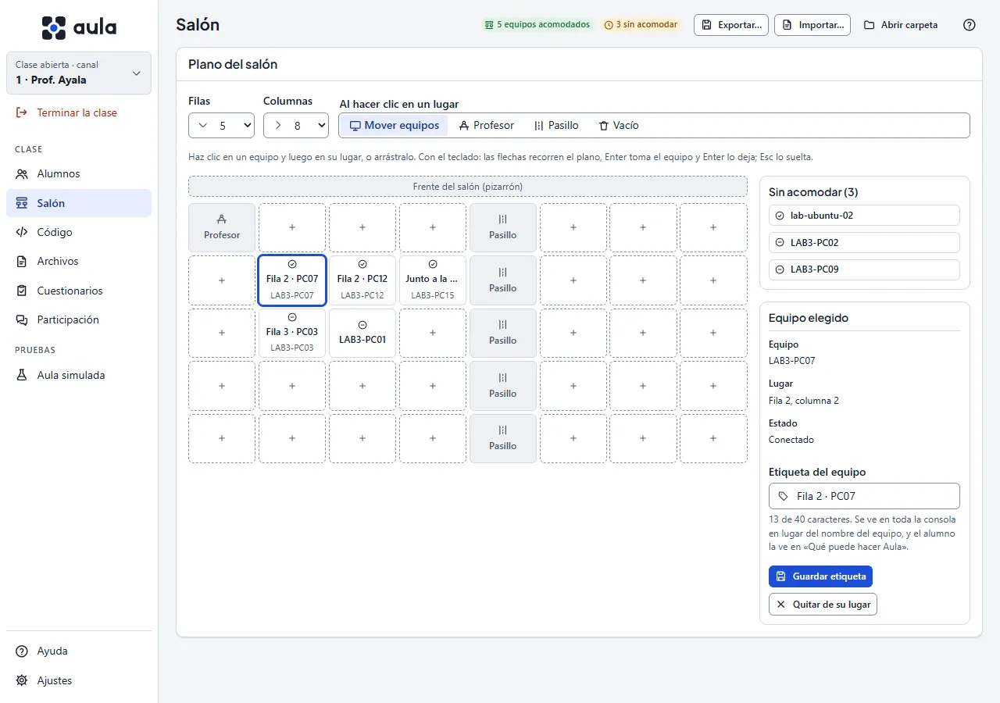

# La pantalla Salón

Con 30 o 40 equipos, «LAB3-PC07» no dice dónde está la máquina. En **Salón** le pones a cada
equipo una **etiqueta** que se entienda («Fila 2 · PC07», «Junto a la puerta») y lo acomodas en
un **plano** de filas y columnas, como está en tu salón. Desde entonces:

- Toda la consola muestra la etiqueta en lugar del nombre del equipo: la lista, las miniaturas,
  la ficha, la pantalla en grande, los acuses de cada envío, Participación… El nombre del equipo
  queda en letra pequeña al lado.
- La lista y las miniaturas siguen el orden del plano: fila por fila, y al final los equipos sin
  acomodar.
- En **Alumnos** aparece la vista **Salón**, con cada pantalla en su lugar (ver
  [La pantalla Alumnos](alumnos#lista-miniaturas-o-salón)).
- El alumno ve la etiqueta de su equipo en **Qué puede hacer Aula en este equipo**, para decírsela
  al soporte.

Un **canal es un salón**: cada canal tiene su propio plano. La consola lo guarda en
**Documentos\Aula\salones\canal-1.json** (con el número del canal) en tu equipo.

## Acomodar el salón

1. Elige el tamaño con **Filas** y **Columnas** (hasta 12 × 12). Arriba del plano está el
   **frente del salón**, donde va el pizarrón.
2. Cada equipo que se conecta por primera vez aparece en **Sin acomodar**, a la derecha. También
   aparecen los que la consola recuerda de otras clases, aunque estén apagados.
3. Arrastra cada equipo a su lugar. También puedes hacer clic en el equipo y luego en su lugar.
4. Si sueltas un equipo sobre otro, cambian de lugar. Para sacar uno del plano, suéltalo en
   **Sin acomodar** o elígelo y pulsa **Quitar de su lugar**.

Con el teclado: Tab entra al plano, las **flechas** lo recorren, **Enter** toma el equipo y
**Enter** lo deja en el lugar elegido; **Esc** lo suelta sin moverlo.

Cada cambio se guarda en el momento: no hay botón de guardar. Si achicas el plano, los equipos
que quedan fuera pasan a **Sin acomodar** con su etiqueta (la consola te avisa antes).

**Quitar del salón** borra un equipo que ya no está en el salón (por ejemplo, uno que se fue a
otro laboratorio): se olvidan su lugar y su etiqueta. Si se vuelve a conectar, aparece otra vez
en **Sin acomodar**.

## Lugares especiales

Con **Al hacer clic en un lugar** eliges qué pone un clic en el plano:

- **Mover equipos**: lo de siempre, acomodar equipos.
- **Profesor**: marca el escritorio del profesor.
- **Pasillo**: marca un pasillo o una columna del salón.
- **Vacío**: quita el lugar especial, o saca de su lugar al equipo que estaba ahí.

Un lugar especial no lleva equipo. Si marcas uno donde había un equipo, el equipo pasa a **Sin
acomodar**.

## Etiquetas de los equipos

Elige un equipo (en el plano o en **Sin acomodar**) y escribe su **Etiqueta** en **Equipo
elegido**, hasta 40 caracteres en una sola línea. Pulsa **Guardar etiqueta**. Para quitarla,
bórrala y guarda.

También puedes cambiarla desde la pantalla en grande de un alumno, con **Etiqueta del equipo**
(ver [Acciones sobre un alumno](alumnos#acciones-sobre-un-alumno)).

La etiqueta es del **equipo**, no del alumno: sigue ahí aunque otro alumno inicie sesión. Si el
alumno está conectado, la ve en el momento en **Qué puede hacer Aula en este equipo**.

Si reinstalan un equipo y vuelve con otro nombre, Aula lo reconoce por su tarjeta de red:
**conserva su lugar y su etiqueta**, y la consola te avisa («LAB3-PC07 ahora se llama
LAB3-07»).

## La vista Salón en Alumnos

En **Alumnos**, el botón **Salón** (junto a Lista y Miniaturas) muestra a los alumnos en su lugar:

- Cada alumno conectado se ve con su pantalla, como en Miniaturas.
- El lugar de un equipo sin conexión se ve vacío y apagado, con **Encender** si la consola lo
  puede encender (ver [Encender los equipos](tareas-frecuentes#encender-los-equipos)).
- El escritorio y los pasillos se ven en gris.
- Los números de arriba y de la izquierda **seleccionan a los de esa columna o esa fila**; otro
  clic los quita de la selección. Así mandas algo solo a la fila del fondo.
- Los alumnos conectados que no tienen lugar salen abajo, en **Sin acomodar**.

**Tamaño** cambia el ancho de cada lugar. Si el salón no cabe, se desplaza dentro de su recuadro.
Mientras ves esta vista, como en Miniaturas, cada alumno tiene en su pantalla el aviso «Tu
pantalla está siendo vista por el profesor».

Los alumnos simulados también ocupan lugares, marcados como **Simulado**, pero nunca se guardan
en el archivo del salón (ver [Probar sin laboratorio](probar-sin-laboratorio)).

## Exportar e importar

Arma el salón una vez y cópialo a las demás consolas del centro:

1. En la consola donde lo armaste, pulsa **Exportar…** y guarda el archivo (por ejemplo, en una
   memoria USB o una carpeta compartida).
2. En la otra consola, abre la clase en el **mismo canal**, pulsa **Importar…** y elige el
   archivo.
3. La consola te dice qué trae (tamaño, cuántos equipos, cuántos con etiqueta) y te pide
   confirmar: **el plano y las etiquetas de esa consola se reemplazan**.

Si el archivo es de otro canal, la consola te lo dice y lo usa para el canal abierto si aceptas.
Si el archivo está dañado o no es un salón de Aula, no se cambia nada: exporta otra vez desde la
consola original. Exportar e Importar también están en **Ajustes › Salón**.

## Si el archivo del salón no se puede leer

- Si el archivo estaba **dañado** (por ejemplo, se editó a mano y quedó roto), la consola guarda
  una copia junto a él (con «danado» y la fecha en el nombre), empieza un salón vacío y te lo dice
  arriba del plano. Puedes importar otra vez el salón desde otra consola.
- Si lo hizo una **versión más nueva de Aula**, la consola no lo toca: los cambios de ahora no se
  guardan. Actualiza la consola.
- Si no se puede **guardar**, revisa que la carpeta **Documentos\Aula\salones** exista y que
  puedas escribir en ella. **Abrir carpeta** la muestra en el Explorador.
