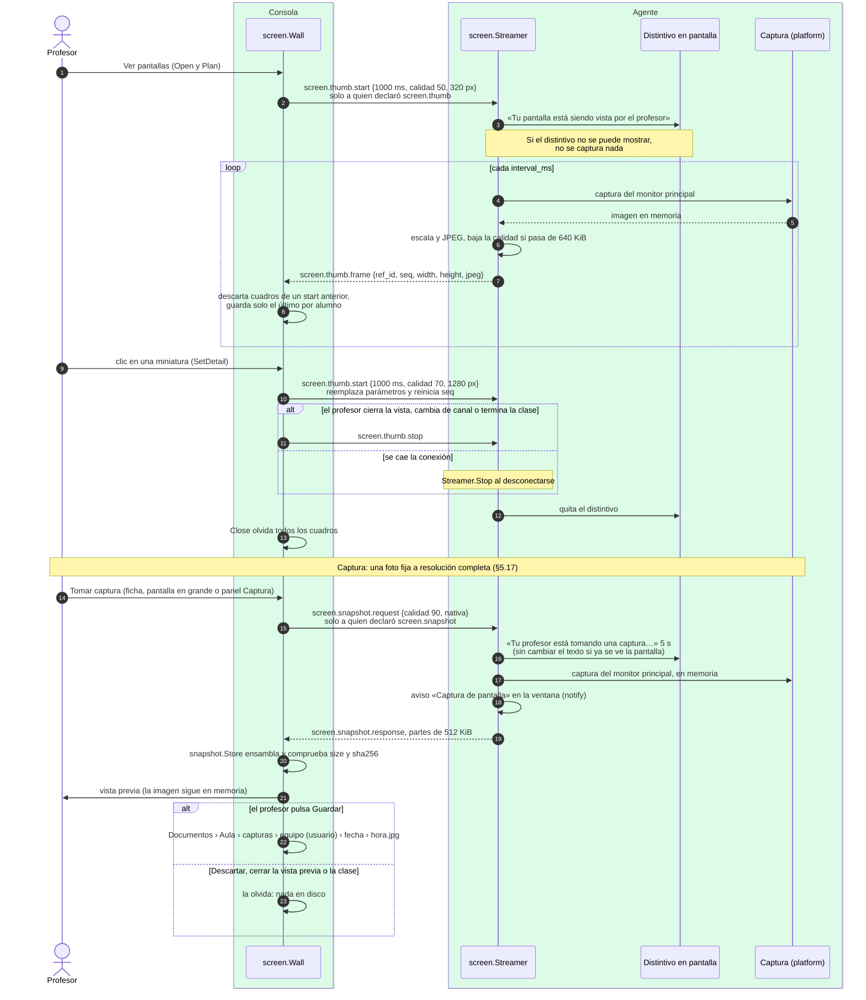

# Monitoreo: miniaturas, pantalla y captura

¿Qué ocurre al abrir «Ver pantallas» o al tomar una captura, y qué garantiza que el alumno lo sepa?

## Lo que no es obvio

- **Solo se transmite mientras el profesor mira**: la consola envía `start` al abrir la vista y
  `stop` al cerrarla; no hay captura en segundo plano.
- **El distintivo va antes del primer cuadro**, y si no se puede mostrar no hay captura. Con el
  agente como servicio, la captura solo existe en el ayudante, que es quien muestra el distintivo
  (diagrama 13).
- **Las miniaturas no tocan el disco en ningún extremo**: viven en memoria; la consola muestra la
  última de cada equipo y la olvida al cerrar la vista. Los logs registran `seq` y tamaños, nunca
  la imagen.
- **La captura es la única excepción, y solo en la consola**: se escribe en disco cuando el
  profesor pulsa «Guardar» (`docs/privacidad.md` reglas 7 y 45–46). El agente la tiene en memoria
  lo justo para enviarla. Una captura nativa pesa más que el límite de 1 MiB por mensaje: va en
  partes (`protocol.SplitParts`, `protocol.Reassembly`), y la consola la descarta si no llega
  completa en 30 s o si la huella no coincide.
- **El aviso de la captura no es una banda**: es un hecho puntual. El distintivo nativo va antes
  de capturar (por eso sale en la imagen) y el aviso en la esquina de la ventana, después.
- Si la captura falla (sesión bloqueada, por ejemplo), el agente responde **una sola vez**
  `error internal` y sigue intentando; el distintivo sigue visible.
- Hoy solo Windows declara `screen.thumb`; Linux y macOS devuelven «no soportado».
- **Pantalla en blanco (`screen.freeze`) no está implementada**: está documentada como pendiente
  (`docs/protocol.md` §5.9–5.11, D-013) y ningún agente declara su capacidad, por eso no aparece
  aquí.

## Fuentes en el código

- `internal/screen/wall.go`, `internal/screen/streamer.go` (`Announce`)
- `internal/snapshot/agent.go` (`Taker`), `internal/snapshot/console.go` (`Store`),
  `internal/snapshot/files.go`, `internal/protocol/parts.go`
- `internal/platform/screen.go`, `internal/platform/screen_windows.go`,
  `internal/platform/screen_other.go`
- `apps/teacher/app.go` (`OpenScreens`, `CloseScreens`, `ViewScreen`, `onFrame`),
  `apps/teacher/snapshot.go` (`TakeSnapshot`, `TakeSnapshots`, `SaveSnapshots`)
- `apps/student/app.go` (`enableScreen`, `onViewed`), `apps/student/snapshot.go` (`onSnapshot`)
- `docs/protocol.md` §5.6–5.8 y §5.17, `docs/privacidad.md` reglas 6–8 y 44–49
