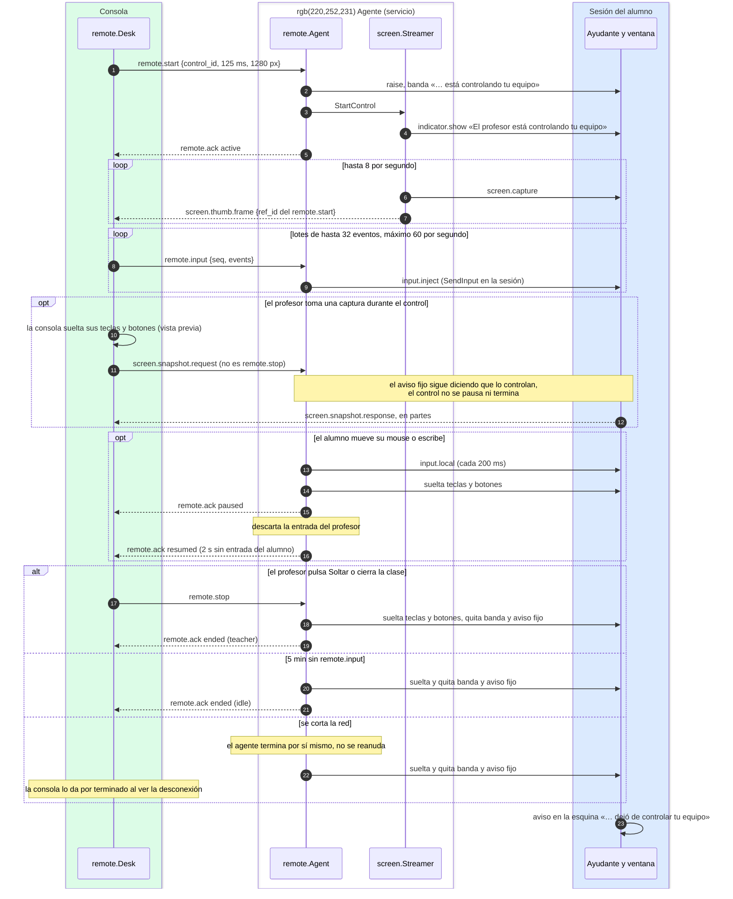

# Control remoto de un alumno

¿Qué pasa desde que el profesor pulsa «Tomar control» hasta que lo suelta, y qué ve el alumno en
cada momento?

## Lo que no es obvio

- **Sin consentimiento, pero nunca a escondidas.** El agente muestra la banda y el aviso fijo y
  trae su ventana al frente **antes** de responder `active`; descarta la entrada que llegue antes.
  El alumno no puede cerrar la banda ni cortar el control (`docs/privacidad.md` reglas 36–39).
- **El alumno tiene prioridad.** El agente no instala *hooks* de teclado: compara la última
  entrada del sistema (`GetLastInputInfo`) y la posición del puntero con lo que inyectó Aula. Sabe
  *que* el alumno usó su equipo, nunca *qué* tecleó.
- **El video es la vista en grande de siempre**, a más velocidad: el mismo `screen.Streamer` y la
  misma captura por el ayudante. Mientras dura, el agente guarda las miniaturas que pida la
  consola y las retoma al terminar. Si una imagen no salió, se salta la siguiente captura: nunca
  se atrasa.
- **Nada queda presionado.** El agente suelta lo que presionó al pausar, terminar o perder la
  conexión; el ayudante también, si el servicio desaparece.
- **Una captura no interrumpe el control** (`docs/protocol.md` §5.16 y §5.17): el profesor la toma
  desde la vista del control; mientras ve la vista previa su teclado no llega al alumno, y el
  aviso fijo no cambia de texto (`docs/privacidad.md` regla 44).
- **Uno a la vez**: `remote.Desk` rechaza un segundo control (`alreadyControlling`). Los alumnos
  simulados no declaran `remote` y nunca reciben estos mensajes.
- **Lo que Windows no deja**: Ctrl+Alt+Supr, la pantalla de bloqueo, el aviso de UAC y las ventanas
  de administrador (UIPI). Si el sistema rechaza la entrada 30 s seguidos, el control termina con
  `error`.

## Fuentes en el código

- `internal/remote/agent.go`, `internal/remote/desk.go`
- `internal/screen/streamer.go` (`StartControl`, `RetuneControl`, `StopControl`)
- `internal/platform/input.go`, `internal/platform/input_windows.go`
- `internal/agentsvc/proxy.go` (`input.inject`, `input.local`)
- `apps/teacher/remote.go`, `apps/student/remote.go`, `apps/student/helper.go`
- `docs/protocol.md` §5.16, `docs/privacidad.md` reglas 36–43, `docs/decisiones.md` D-019
