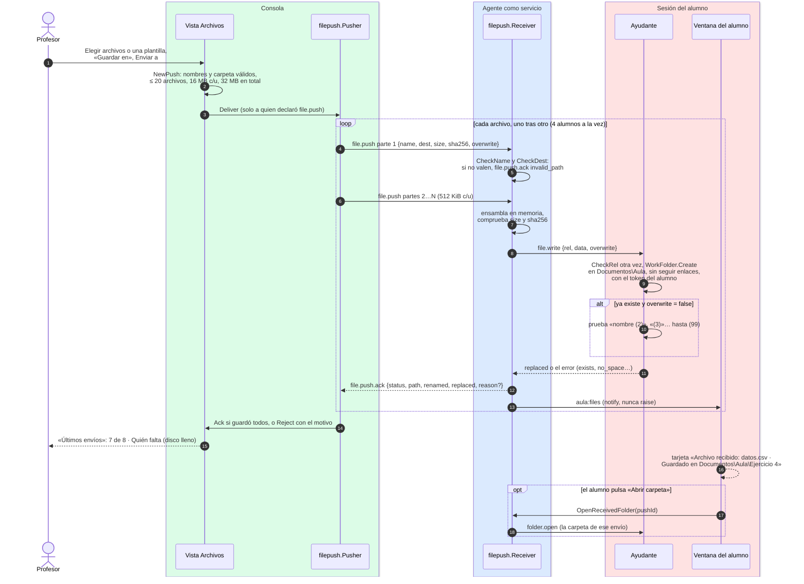

# Enviar archivos y plantillas

¿Qué pasa desde que el profesor pulsa «Enviar» en la pestaña Archivos hasta que el archivo está
en la carpeta del alumno y «Últimos envíos» dice que lo tiene?

## Lo que no es obvio

- **La ruta se comprueba tres veces y nunca se corrige.** La consola rechaza un nombre malo antes
  de enviar; el agente responde `invalid_path` sin tocar el disco; el ayudante vuelve a revisar la
  ruta sin limpiarla (`a/../x` se rechaza, no se convierte en `x`) y la carpeta de trabajo se niega
  a cruzar un enlace o *junction* (`docs/privacidad.md` regla 55).
- **Escribe el ayudante, no el servicio.** Así el archivo es del alumno y un enlace no le daría a
  Aula más permisos que los que ya tiene él (diagrama 13). En modo ventana, el propio agente corre
  como el alumno.
- **Nunca se pisa trabajo sin decirlo.** Sin «Reemplazar si ya lo tienen», un nombre ocupado se
  guarda como `nombre (2)`. Escribir pasa por un archivo temporal oculto que se mueve al final, así
  que nunca queda un archivo a medias.
- **El acuse va por archivo; el conteo, por alumno.** El `Pusher` espera el `file.push.ack` de un
  archivo (60 s como mucho) antes de mandar el siguiente, y cuenta al alumno en `Deliveries` solo
  cuando terminó con todos (diagrama 07). Si no responde, el motivo es `timeout`; si se fue,
  `gone`. Cerrar la clase corta lo que se estaba enviando.
- **Memoria acotada en el agente**: 4 archivos a la vez y 32 MiB; lo que no se completa en 60 s se
  descarta (`incomplete`). Nada se registra con nombres ni contenidos.
- **Los alumnos simulados** pasan por el mismo `Receiver`, con una carpeta en memoria que solo
  guarda nombres: acusan (y renombran) sin escribir en disco.
- **Las plantillas son carpetas** en `Documentos\Aula\plantillas` del profesor; se leen al enviar,
  así que un cambio hecho en el Explorador se nota en el siguiente envío o reenvío.

## Fuentes en el código

- `internal/filepush/path.go` (`CheckName`, `CheckDest`, `CheckRel`, `Alternative`),
  `internal/filepush/push.go`, `internal/filepush/pusher.go`, `internal/filepush/receiver.go`,
  `internal/filepush/inbox.go`, `internal/filepush/templates.go`
- `internal/platform/workfolder.go`, `internal/platform/workfolder_windows.go`
- `internal/agentsvc/proxy.go` (`WorkFolder`, `CallFileWrite`, `CallFolderOpen`)
- `apps/teacher/files.go`, `apps/student/files.go`, `apps/student/helper.go`
- `internal/simclass/files.go`
- `docs/protocol.md` §5.20, `docs/privacidad.md` reglas 55–59
