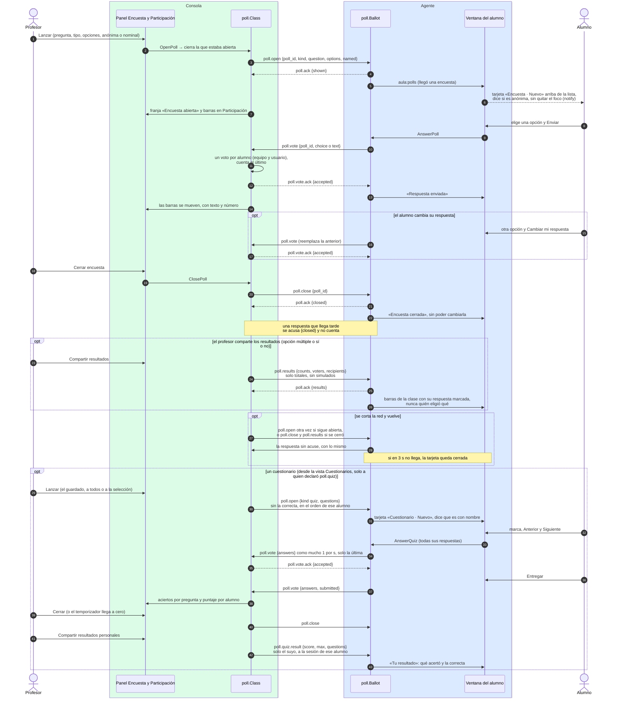

# Encuestas y cuestionarios

¿Qué pasa desde que el profesor lanza una pregunta rápida hasta que la clase ve el resultado, y
qué ve cada quien de las respuestas? Un cuestionario (varias preguntas con su correcta y sus
puntos) sigue el mismo camino, con lo que cambia en el último bloque.

## Lo que no es obvio

- **No toca el equipo del alumno**: no hay banda ni aviso fijo, y nada trae su ventana al frente.
  La capacidad `poll` la declara cualquier agente con ventana, en cualquier sistema, y también los
  alumnos simulados, que responden solos para probar las barras sin laboratorio.
- **Anónima o nominal lo decide el profesor en cada encuesta**, y el alumno lo lee en la tarjeta
  antes de responder. En una anónima la consola guarda internamente a quién corresponde cada voto
  (para contar uno por alumno y aceptar los reenvíos), pero la vista nunca lo muestra: solo
  totales y, en las abiertas, los textos sin nombre ni hora, en orden alfabético
  (`docs/privacidad.md` regla 72).
- **Lo compartido son solo totales**, nunca quién eligió qué, aunque la encuesta sea nominal. Las
  respuestas abiertas no se comparten. Los votos simulados no entran en ese total (regla 32).
- **Una abierta a la vez**: lanzar otra cierra la vigente. La consola conserva las 20 últimas de la
  clase en memoria y las borra al cerrarla o cambiar de canal. El agente conserva 5 tarjetas.
- **Ritmo**: la ventana acepta una respuesta por segundo, y la consola, por si acaso, admite
  ráfagas de 3 y descarta lo que pase con `error invalid_message`.
- **Nada se escribe en los registros** de la pregunta, las opciones ni las respuestas: solo
  `poll_id`, el tipo, los estados y los totales (regla 74).
- Con el agente como servicio, la ventana es la del ayudante: «Enviar» llega al servicio por el
  canal local (`CallBinding`, diagrama 13), que es quien tiene la conexión con la consola.
- **Cuestionarios** (`docs/privacidad.md` reglas 87–91): siempre con nombre; la correcta **no sale
  de la consola** antes del cierre y solo viaja en el resultado personal de cada alumno. Califica
  todo o nada. Un agente sin `poll.quiz` no lo recibe. Al reconectar, el `poll.open` reenviado trae
  las respuestas acusadas de ese alumno. Los puntajes viven en memoria y solo se escriben con
  «Exportar calificaciones» (CSV, sin simulados). Con tiempo, el temporizador lo cierra al llegar a
  cero.

## Fuentes en el código

- `internal/poll/class.go` (consola), `internal/poll/ballot.go` (agente)
- `internal/poll/quiz.go` (cuestionario, calificación, CSV), `internal/poll/library.go` (guardados)
- `apps/teacher/poll.go` (`OpenPoll`, `ClosePoll`, `SharePollResults`, `onPollMessage`)
- `apps/teacher/quiz.go` (`Quizzes`, `SaveQuiz`, `OpenQuiz`, `ExportQuizGrades`, cierre por tiempo)
- `apps/student/poll.go` (`AnswerPoll`, `AnswerQuiz`, `handlePoll`)
- `internal/simclass/poll.go` (alumnos simulados)
- `docs/protocol.md` §5.23 y §5.23.1, `docs/eventos-ui.md`
