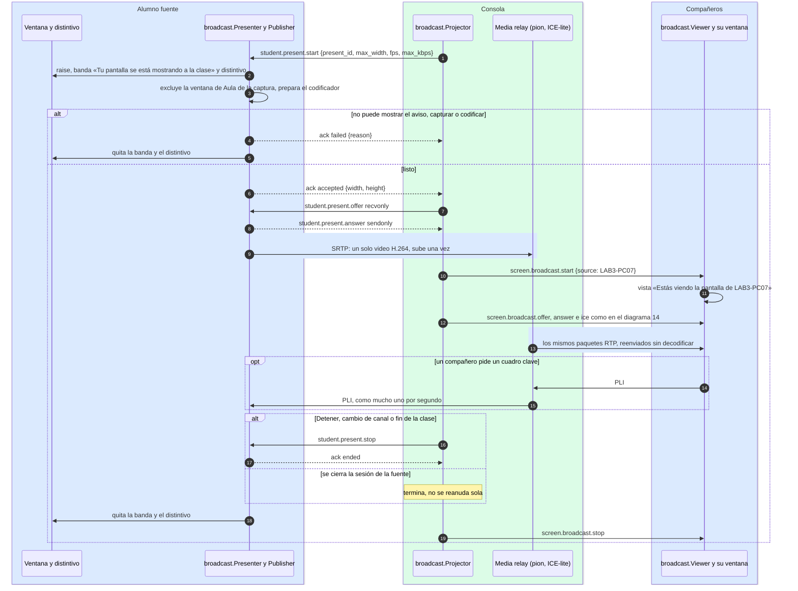

# Proyectar la pantalla de un alumno

¿Qué pasa desde que el profesor pulsa «Proyectar a la clase» hasta que la detiene, qué ve el
alumno y por qué el video pasa por la consola y no de alumno a alumno?

## Lo que no es obvio

- **Sin permiso, pero nunca a escondidas** (reglas 75–77): como el control remoto, lo decide y lo
  termina el profesor. La ventana del alumno pasa al frente con la banda y el distintivo **antes**
  del primer cuadro; la banda no tiene botones y el alumno no puede cortarla.
- **El video pasa por la consola**: los alumnos se conectan al profesor, nunca entre sí. La fuente
  solo sale por UDP hacia el puerto de la consola (`ws_port + 1`, el del diagrama 14) y sube una
  sola copia; la consola la reparte como el SFU de D-014, sin decodificarla.
- **La fuente es el diagrama 14 al revés**: la consola ofrece recibir y el agente responde
  enviando. Por eso sus mensajes se llaman aparte (`student.present.*`): `screen.broadcast.*`
  sigue prometiendo al agente que solo recibe (regla 13). Los compañeros, en cambio, usan
  exactamente el flujo del 14, con `source` para que la franja diga de quién es.
- **Lo privado no se ve** (regla 78): la ventana de Aula del alumno se excluye de la captura; si
  Windows no lo permite, no se publica.
- Si la conexión WebRTC de la fuente falla, la consola le manda una oferta nueva sin cerrar la de
  los compañeros, que ven «Conectando con la pantalla de LAB3-PC07…». Si la fuente no contesta
  el `start` en 15 s, la proyección termina.
- **Uno a la vez**, y nunca junto con la pantalla del profesor (regla 79). Con el agente como
  servicio, la captura, el codificador y la conexión corren en el ayudante, en la sesión del
  alumno (diagrama 13). Nunca a alumnos simulados.

## Fuentes en el código

- `internal/broadcast/presenter.go`, `internal/broadcast/publisher.go`,
  `internal/broadcast/projector.go`, `internal/broadcast/pion.go`, `internal/broadcast/indicator.go`
- `internal/agentsvc/proxy_present.go`, `apps/student/present.go`, `apps/student/helper.go`
- `apps/teacher/present.go`, `internal/ui/receptor-video.js`
- `docs/protocol.md` §5.24, `docs/privacidad.md` reglas 75–82, `docs/decisiones.md` D-014 y D-020
