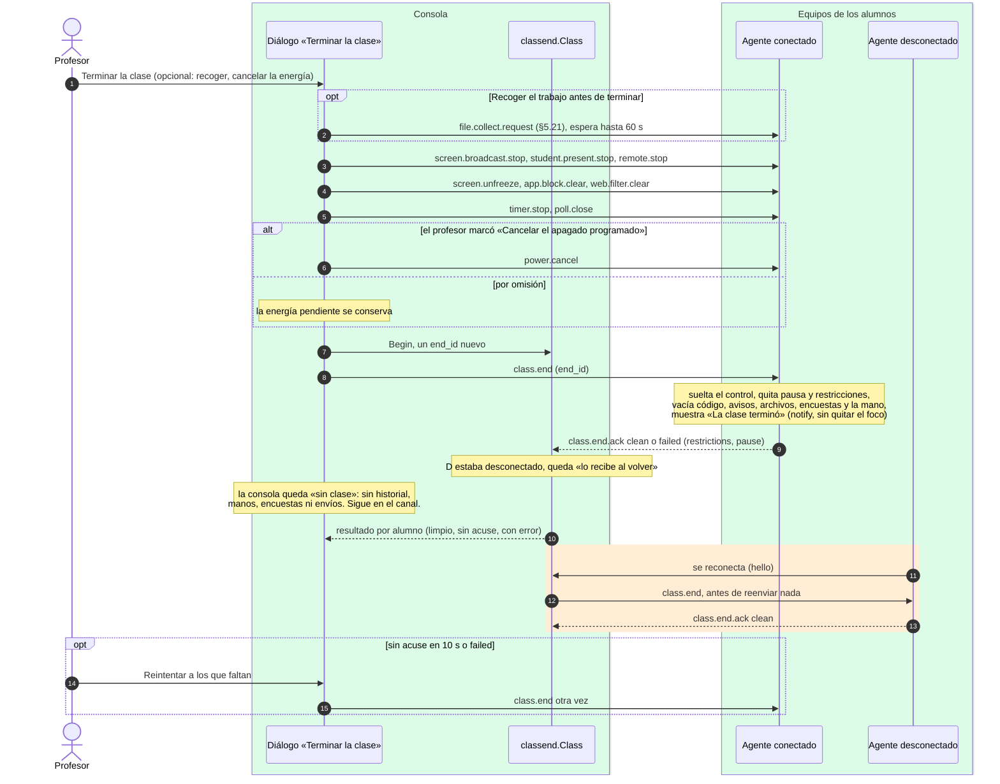

# Terminar la clase

¿Qué hace «Terminar la clase», en qué orden, y cómo se entera la consola de que cada ventana
quedó limpia, también la de un alumno que estaba desconectado?

## Lo que no es obvio

- **Primero lo que actúa sobre el equipo, después la ventana.** La consola usa la parada de
  siempre de cada función (§5.12–5.24), así el alumno ve desaparecer cada banda con su propia
  regla; `class.end` solo deja la ventana como recién abierta y repite las paradas en el agente
  por si alguna no llegó.
- **Si un paso falla, los demás siguen** y el resultado lo dice. Terminar dos veces seguidas no
  rompe nada: el agente vuelve a acusar `clean`.
- **La energía no se cancela sola** (regla 85): el profesor pudo programar el apagado de fin de
  día a propósito. Solo con «Cancelar el apagado programado» se envía `power.cancel`.
- **Quien faltaba no hereda nada.** Las restricciones y la pausa ya se quitaron solas al perder la
  conexión (reglas 10 y 24); al volver, recibe `class.end` antes que lo que la consola reenvía al
  reconectar, y no pierde nada nuevo: mientras estuvo fuera no recibió nada.
- **Un agente anterior** (sin `class.end`) recibe las paradas y `code.clear`: queda «limpio en
  parte».
- **Nunca se borra un archivo** (regla 84): ni en `Documentos\Aula` del alumno ni en las carpetas
  de la consola.
- Los alumnos simulados también lo reciben y limpian su ventana simulada.

## Fuentes en el código

- `internal/classend/classend.go` (`Class`: `Begin`, `Sent`, `Ack`, `Expire`, `Owed`, `Retry`)
- `internal/classend/agent.go` (`Removed`, `Card`, `Ack`)
- `apps/teacher/classend.go` (`FinishClass`, `runClassEnd`, `syncClassEnd`, `clearConsoleClass`)
- `apps/student/classend.go` (`endClass`), `internal/simclass/classend.go`
- `docs/protocol.md` §5.25, `docs/privacidad.md` reglas 83–86
