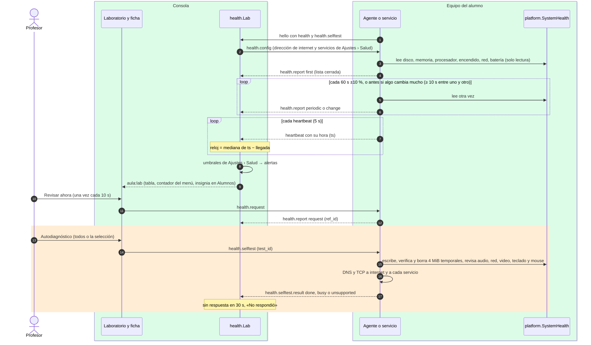

# Salud del laboratorio

¿Cómo sabe la consola, antes de clase, qué equipos van a dar problemas, y qué hace cada botón de
**Laboratorio**?

## Lo que no es obvio

- **Solo informa** (privacidad, regla 93): ni el informe ni el autodiagnóstico cambian nada del
  equipo. El autodiagnóstico escribe solo en la carpeta temporal del agente y borra su archivo
  siempre; nunca toca `Documentos`.
- **Lista cerrada** (regla 92, §5.27.3): un dato nuevo cambia el protocolo y la regla. Un dato
  que el sistema no sabe leer **no viaja**, y la consola dice «No se puede leer en este equipo» sin
  alerta. Fuera de Windows el informe va casi vacío y no hay autodiagnóstico.
- **El reloj no viaja**: la consola lo calcula con los `heartbeat` que ya existían, con la
  mediana de los últimos 5 para que un paquete lento no lo mueva.
- **Como servicio, sin ayudante**: el servicio (SYSTEM) lee el equipo él mismo, también sin
  nadie con sesión iniciada; entonces no hay disco de `Documentos`. El estado S.M.A.R.T. necesita
  permisos de administrador: con Aula como ventana, suele no poder leerse.
- **Los umbrales viven en la consola**: el agente solo sabe cuándo un cambio es «grande» (bandas
  fijas) para mandar el informe antes de tiempo; qué es alerta lo decide Ajustes › Salud.
- **Solo en memoria** (regla 95): los informes se olvidan al cerrar la consola o cambiar de canal.
- Los alumnos simulados inventan sus valores, con algunas alertas, para probar la pantalla.

## Fuentes en el código

- `internal/protocol/health.go`, `internal/platform/health*.go`
- `internal/health/agent.go` (`Monitor`, `SelfTest`, `Notable`), `internal/health/console.go`
  (`Lab`, `Evaluate`, `Thresholds`, `Targets`), `internal/health/simulated.go`
- `internal/session/registry.go` (`RecordClock`)
- `apps/student/health.go`, `apps/teacher/health.go`, `internal/simclass/health.go`
- `docs/protocol.md` §5.27, `docs/privacidad.md` reglas 92–95
