# Mapa de la interfaz

Los nombres de cada zona de las dos apps, para hablar de la interfaz sin ambigüedad: «en la
**Ficha del alumno**, en **Qué puede hacer su equipo**…». Son los mismos que muestra el anotador
(`node scripts/ux/anotar.mjs`) al pasar el mouse. La fuente es `scripts/ux/zonas.mjs`; este
archivo y sus imágenes los genera `node scripts/ux/mapa.mjs` (no se editan a mano).

## Consola del profesor

### Consola · Alumnos (lista)

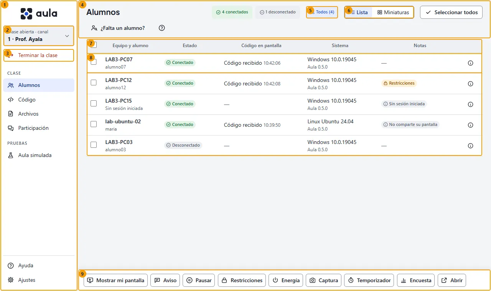

| # | Zona | Qué es |
|---|---|---|
| 1 | **Menú** | Columna izquierda: la clase abierta, las vistas y Ayuda y Ajustes. |
| 2 | **Selector de clase** | Canal y nombre de la clase abierta; abre «Cambiar de canal». |
| 3 | **Terminar la clase** | Bajo el Selector de clase: detiene lo activo y deja limpia la ventana de cada alumno (prompt 10.14). |
| 4 | **Cabecera de la vista** | Título de la vista, su resumen y el «?» de ayuda contextual. |
| 5 | **Selección** | A quién van las acciones de la barra: «Todos (n)» o «n seleccionados», con su explicación en el tooltip. |
| 6 | **Selector Lista | Miniaturas | Salón** | Cambia entre la tabla, las miniaturas de pantalla y los alumnos en su lugar del salón. |
| 7 | **Mostrar apagados** | Muestra en la lista los equipos que la consola conoce y no están conectados, con Encender y Olvidar; solo en Lista y se recuerda (prompt 10.19). |
| 8 | **Lista de alumnos** | Tabla con un alumno por fila. |
| 9 | **Fila del alumno** | Un alumno: casilla, equipo, estado, insignias y el botón de su ficha; en un equipo sin conexión, Encender. |
| 10 | **Barra de acciones** | Abajo: lo que se aplica a la selección (aviso, transmitir, pausar, restricciones, captura, temporizador, encuesta, energía…). |

### Consola · Alumnos (miniaturas)

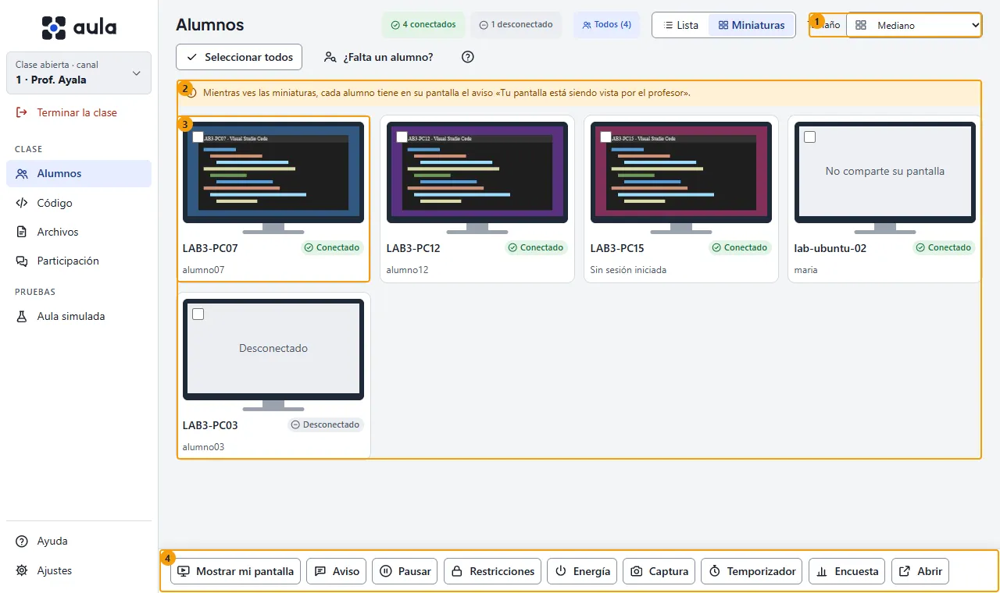

| # | Zona | Qué es |
|---|---|---|
| 1 | **Tamaño de las miniaturas** | Pequeño, Mediano, Grande, Extra grande o Ajustar a la pantalla; en Miniaturas y en Salón, y se recuerda. |
| 2 | **Miniaturas** | Cuadrícula con la pantalla de cada alumno. |
| 3 | **Tarjeta del alumno** | La miniatura de un alumno como un monitor, con su nombre; un clic en la pantalla abre la Pantalla grande. |
| 4 | **Barra de acciones** | Abajo: lo que se aplica a la selección (aviso, transmitir, pausar, restricciones, captura, temporizador, encuesta, energía…). |

### Consola · Ficha del alumno

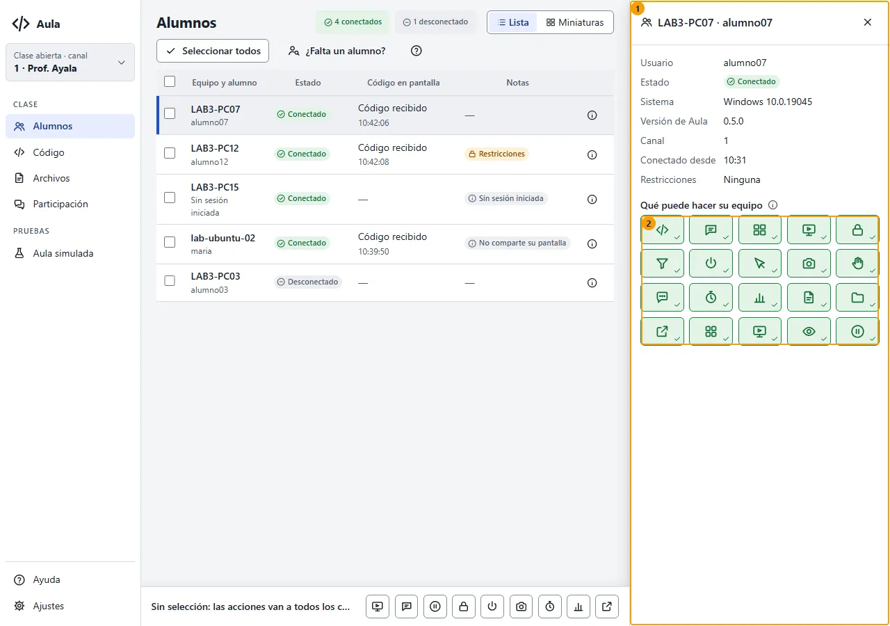

| # | Zona | Qué es |
|---|---|---|
| 1 | **Ficha del alumno** | Panel derecho con los datos de un alumno y qué puede hacer su equipo; su fila queda marcada. Las acciones están en la Pantalla grande. |
| 2 | **Qué puede hacer su equipo** | Lista de capacidades del equipo del alumno. |

### Consola · Pantalla grande

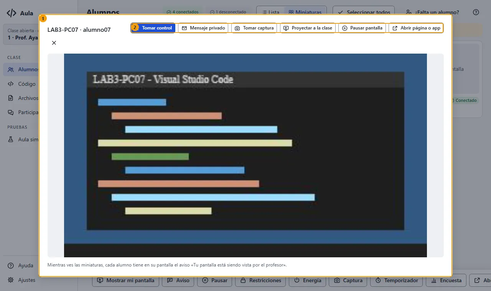

| # | Zona | Qué es |
|---|---|---|
| 1 | **Pantalla grande** | La pantalla de un alumno en grande; también la vista del control remoto y la de la proyección de un alumno. |
| 2 | **Acciones sobre el alumno** | Tomar control, Mensaje privado, Tomar captura, Proyectar a la clase, Pausar pantalla, Abrir página o app y Etiqueta del equipo (ACCIONES_ALUMNO en main.js). |

### Consola · Franja global y un panel de la barra

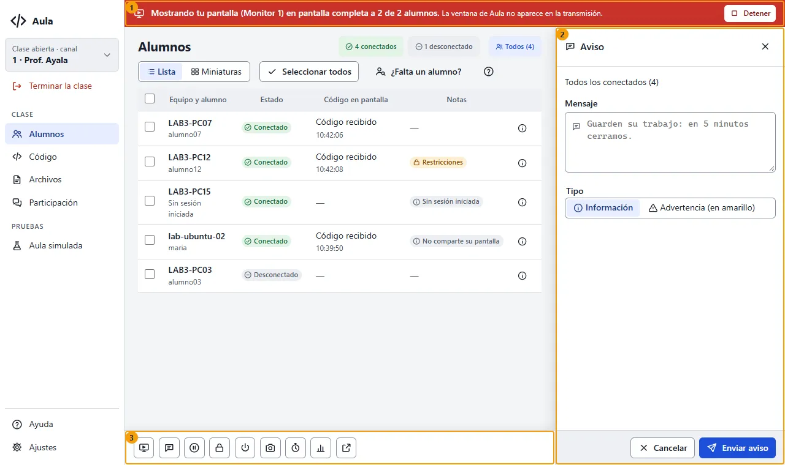

| # | Zona | Qué es |
|---|---|---|
| 1 | **Franja global** | Lo que sigue activo durante la clase (transmitir, proyectar a un alumno, control, pantallas en pausa, energía, temporizador, encuesta o cuestionario abierto, aula simulada), con su botón para detenerlo. |
| 2 | **Panel Aviso** | Mandar un aviso a la selección. |
| 3 | **Barra de acciones** | Abajo: lo que se aplica a la selección (aviso, transmitir, pausar, restricciones, captura, temporizador, encuesta, energía…). |

### Consola · Pausar pantallas

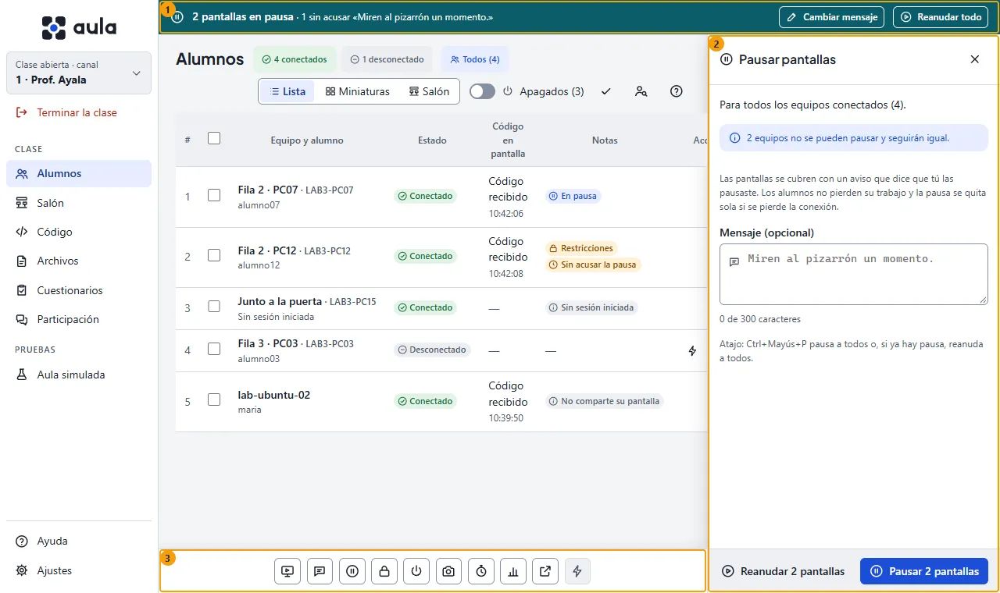

| # | Zona | Qué es |
|---|---|---|
| 1 | **Franja global** | Lo que sigue activo durante la clase (transmitir, proyectar a un alumno, control, pantallas en pausa, energía, temporizador, encuesta o cuestionario abierto, aula simulada), con su botón para detenerlo. |
| 2 | **Panel Pausar pantallas** | Pausar las pantallas de la selección o de todos, con un mensaje opcional, o reanudarlas (Ctrl+Mayús+P). |
| 3 | **Barra de acciones** | Abajo: lo que se aplica a la selección (aviso, transmitir, pausar, restricciones, captura, temporizador, encuesta, energía…). |

### Consola · Terminar la clase

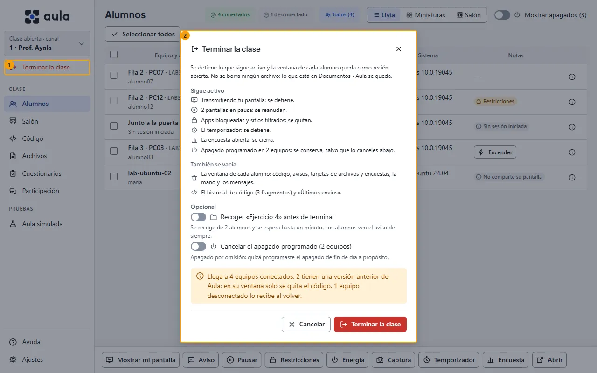

| # | Zona | Qué es |
|---|---|---|
| 1 | **Terminar la clase** | Bajo el Selector de clase: detiene lo activo y deja limpia la ventana de cada alumno (prompt 10.14). |
| 2 | **Diálogo Terminar la clase** | Lo que sigue activo, lo que se vacía y lo opcional (recoger, cancelar la energía); después, los pasos y el resultado por alumno con «Reintentar a los que faltan». |

### Consola · Abrir página o app

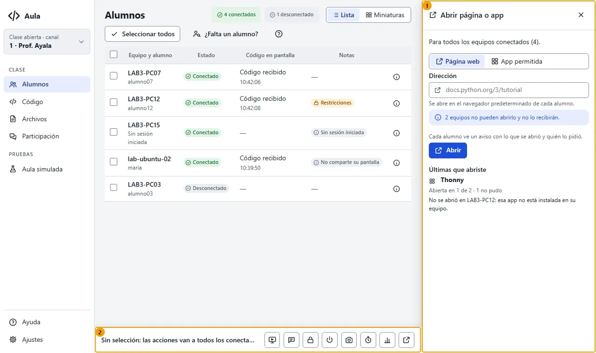

| # | Zona | Qué es |
|---|---|---|
| 1 | **Panel Abrir página o app** | Abrir una página en el navegador o una app permitida en los equipos de la selección, y las últimas que abriste. |
| 2 | **Barra de acciones** | Abajo: lo que se aplica a la selección (aviso, transmitir, pausar, restricciones, captura, temporizador, encuesta, energía…). |

### Consola · Ajustes › Apps permitidas

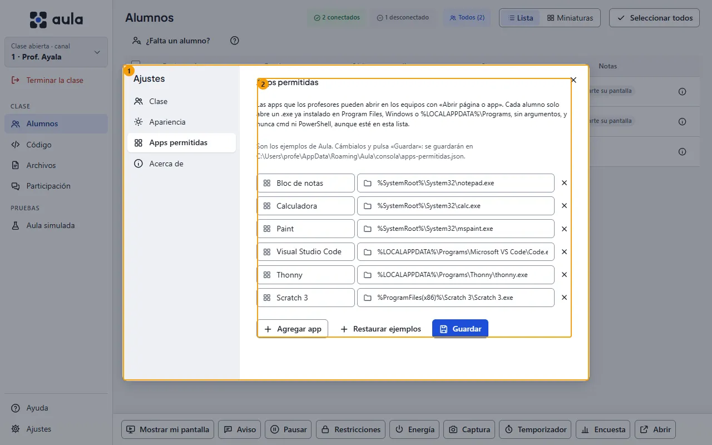

| # | Zona | Qué es |
|---|---|---|
| 1 | **Ajustes** | Diálogo con Clase, Apariencia, Apps permitidas, Salón y Acerca de. |
| 2 | **Apps permitidas** | Las apps que se pueden abrir en los equipos: nombre y ruta del .exe, con ejemplos. |

### Consola · Código

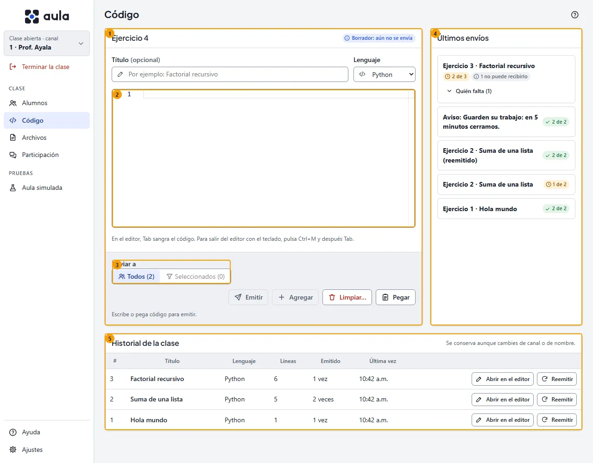

| # | Zona | Qué es |
|---|---|---|
| 1 | **Tarjeta del editor** | Título, lenguaje, editor, «Enviar a» y los botones de emitir. |
| 2 | **Editor** | El editor de código (Monaco). |
| 3 | **Enviar a** | Todos los conectados o la selección. |
| 4 | **Últimos envíos** | Cada envío con quién lo tiene y quién falta. |
| 5 | **Historial de la clase** | Lo emitido en la clase, para reabrir o reemitir. |

### Consola · Archivos

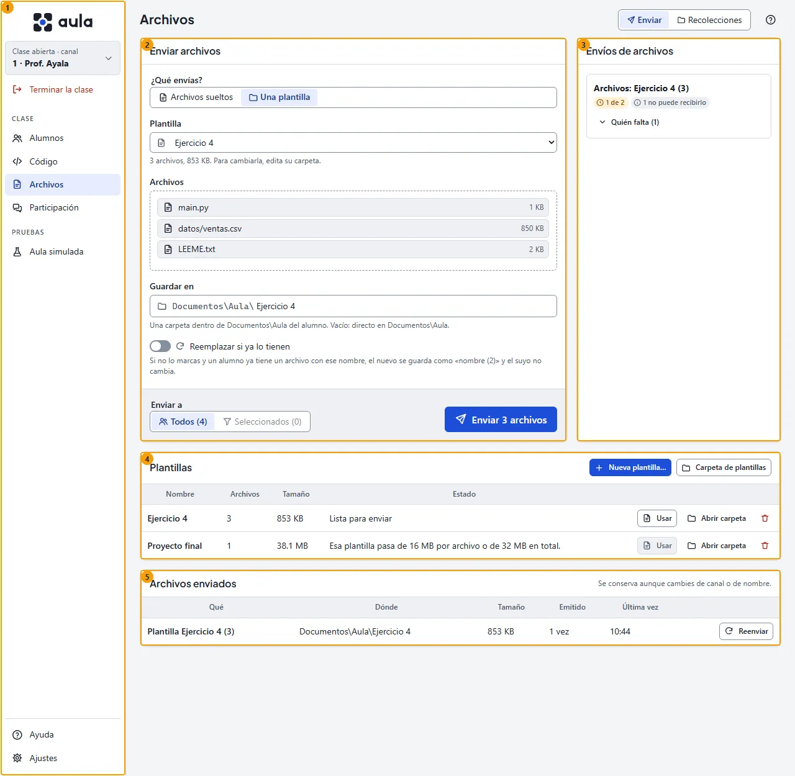

| # | Zona | Qué es |
|---|---|---|
| 1 | **Menú** | Columna izquierda: la clase abierta, las vistas y Ayuda y Ajustes. |
| 2 | **Enviar archivos** | Plantilla o archivos elegidos, «Guardar en», «Reemplazar», «Enviar a» y Enviar. |
| 3 | **Envíos de archivos** | Cada envío de archivos con quién lo tiene y quién falta. |
| 4 | **Plantillas** | Las plantillas de Documentos\Aula\plantillas: Nueva plantilla, Usar, Abrir carpeta y Eliminar. |
| 5 | **Archivos enviados** | Los envíos de la clase, para reenviarlos. |

### Consola · Archivos › Recolecciones

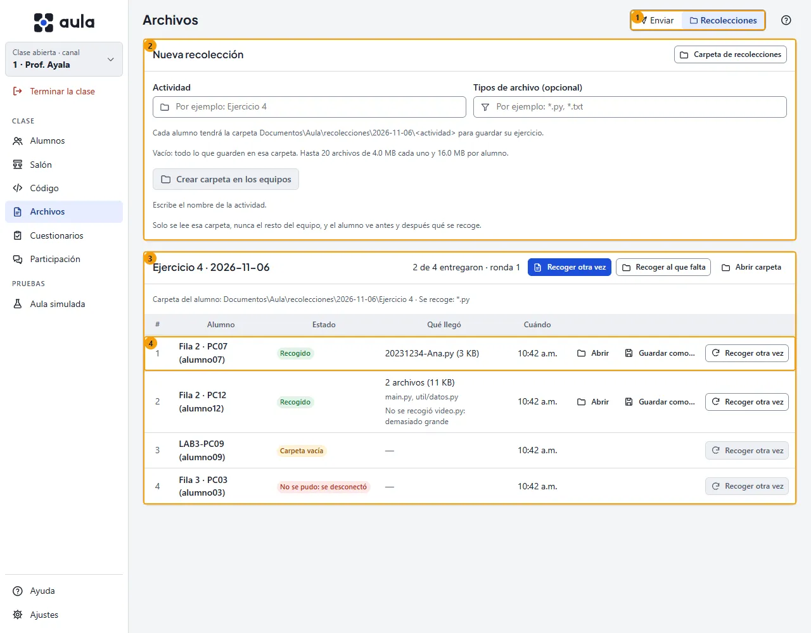

| # | Zona | Qué es |
|---|---|---|
| 1 | **Selector Enviar | Recolecciones** | Cambia entre enviar archivos y las recolecciones. |
| 2 | **Nueva recolección** | Actividad, tipos de archivo y «Crear carpeta en los equipos». |
| 3 | **Tarjeta de recolección** | Una actividad: Recoger, Recoger a los que faltan, Abrir carpeta y la tabla por alumno. |
| 4 | **Fila de la recolección** | Un alumno: estado, qué llegó, cuándo, Abrir, Guardar como… y Recoger otra vez. |

### Consola · Participación

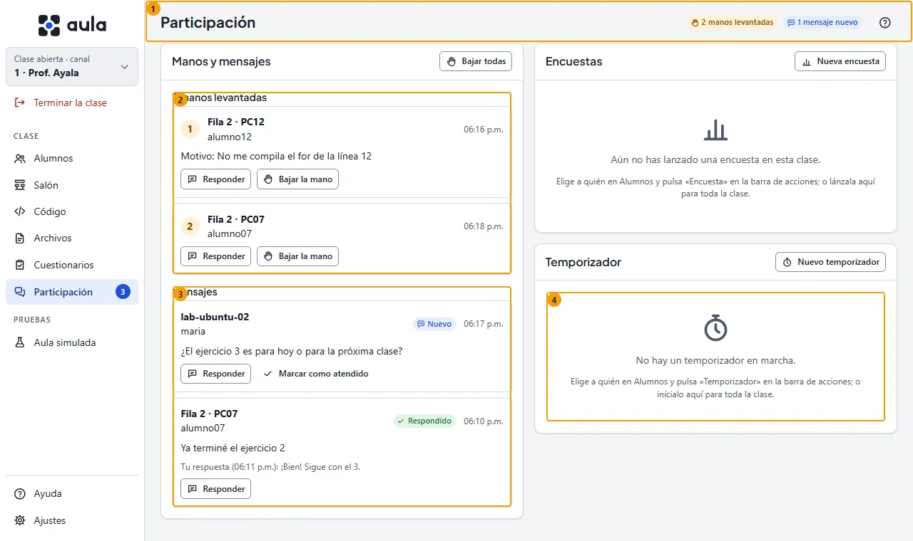

| # | Zona | Qué es |
|---|---|---|
| 1 | **Cabecera de la vista** | Título de la vista, su resumen y el «?» de ayuda contextual. |
| 2 | **Manos levantadas** | La fila de manos, por orden de llegada. |
| 3 | **Mensajes de los alumnos** | La bandeja de mensajes con Responder. |
| 4 | **Sección Temporizador** | Quién ve el temporizador y quién falta. |

### Consola · Encuesta (panel de la barra)

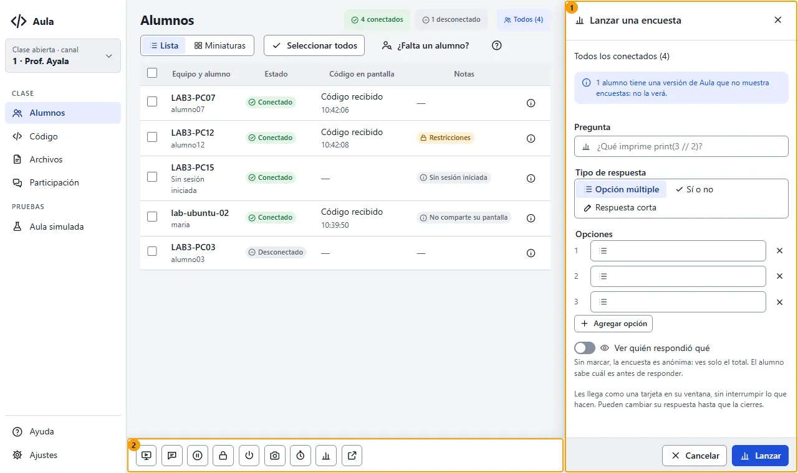

| # | Zona | Qué es |
|---|---|---|
| 1 | **Panel Encuesta** | La pregunta, el tipo de respuesta, las opciones y «Ver quién respondió qué»; Lanzar a todos o a la selección. |
| 2 | **Barra de acciones** | Abajo: lo que se aplica a la selección (aviso, transmitir, pausar, restricciones, captura, temporizador, encuesta, energía…). |

### Consola · Participación › Encuestas

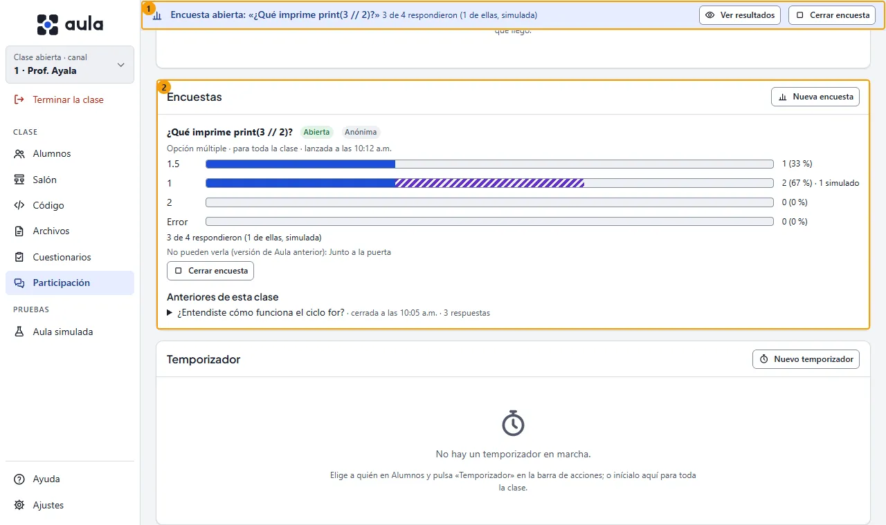

| # | Zona | Qué es |
|---|---|---|
| 1 | **Franja global** | Lo que sigue activo durante la clase (transmitir, proyectar a un alumno, control, pantallas en pausa, energía, temporizador, encuesta o cuestionario abierto, aula simulada), con su botón para detenerlo. |
| 2 | **Sección Encuestas** | La encuesta o el cuestionario abierto en vivo (barras, o aciertos por pregunta y puntaje por alumno) con Cerrar, y los anteriores con Compartir resultados y Exportar calificaciones. |

### Consola · Alumnos (salón)

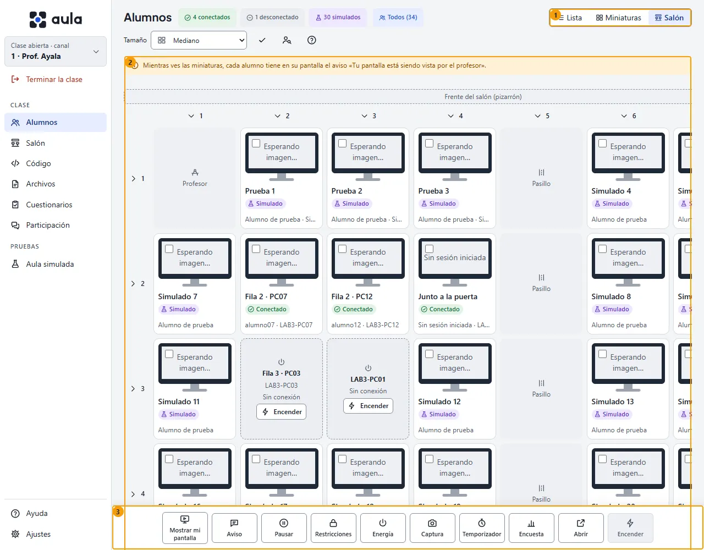

| # | Zona | Qué es |
|---|---|---|
| 1 | **Selector Lista | Miniaturas | Salón** | Cambia entre la tabla, las miniaturas de pantalla y los alumnos en su lugar del salón. |
| 2 | **Alumnos en el salón** | Las tarjetas de los alumnos en su lugar del salón; el lugar de un equipo sin conexión se ve vacío, con Encender. Los números de fila y columna seleccionan a los de esa fila o columna (prompt 10.15). |
| 3 | **Barra de acciones** | Abajo: lo que se aplica a la selección (aviso, transmitir, pausar, restricciones, captura, temporizador, encuesta, energía…). |

### Consola · Salón

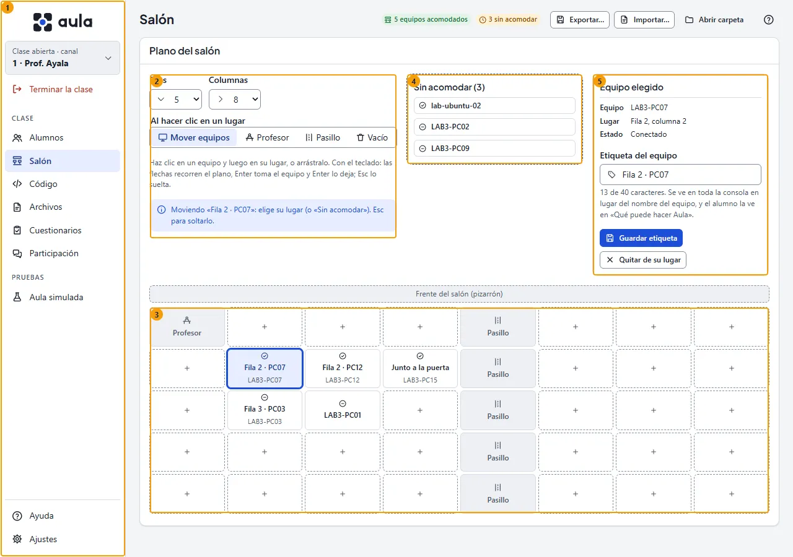

| # | Zona | Qué es |
|---|---|---|
| 1 | **Menú** | Columna izquierda: la clase abierta, las vistas y Ayuda y Ajustes. |
| 2 | **Filas, columnas y lugar** | El tamaño del salón (hasta 12 × 12) y qué pone un clic: mover equipos, Profesor, Pasillo o Vacío. |
| 3 | **Plano del salón** | Un botón por lugar, con el frente del salón arriba: se arrastra cada equipo a su lugar, o con el teclado (flechas, Enter y Esc). |
| 4 | **Sin acomodar** | Los equipos sin lugar: los nuevos y los que la consola recuerda; soltar uno aquí lo saca del plano. |
| 5 | **Equipo elegido** | El equipo elegido: su nombre, lugar y estado, su etiqueta con Guardar etiqueta, Quitar de su lugar y Quitar del salón. |

### Consola · Cuestionarios

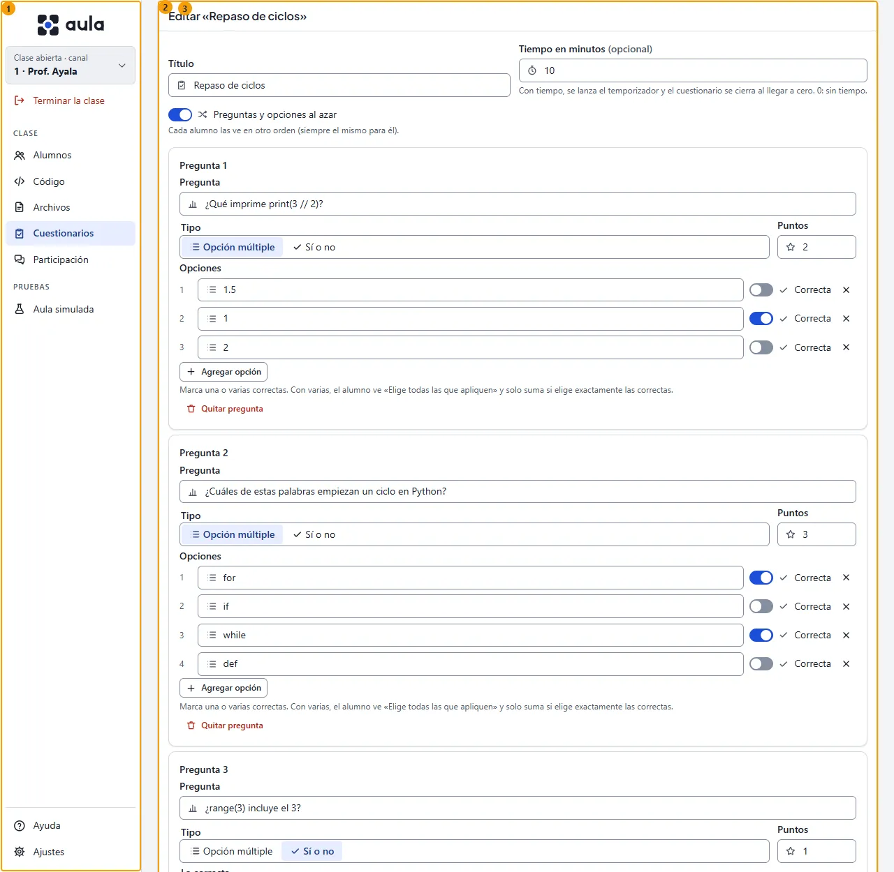

| # | Zona | Qué es |
|---|---|---|
| 1 | **Menú** | Columna izquierda: la clase abierta, las vistas y Ayuda y Ajustes. |
| 2 | **Cuestionarios guardados** | Los de Documentos\Aula\cuestionarios con «Lanzar a» (todos o la selección), Lanzar, Editar, Eliminar, Nuevo cuestionario y Abrir carpeta. |
| 3 | **Editor de cuestionario** | Título, tiempo, al azar y cada pregunta con su tipo, puntos y opciones con el interruptor Correcta; Guardar y Guardar y lanzar. |

### Consola · Participación › Encuestas (cuestionario)

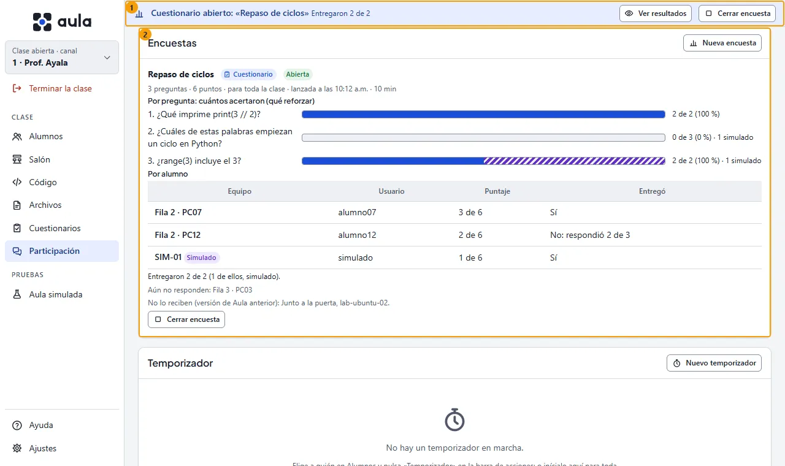

| # | Zona | Qué es |
|---|---|---|
| 1 | **Franja global** | Lo que sigue activo durante la clase (transmitir, proyectar a un alumno, control, pantallas en pausa, energía, temporizador, encuesta o cuestionario abierto, aula simulada), con su botón para detenerlo. |
| 2 | **Sección Encuestas** | La encuesta o el cuestionario abierto en vivo (barras, o aciertos por pregunta y puntaje por alumno) con Cerrar, y los anteriores con Compartir resultados y Exportar calificaciones. |

## App del alumno

### Alumno · Tira de identidad y bandas

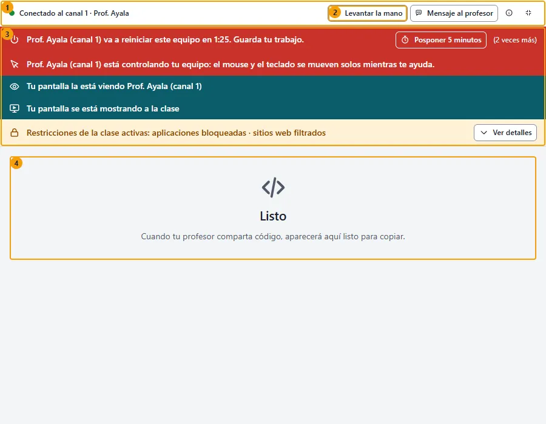

| # | Zona | Qué es |
|---|---|---|
| 1 | **Tira de identidad** | Arriba: a qué clase está conectado, el temporizador y los botones del alumno. |
| 2 | **Botones de la tira** | Levantar la mano, Mensaje al profesor, Qué puede hacer Aula en este equipo y Modo compacto. |
| 3 | **Bandas de transparencia** | Lo que el profesor hace con el equipo (energía, control, pantalla en pausa, pantalla vista, tu pantalla mostrada a la clase, restricciones); no se cierran. |
| 4 | **Estado vacío** | Lo que se ve cuando no hay código ni archivos. |

### Alumno · La clase terminó

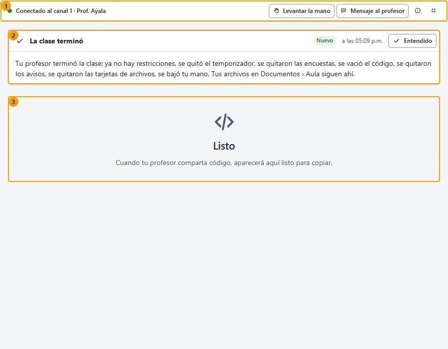

| # | Zona | Qué es |
|---|---|---|
| 1 | **Tira de identidad** | Arriba: a qué clase está conectado, el temporizador y los botones del alumno. |
| 2 | **Tarjeta «La clase terminó»** | Cuándo terminó la clase y qué se quitó, con «Entendido»; no es una banda (prompt 10.14). |
| 3 | **Estado vacío** | Lo que se ve cuando no hay código ni archivos. |

### Alumno · Código recibido

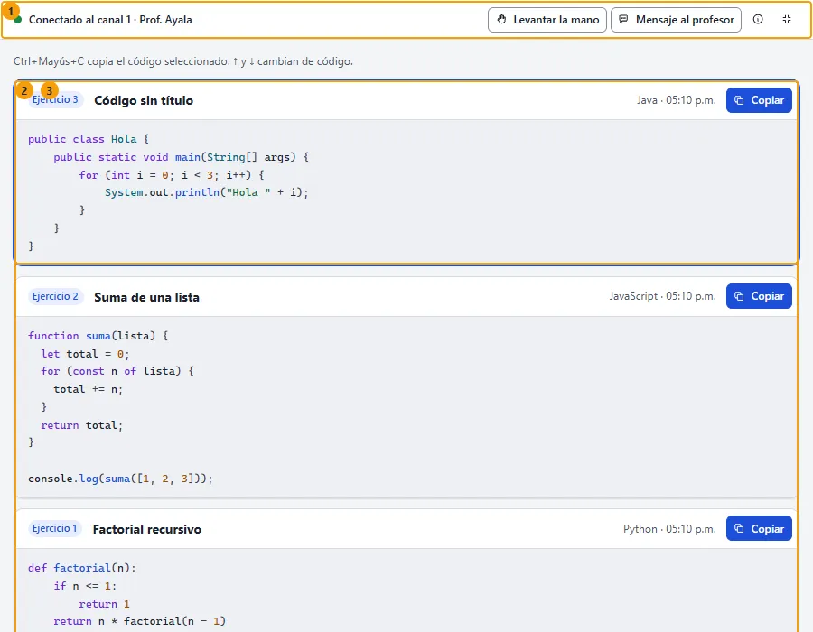

| # | Zona | Qué es |
|---|---|---|
| 1 | **Tira de identidad** | Arriba: a qué clase está conectado, el temporizador y los botones del alumno. |
| 2 | **Lista de código** | El código que mandó el profesor, lo más nuevo arriba. |
| 3 | **Tarjeta de código** | Un fragmento con su ejercicio, título, lenguaje y Copiar. |

### Alumno · Archivos y mensajes

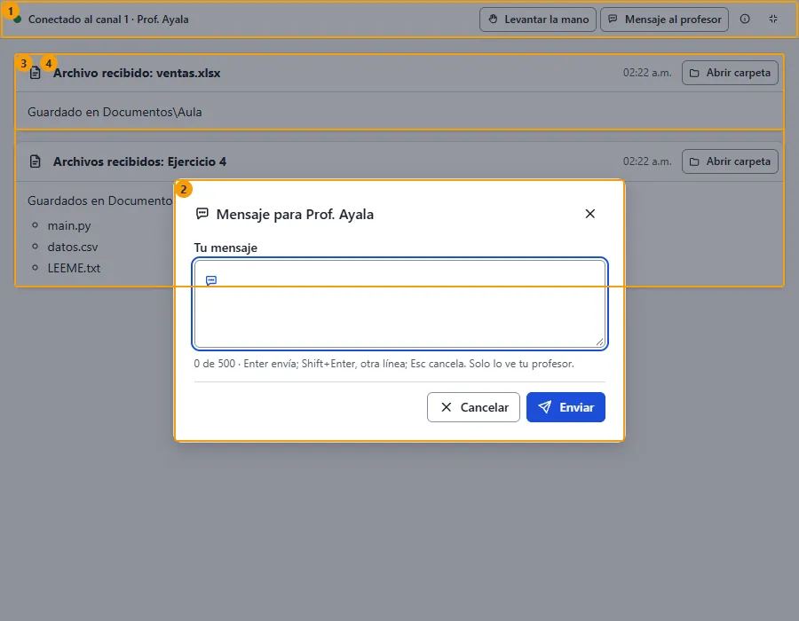

| # | Zona | Qué es |
|---|---|---|
| 1 | **Tira de identidad** | Arriba: a qué clase está conectado, el temporizador y los botones del alumno. |
| 2 | **Diálogo Mensaje al profesor** | El diálogo para escribirle al profesor. |
| 3 | **Archivos recibidos** | Una tarjeta por envío de archivos. |
| 4 | **Tarjeta de archivo** | Qué llegó, dónde quedó y Abrir carpeta. |

### Alumno · Encuestas

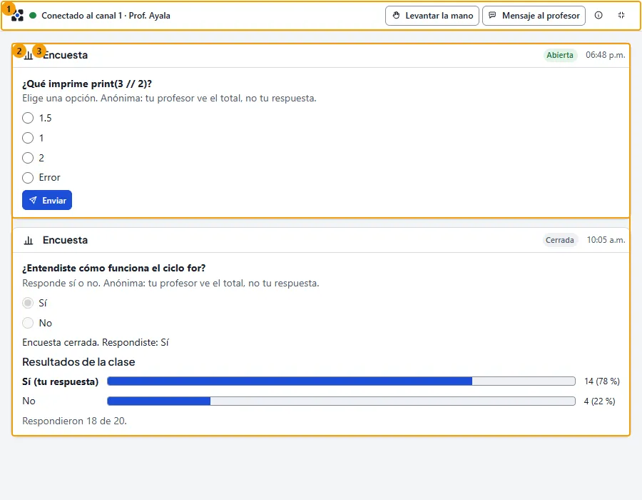

| # | Zona | Qué es |
|---|---|---|
| 1 | **Tira de identidad** | Arriba: a qué clase está conectado, el temporizador y los botones del alumno. |
| 2 | **Encuestas** | Una tarjeta por encuesta del profesor, arriba de la lista. |
| 3 | **Tarjeta de encuesta** | La pregunta, si es anónima, las opciones con Enviar y, si el profesor los comparte, los resultados de la clase. |

### Alumno · Cuestionario

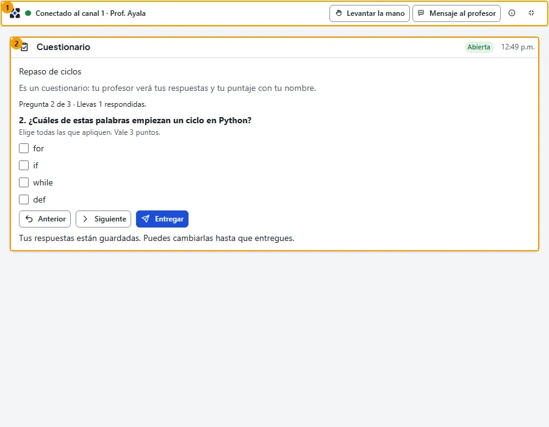

| # | Zona | Qué es |
|---|---|---|
| 1 | **Tira de identidad** | Arriba: a qué clase está conectado, el temporizador y los botones del alumno. |
| 2 | **Tarjeta de cuestionario** | Una pregunta a la vez con Anterior, Siguiente y cuántas lleva, y Entregar; si el profesor lo comparte, solo su resultado (prompt 10.20). |

### Alumno · Recolección

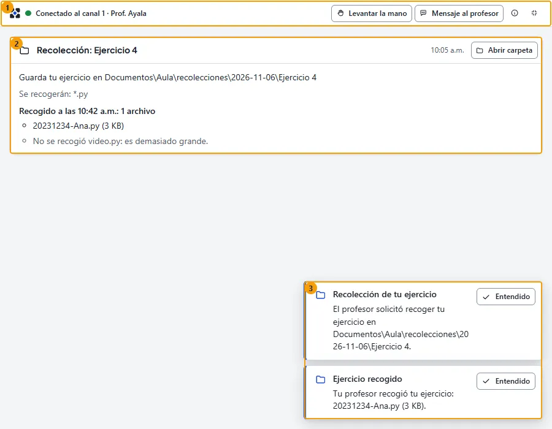

| # | Zona | Qué es |
|---|---|---|
| 1 | **Tira de identidad** | Arriba: a qué clase está conectado, el temporizador y los botones del alumno. |
| 2 | **Tarjeta de recolección** | Dónde guardar el ejercicio, qué se recogió y cuándo, y Abrir carpeta. |
| 3 | **Avisos en la esquina** | Avisos del profesor y de Aula, abajo a la derecha. |

### Alumno · Mano levantada y avisos

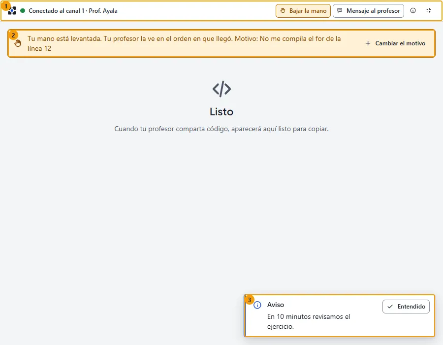

| # | Zona | Qué es |
|---|---|---|
| 1 | **Tira de identidad** | Arriba: a qué clase está conectado, el temporizador y los botones del alumno. |
| 2 | **Estado de la mano** | «Tu mano está levantada» y el motivo. |
| 3 | **Avisos en la esquina** | Avisos del profesor y de Aula, abajo a la derecha. |

### Alumno · Modo compacto

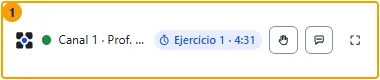

| # | Zona | Qué es |
|---|---|---|
| 1 | **Modo compacto** | La ventana encogida a una tira. |

## Todas las zonas

También las que no salen en una imagen (diálogos y paneles). El `id` es el que guardan las notas.

### Consola

| id | Zona | Qué es |
|---|---|---|
| `menu` | Menú | Columna izquierda: la clase abierta, las vistas y Ayuda y Ajustes. |
| `menu-clase` | Menú › Selector de clase | Canal y nombre de la clase abierta; abre «Cambiar de canal». |
| `menu-terminar` | Menú › Terminar la clase | Bajo el Selector de clase: detiene lo activo y deja limpia la ventana de cada alumno (prompt 10.14). |
| `franja` | Franja global | Lo que sigue activo durante la clase (transmitir, proyectar a un alumno, control, pantallas en pausa, energía, temporizador, encuesta o cuestionario abierto, aula simulada), con su botón para detenerlo. |
| `cabecera` | Cabecera de la vista | Título de la vista, su resumen y el «?» de ayuda contextual. |
| `avisos` | Avisos (toasts) | Mensajes breves abajo a la derecha tras una acción. |
| `alumnos` | Vista Alumnos | Los alumnos del canal, en lista, miniaturas o como en el salón. |
| `alumnos-modo` | Vista Alumnos › Selector Lista | Miniaturas | Salón | Cambia entre la tabla, las miniaturas de pantalla y los alumnos en su lugar del salón. |
| `alumnos-lista` | Vista Alumnos › Lista de alumnos | Tabla con un alumno por fila. |
| `fila-alumno` | Vista Alumnos › Lista de alumnos › Fila del alumno | Un alumno: casilla, equipo, estado, insignias y el botón de su ficha; en un equipo sin conexión, Encender. |
| `alumnos-seleccion` | Vista Alumnos › Selección | A quién van las acciones de la barra: «Todos (n)» o «n seleccionados», con su explicación en el tooltip. |
| `alumnos-apagados` | Vista Alumnos › Mostrar apagados | Muestra en la lista los equipos que la consola conoce y no están conectados, con Encender y Olvidar; solo en Lista y se recuerda (prompt 10.19). |
| `alumnos-tamano` | Vista Alumnos › Tamaño de las miniaturas | Pequeño, Mediano, Grande, Extra grande o Ajustar a la pantalla; en Miniaturas y en Salón, y se recuerda. |
| `alumnos-miniaturas` | Vista Alumnos › Miniaturas | Cuadrícula con la pantalla de cada alumno. |
| `tarjeta-alumno` | Vista Alumnos › Miniaturas › Tarjeta del alumno | La miniatura de un alumno como un monitor, con su nombre; un clic en la pantalla abre la Pantalla grande. |
| `alumnos-salon` | Vista Alumnos › Alumnos en el salón | Las tarjetas de los alumnos en su lugar del salón; el lugar de un equipo sin conexión se ve vacío, con Encender. Los números de fila y columna seleccionan a los de esa fila o columna (prompt 10.15). |
| `barra-acciones` | Vista Alumnos › Barra de acciones | Abajo: lo que se aplica a la selección (aviso, transmitir, pausar, restricciones, captura, temporizador, encuesta, energía…). |
| `ficha` | Ficha del alumno | Panel derecho con los datos de un alumno y qué puede hacer su equipo; su fila queda marcada. Las acciones están en la Pantalla grande. |
| `ficha-puede` | Ficha del alumno › Qué puede hacer su equipo | Lista de capacidades del equipo del alumno. |
| `pantalla-grande` | Pantalla grande | La pantalla de un alumno en grande; también la vista del control remoto y la de la proyección de un alumno. |
| `pg-acciones` | Pantalla grande › Acciones sobre el alumno | Tomar control, Mensaje privado, Tomar captura, Proyectar a la clase, Pausar pantalla, Abrir página o app y Etiqueta del equipo (ACCIONES_ALUMNO en main.js). |
| `dlg-etiqueta` | Diálogo Etiqueta del equipo | Cambiar o quitar la etiqueta de un equipo; se abre desde la Pantalla grande (prompt 10.15). |
| `dlg-privado` | Diálogo Mensaje privado | Escribir un mensaje solo para un alumno, con su tipo; se abre desde la Pantalla grande. |
| `dlg-abrir` | Diálogo Abrir en un alumno | Abrir una página o una app permitida en el equipo de un alumno; se abre desde la Pantalla grande. |
| `dlg-plantilla` | Diálogo Nueva plantilla | Crear una plantilla con su nombre y sus archivos; se abre desde Plantillas (nota de interfaz 17). |
| `dlg-terminar` | Diálogo Terminar la clase | Lo que sigue activo, lo que se vacía y lo opcional (recoger, cancelar la energía); después, los pasos y el resultado por alumno con «Reintentar a los que faltan». |
| `dlg-pausa` | Diálogo Cambiar mensaje de la pausa | Cambiar el mensaje de las pantallas en pausa; se abre desde la Franja global (prompt 10.21). |
| `panel-aviso` | Panel Aviso | Mandar un aviso a la selección. |
| `panel-pausa` | Panel Pausar pantallas | Pausar las pantallas de la selección o de todos, con un mensaje opcional, o reanudarlas (Ctrl+Mayús+P). |
| `panel-pantalla` | Panel Transmitir | Transmitir tu pantalla a la clase. |
| `panel-restricciones` | Panel Restricciones | Bloquear aplicaciones y filtrar sitios. |
| `panel-captura` | Panel Captura | Tomar capturas de varios alumnos. |
| `panel-temporizador` | Panel Temporizador | Lanzar un temporizador de ejercicio. |
| `panel-energia` | Panel Energía | Apagar, reiniciar, cerrar sesión o encender los equipos apagados. |
| `panel-encuesta` | Panel Encuesta | La pregunta, el tipo de respuesta, las opciones y «Ver quién respondió qué»; Lanzar a todos o a la selección. |
| `panel-abrir` | Panel Abrir página o app | Abrir una página en el navegador o una app permitida en los equipos de la selección, y las últimas que abriste. |
| `captura` | Vista previa de captura | La captura de un alumno, con Guardar y Descartar. |
| `codigo` | Vista Código | Preparar y enviar código a los alumnos. |
| `codigo-editor` | Vista Código › Tarjeta del editor | Título, lenguaje, editor, «Enviar a» y los botones de emitir. |
| `editor` | Vista Código › Tarjeta del editor › Editor | El editor de código (Monaco). |
| `enviar-a` | Vista Código › Tarjeta del editor › Enviar a | Todos los conectados o la selección. |
| `envios` | Vista Código › Últimos envíos | Cada envío con quién lo tiene y quién falta. |
| `historial` | Vista Código › Historial de la clase | Lo emitido en la clase, para reabrir o reemitir. |
| `archivos` | Vista Archivos | Enviar archivos y plantillas a los alumnos, y recoger su trabajo. |
| `archivos-pestanas` | Vista Archivos › Selector Enviar | Recolecciones | Cambia entre enviar archivos y las recolecciones. |
| `archivos-enviar` | Vista Archivos › Enviar archivos | Plantilla o archivos elegidos, «Guardar en», «Reemplazar», «Enviar a» y Enviar. |
| `archivos-envios` | Vista Archivos › Envíos de archivos | Cada envío de archivos con quién lo tiene y quién falta. |
| `plantillas` | Vista Archivos › Plantillas | Las plantillas de Documentos\Aula\plantillas: Nueva plantilla, Usar, Abrir carpeta y Eliminar. |
| `archivos-historial` | Vista Archivos › Archivos enviados | Los envíos de la clase, para reenviarlos. |
| `recolecciones` | Vista Archivos › Recolecciones | Crear la carpeta de una actividad en los equipos y recoger lo que guardó cada alumno. |
| `reco-nueva` | Vista Archivos › Recolecciones › Nueva recolección | Actividad, tipos de archivo y «Crear carpeta en los equipos». |
| `recoleccion` | Vista Archivos › Recolecciones › Tarjeta de recolección | Una actividad: Recoger, Recoger a los que faltan, Abrir carpeta y la tabla por alumno. |
| `reco-fila` | Vista Archivos › Recolecciones › Tarjeta de recolección › Fila de la recolección | Un alumno: estado, qué llegó, cuándo, Abrir, Guardar como… y Recoger otra vez. |
| `salon` | Vista Salón | El plano del salón del canal: etiqueta y lugar de cada equipo, Exportar, Importar y Abrir carpeta. |
| `salon-herramientas` | Vista Salón › Filas, columnas y lugar | El tamaño del salón (hasta 12 × 12) y qué pone un clic: mover equipos, Profesor, Pasillo o Vacío. |
| `salon-plano` | Vista Salón › Plano del salón | Un botón por lugar, con el frente del salón arriba: se arrastra cada equipo a su lugar, o con el teclado (flechas, Enter y Esc). |
| `salon-sin` | Vista Salón › Sin acomodar | Los equipos sin lugar: los nuevos y los que la consola recuerda; soltar uno aquí lo saca del plano. |
| `salon-elegido` | Vista Salón › Equipo elegido | El equipo elegido: su nombre, lugar y estado, su etiqueta con Guardar etiqueta, Quitar de su lugar y Quitar del salón. |
| `cuestionarios` | Vista Cuestionarios | Los cuestionarios guardados, su editor y Lanzar; los resultados van en Participación › Encuestas. |
| `cuest-guardados` | Vista Cuestionarios › Cuestionarios guardados | Los de Documentos\Aula\cuestionarios con «Lanzar a» (todos o la selección), Lanzar, Editar, Eliminar, Nuevo cuestionario y Abrir carpeta. |
| `cuest-editor` | Vista Cuestionarios › Editor de cuestionario | Título, tiempo, al azar y cada pregunta con su tipo, puntos y opciones con el interruptor Correcta; Guardar y Guardar y lanzar. |
| `participacion` | Vista Participación | Lo que responden los alumnos en vivo. |
| `manos` | Vista Participación › Manos levantadas | La fila de manos, por orden de llegada. |
| `mensajes` | Vista Participación › Mensajes de los alumnos | La bandeja de mensajes con Responder. |
| `part-encuestas` | Vista Participación › Sección Encuestas | La encuesta o el cuestionario abierto en vivo (barras, o aciertos por pregunta y puntaje por alumno) con Cerrar, y los anteriores con Compartir resultados y Exportar calificaciones. |
| `part-temporizador` | Vista Participación › Sección Temporizador | Quién ve el temporizador y quién falta. |
| `simulada` | Vista Aula simulada | Alumnos de prueba y sus fallas. |
| `ayuda` | Vista Ayuda (manual) | El manual, con búsqueda e índice. |
| `panel-ayuda` | Panel de ayuda contextual | La página del manual de la vista actual, al costado. |
| `falta` | Vista ¿Falta un alumno? | Comprobar la conexión y el asistente paso a paso. |
| `ajustes` | Ajustes | Diálogo con Clase, Apariencia, Apps permitidas, Salón y Acerca de. |
| `ajustes-apps` | Ajustes › Apps permitidas | Las apps que se pueden abrir en los equipos: nombre y ruta del .exe, con ejemplos. |
| `ajustes-salon` | Ajustes › Salón | El resumen del salón del canal, dónde se guarda, Abrir el salón, Exportar e Importar (prompt 10.15). |
| `confirmar` | Diálogo de confirmación | «¿Seguro?» antes de una acción con consecuencias. |
| `arranque` | Pantalla de arranque | Abrir la clase: canal y nombre. |

### Alumno

| id | Zona | Qué es |
|---|---|---|
| `tira` | Tira de identidad | Arriba: a qué clase está conectado, el temporizador y los botones del alumno. |
| `tira-botones` | Tira de identidad › Botones de la tira | Levantar la mano, Mensaje al profesor, Qué puede hacer Aula en este equipo y Modo compacto. |
| `tira-temporizador` | Tira de identidad › Insignia del temporizador | Cuánto falta del ejercicio. |
| `bandas` | Bandas de transparencia | Lo que el profesor hace con el equipo (energía, control, pantalla en pausa, pantalla vista, tu pantalla mostrada a la clase, restricciones); no se cierran. |
| `banda-mostrando` | Bandas de transparencia › Banda «Tu pantalla se está mostrando» | Mientras sus compañeros ven su pantalla; sin botones: la termina el profesor. |
| `mano-estado` | Estado de la mano | «Tu mano está levantada» y el motivo. |
| `redactar` | Diálogo Mensaje al profesor | El diálogo para escribirle al profesor. |
| `capacidades` | Qué puede hacer Aula en este equipo | La grilla de lo que el profesor puede hacer con este equipo, como la ficha de la consola. |
| `enviados` | Tus mensajes | Los mensajes enviados y si llegaron. |
| `vacio` | Estado vacío | Lo que se ve cuando no hay código ni archivos. |
| `fin-clase` | Tarjeta «La clase terminó» | Cuándo terminó la clase y qué se quitó, con «Entendido»; no es una banda (prompt 10.14). |
| `encuestas` | Encuestas | Una tarjeta por encuesta del profesor, arriba de la lista. |
| `tarjeta-encuesta` | Encuestas › Tarjeta de encuesta | La pregunta, si es anónima, las opciones con Enviar y, si el profesor los comparte, los resultados de la clase. |
| `tarjeta-cuestionario` | Encuestas › Tarjeta de cuestionario | Una pregunta a la vez con Anterior, Siguiente y cuántas lleva, y Entregar; si el profesor lo comparte, solo su resultado (prompt 10.20). |
| `recolecciones` | Recolecciones | Una tarjeta por recolección del profesor. |
| `tarjeta-recoleccion` | Recolecciones › Tarjeta de recolección | Dónde guardar el ejercicio, qué se recogió y cuándo, y Abrir carpeta. |
| `archivos` | Archivos recibidos | Una tarjeta por envío de archivos. |
| `tarjeta-archivo` | Archivos recibidos › Tarjeta de archivo | Qué llegó, dónde quedó y Abrir carpeta. |
| `codigos` | Lista de código | El código que mandó el profesor, lo más nuevo arriba. |
| `tarjeta-codigo` | Lista de código › Tarjeta de código | Un fragmento con su ejercicio, título, lenguaje y Copiar. |
| `avisos` | Avisos en la esquina | Avisos del profesor y de Aula, abajo a la derecha. |
| `compacto` | Modo compacto | La ventana encogida a una tira. |
| `transmision` | Vista de la transmisión | La pantalla del profesor, o la de un compañero, ocupando la ventana. |
