# Fase 2: sistema de diseño y prototipo de la consola

Estado: **para aprobación**. Sigue al [análisis](consola-analisis.md) y a las decisiones del §11.
La consola real todavía no cambia: esto es el sistema de diseño y un prototipo de 3 pantallas.

## Cómo verlo

```sh
go run ./tools/vistaprevia      # imprime las direcciones; solo escucha en 127.0.0.1
```

- **Catálogo:** `dev/catalogo.html`. Muestra todos los componentes en claro u oscuro.
- **Prototipo:** `dev/prototipo/alumnos.html`, con navegación a Código y a «¿Falta un
  alumno?».
  - Se puede seleccionar, cambiar entre lista y miniaturas, abrir paneles, confirmar y
    copiar.
  - Parámetros útiles: `?sel=pc01,pc02`, `?panel=energia`, `?modo=miniaturas`,
    `?escena=simulada` y `?tema=oscuro`.

## Qué hay y dónde

| Pieza | Archivo | Notas |
|---|---|---|
| Tokens | `apps/teacher/frontend/dist/sistema/tokens.css` | Colores con estados (conectado, desconectado, advertencia, error, **simulado**, info), tipografía del sistema, espaciado de 4 px, radios y sombras. Tema claro, oscuro por el sistema y oscuro fijado con `data-theme`. |
| Componentes | `…/dist/sistema/componentes.css` | Ver la lista de abajo. |
| Iconos | `…/dist/sistema/iconos.svg` | 44 iconos propios en un solo sprite, sin scripts ni referencias externas. Sustituye a ⏻ y 🔒, que no se dibujan con las fuentes de Windows (M3). |
| Catálogo y prototipo | `apps/teacher/frontend/dev/` | **Fuera de** `//go:embed all:frontend/dist`: no entran al binario. |
| Contraste AA | `apps/teacher/sistema_test.go` | Verifica 23 pares de texto (4.5:1) y 9 de controles (3:1) en ambos temas, y que el oscuro automático y el manual sean iguales. Ya detectó y corrigió dos pares oscuros. |
| Vista previa | `tools/vistaprevia` | Servidor estático en Go, sin Node. |

Los componentes de `componentes.css` son:

- botones primario, secundario, peligro y fantasma, con tamaños, estado «trabajando» y
  deshabilitado legible (sin opacidad);
- selector segmentado;
- campos con ayuda y error en línea;
- insignias de estado (siempre con icono y texto);
- tarjetas y tarjeta de alumno (miniatura);
- tabla que pasa a tarjetas en contenedores angostos (*container queries*);
- avisos flotantes (los de error no se van solos);
- franjas globales;
- diálogo de confirmación;
- estado vacío con acción;
- carga (giro y esqueleto);
- pasos de asistente;
- bloque de código con «Copiar»;
- visor de diagramas (zoom y SVG claro u oscuro según el tema);
- la estructura: navegación lateral, barra de acciones y panel lateral.


## Capturas (ronda 2)

### Alumnos (inicio)

| Lista con 2 seleccionados y «Quitar selección» | Miniaturas con el aviso en línea |
|---|---|
| 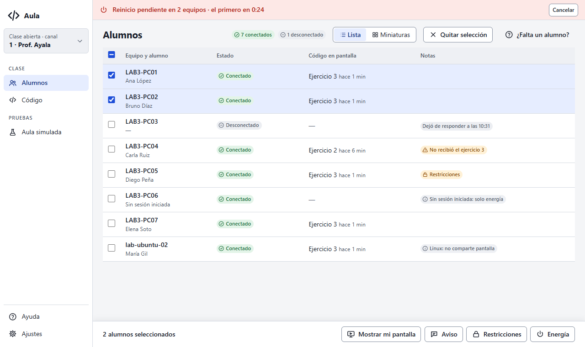 | 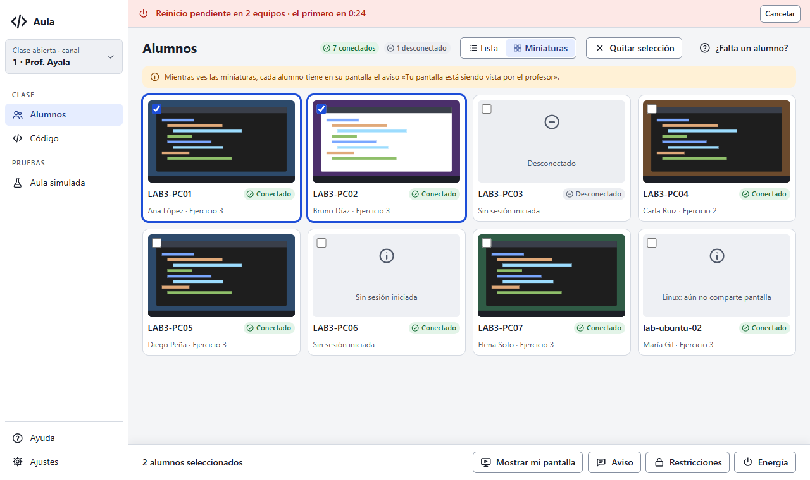 |
| **Panel lateral de Energía** (la selección sigue visible) | **Confirmación única** |
| 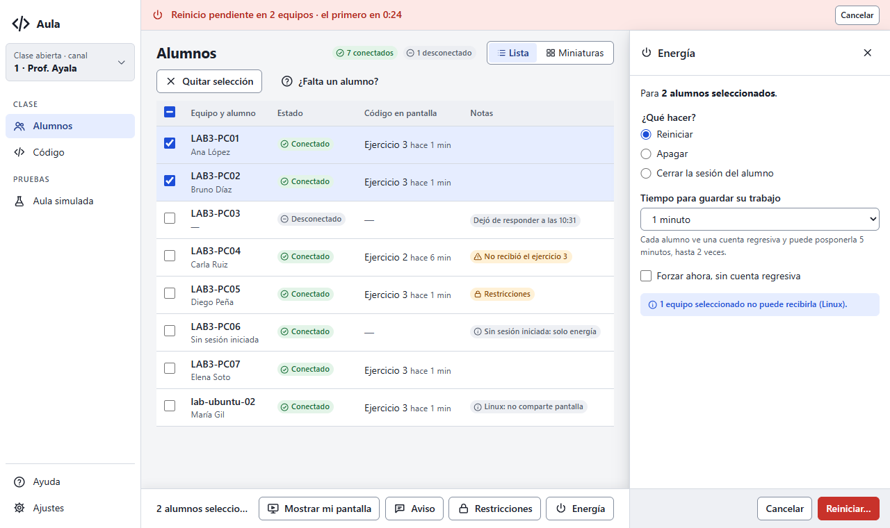 | 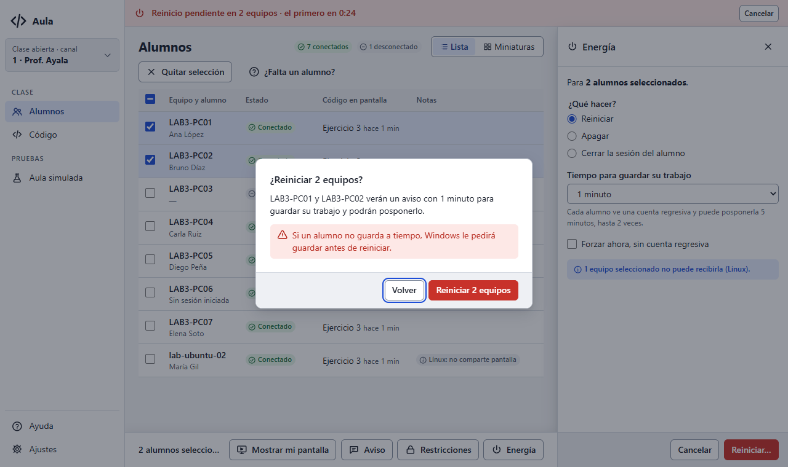 |
| **900×600:** menú de iconos, el canal como «1», panel encima | **Aula simulada:** una lista, los simulados al final |
| 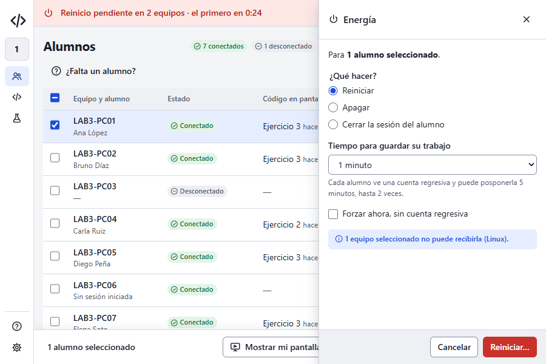 | 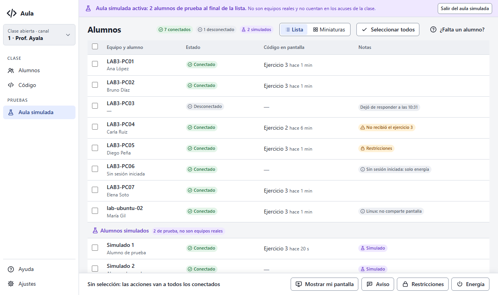 |

En la lista, la selección es un clic en la fila o en su casilla, el botón de la cabecera o
Ctrl+A. Sin selección, las acciones van a «todos los conectados», y la barra lo dice. Si la
barra de acciones no cabe, sus botones quedan solo con el icono.

### Código

| Claro | Oscuro | 900×600 |
|---|---|---|
| 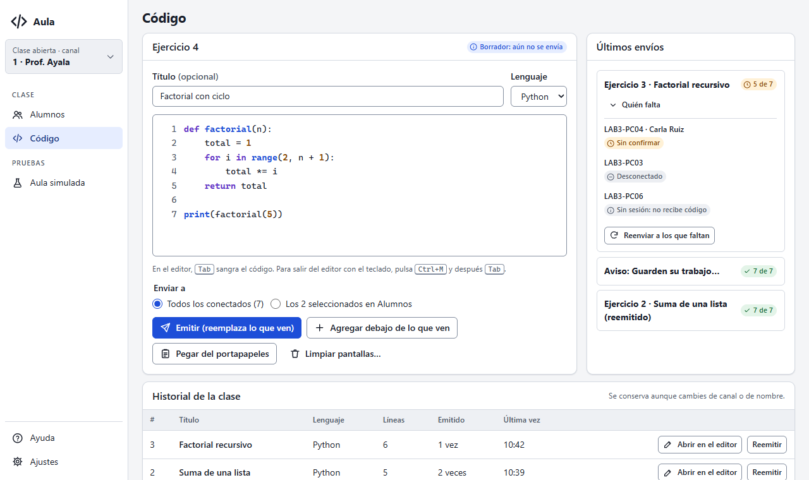 | 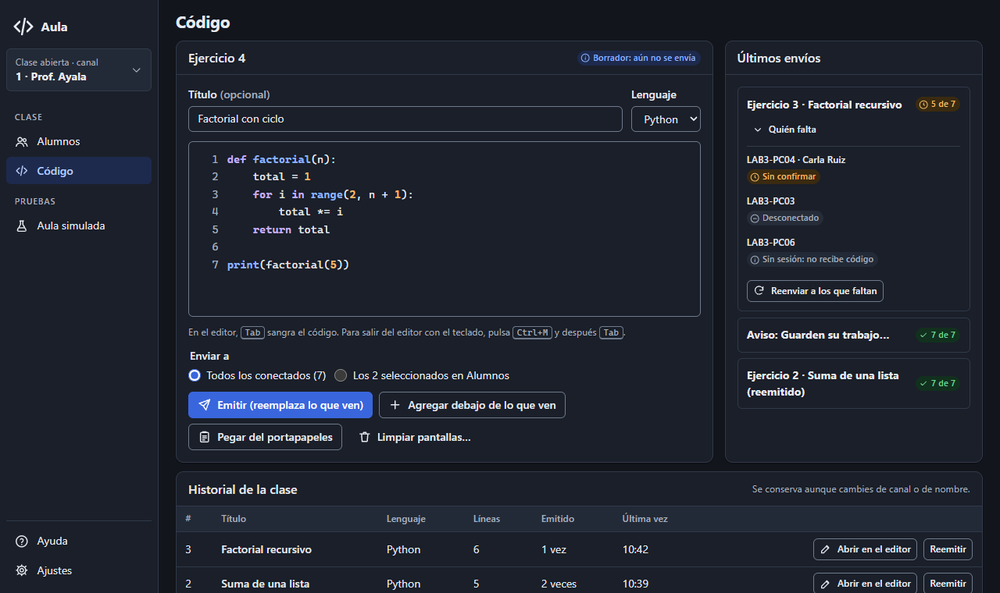 | 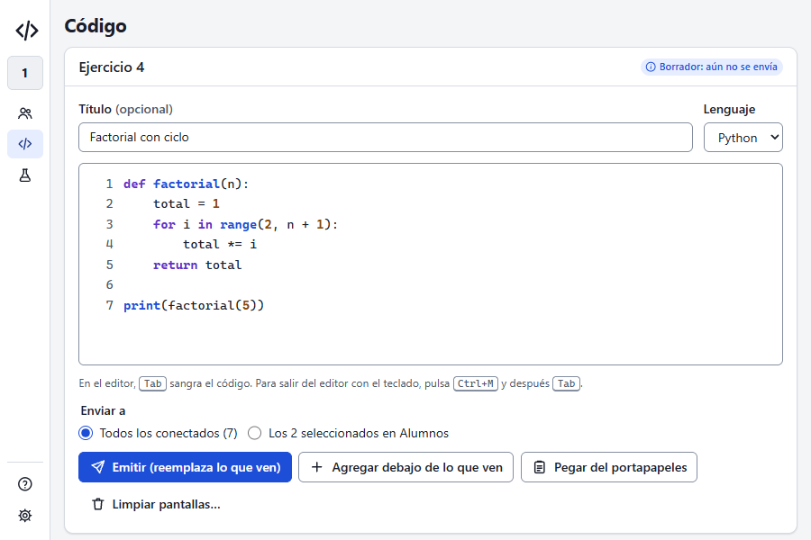 |

- «Pegar del portapapeles» va junto a Emitir y Agregar, sin el atajo (el atajo global sigue
  existiendo y se explica en el `title` y en Ajustes).
- «Últimos envíos» toma la altura del editor y se desplaza por dentro.
- El historial es una tabla a todo el ancho que se conserva al cambiar de canal o de nombre.

### Ayuda y «¿Falta un alumno?»

| Índice del manual con buscador | Asistente (Solución de problemas) | Oscuro |
|---|---|---|
| 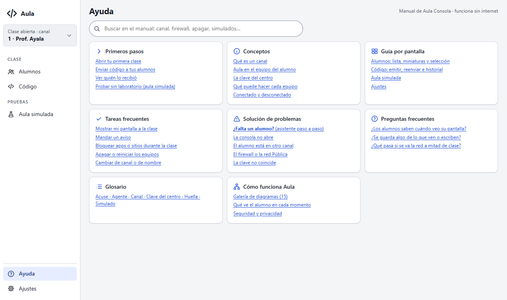 | 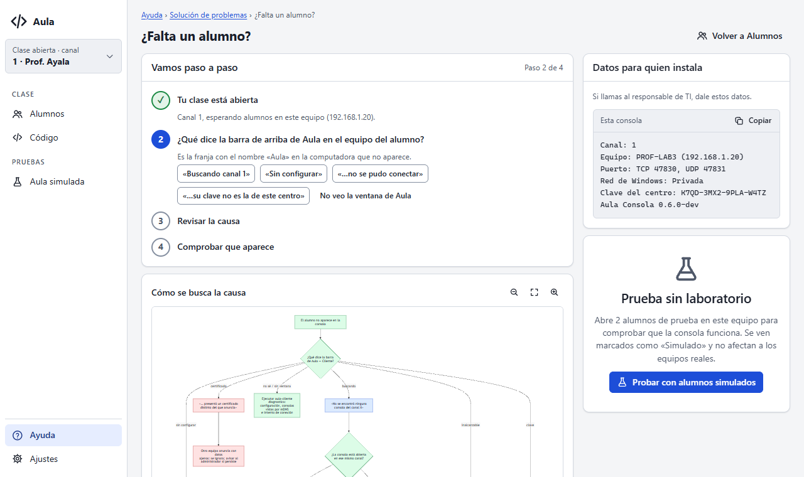 | 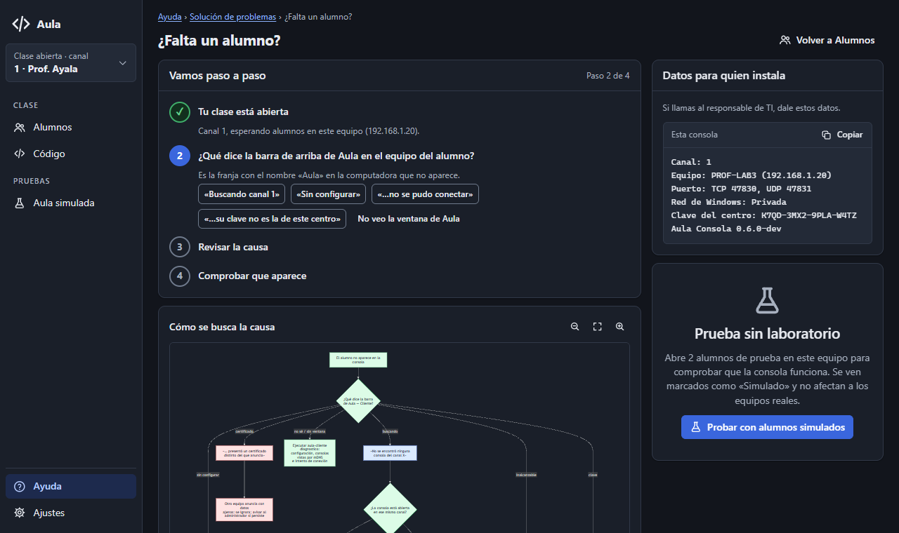 |

### Ajustes (modal) y cambio de canal

| Clase | Apariencia (oscuro) | Acerca de |
|---|---|---|
| 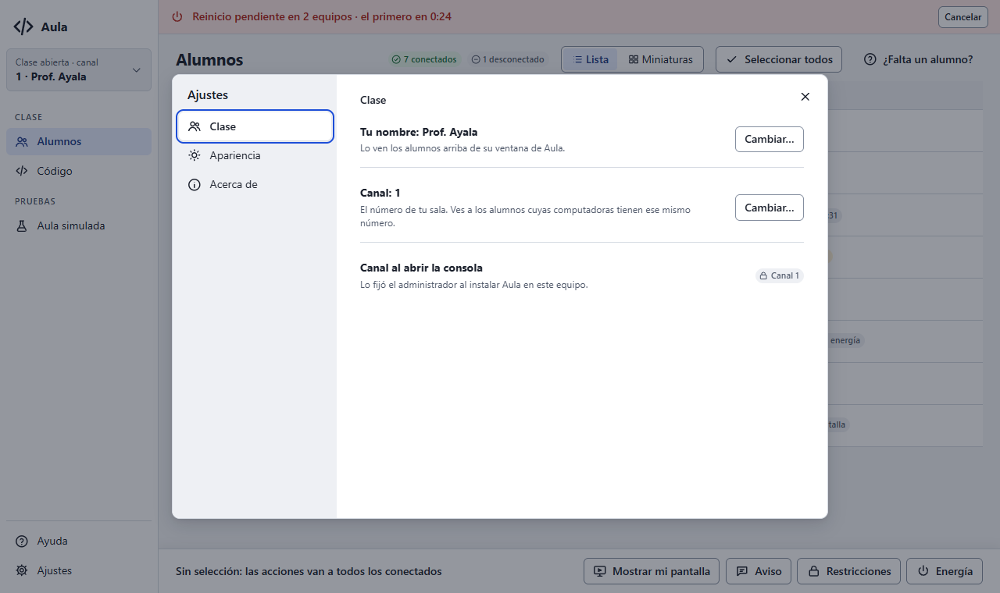 | 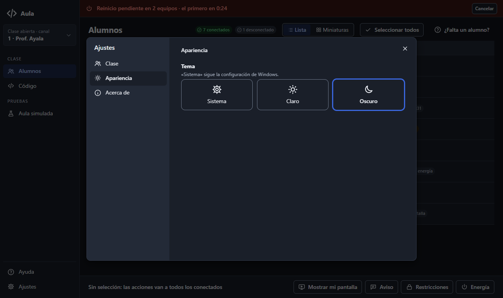 | 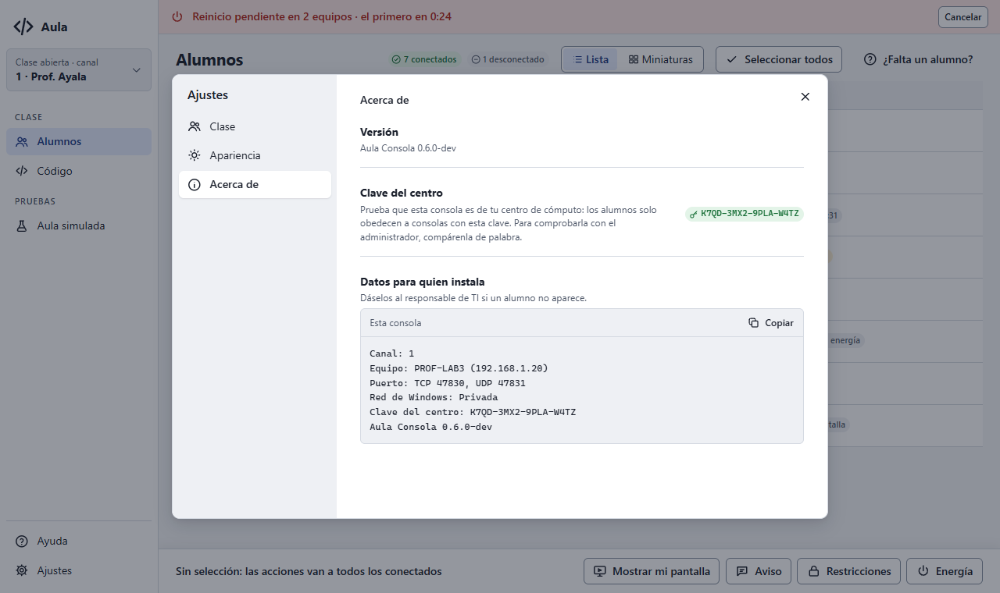 |
| **900×600** | **Cambiar de canal** (desde la tarjeta de la clase) | |
| 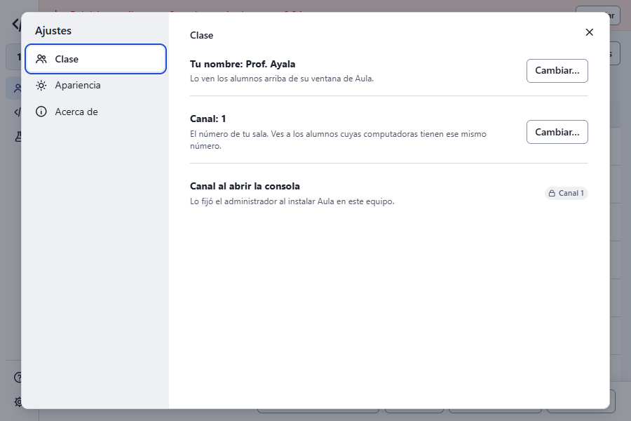 | 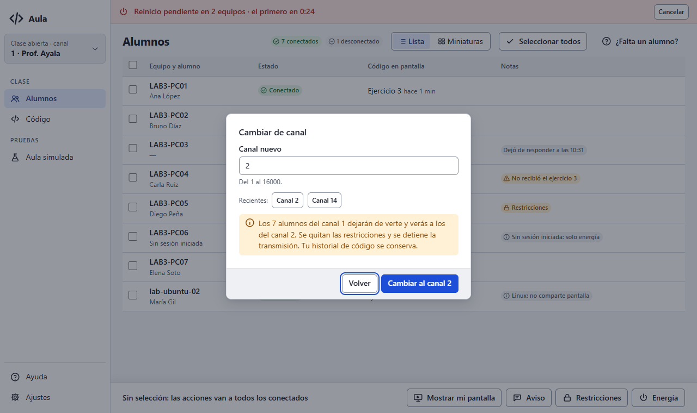 | |

### Catálogo

[Claro](https://github.com/bayalad7/aula/blob/d3152a7/docs/v1/ux/profesor/prototipo/18-catalogo-claro.png) · [Oscuro](https://github.com/bayalad7/aula/blob/d3152a7/docs/v1/ux/profesor/prototipo/19-catalogo-oscuro.png)

Las 19 capturas pasan axe-core (WCAG 2.1 A/AA y buenas prácticas) sin violaciones.

## Cambios pedidos y decisiones (ronda 2, 29/10/2026)

Pedidos:

1. Sin atajos «Alt X» en el menú.
2. Botón para seleccionar a todos en Lista y en Miniaturas.
3. El aviso de las miniaturas, con márgenes y esquinas redondeadas.
4. Barras de desplazamiento con estilo propio.
5. El selector de tema y la barra de acciones se adaptan a ventanas pequeñas.
6. En Código:
   - «Pegar del portapapeles» va junto a Emitir y sin el atajo;
   - «Últimos envíos» tiene la misma altura que el editor;
   - el historial es una tabla.
7. Ajustes se abre como modal.
8. Ayuda es el índice del manual.
9. El menú lateral se agrupa.
10. Hay un lugar para la versión, la clave del centro y el cambio de canal.

Decisiones:

- **Menú:** grupos CLASE (Alumnos, Código) y PRUEBAS (Aula simulada); abajo, Ayuda y
  Ajustes.
- **Tema:** solo en Ajustes › Apariencia; sale del pie del menú.
- **Canal:** se cambia desde la tarjeta de la clase del menú, con un diálogo que dice qué pasa,
  y también en Ajustes › Clase.
- **Ajustes** (modal con pestañas, como la Configuración de claude.ai):
  - Clase: nombre y canal;
  - Apariencia;
  - Acerca de: versión, clave del centro y datos para el instalador.
- **Ayuda:** índice del manual con buscador. «¿Falta un alumno?» queda dentro de Solución de
  problemas.
- **Seleccionar todos:** un botón en la cabecera que alterna con «Quitar selección», más
  Ctrl+A.
- **Aula simulada:** una sola lista, con los simulados agrupados al final y su conteo aparte.
- **Diagramas en oscuro:** la Fase 5 genera una paleta oscura propia sin tocar los `.md`.
- **Compartir el sistema:** paquete `internal/ui`, que se agregará a CLAUDE.md cuando se
  implemente.

## Preguntas de la ronda 1 (ya respondidas arriba)

1. **Aula simulada en la lista.** En el prototipo, la vista simulada muestra solo a los
   simulados y la franja dice que los reales siguen aparte.
   - ¿Prefieres eso (dos vistas separadas)?
   - ¿O una sola lista con los simulados agrupados al final y su insignia?
2. **Diagramas en oscuro.** Las clases de color de los diagramas tienen rellenos claros fijos
   (README de diagramas). En el SVG oscuro, los nodos se ven como recuadros claros (captura
   10): se leen bien, pero contrastan. En la Fase 5 puedo hacer que el pipeline genere una
   paleta oscura propia sin cambiar los `.md`. ¿Lo hago?
3. **Compartir con el overlay del alumno.** Propongo un paquete `internal/ui` que embeba
   `sistema/` y que cada app lo sirva en `/sistema/`, sin copias. Implica añadirlo a la lista
   de paquetes de CLAUDE.md. La alternativa es una copia en la app del alumno verificada por
   una prueba.
