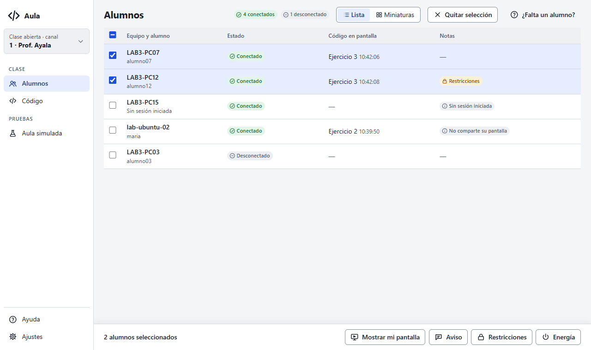

# La pantalla Alumnos

Es la pantalla de inicio: muestra a los alumnos de tu canal y desde aquí aplicas acciones a todos
o solo a algunos.

## Lista o miniaturas

- **Lista**: una fila por equipo con su estado, el código que tiene en pantalla y notas (por
  ejemplo, «No comparte su pantalla» o «Restricciones»).
- **Miniaturas**: la pantalla de cada alumno, actualizada cada segundo. Haz clic en una para verla
  en grande.

Mientras ves las miniaturas, cada alumno tiene en su pantalla el aviso «Tu pantalla está siendo
vista por el profesor». Las imágenes no se guardan: al salir de Miniaturas se dejan de pedir.

## Seleccionar alumnos

Haz clic en una fila o su casilla, o usa **Seleccionar todos** (también con Ctrl+A). La barra de
abajo dice cuántos tienes seleccionados. **Sin selección, las acciones van a todos los
conectados.**

## Acciones sobre la selección

La barra de abajo abre un panel a la derecha, sin tapar la lista:

| Acción | Qué hace | Más |
|---|---|---|
| Mostrar mi pantalla | Tus alumnos ven tu pantalla en grande, con tu nombre arriba. | [Tareas frecuentes](tareas-frecuentes#mostrar-tu-pantalla) |
| Aviso | Un mensaje que aparece en su pantalla. | [Tareas frecuentes](tareas-frecuentes#mandar-un-aviso) |
| Restricciones | Bloquea aplicaciones o sitios web durante la clase. | [Tareas frecuentes](tareas-frecuentes#bloquear-aplicaciones-o-sitios) |
| Energía | Apaga, reinicia o cierra la sesión de los equipos. | [Tareas frecuentes](tareas-frecuentes#apagar-o-reiniciar-los-equipos) |

## Estados de un alumno

- **Conectado**: Aula está abierta en su equipo y te escucha.
- **Desconectado**: el equipo dejó de responder (se apagó, se fue la red o cerró Aula). Vuelve
  solo cuando se recupera.
- **Sin sesión iniciada**: el equipo está encendido pero nadie inició sesión; solo puede recibir
  órdenes de energía.

Si un alumno no aparece, abre [¿Falta un alumno?](pantalla:falta).
