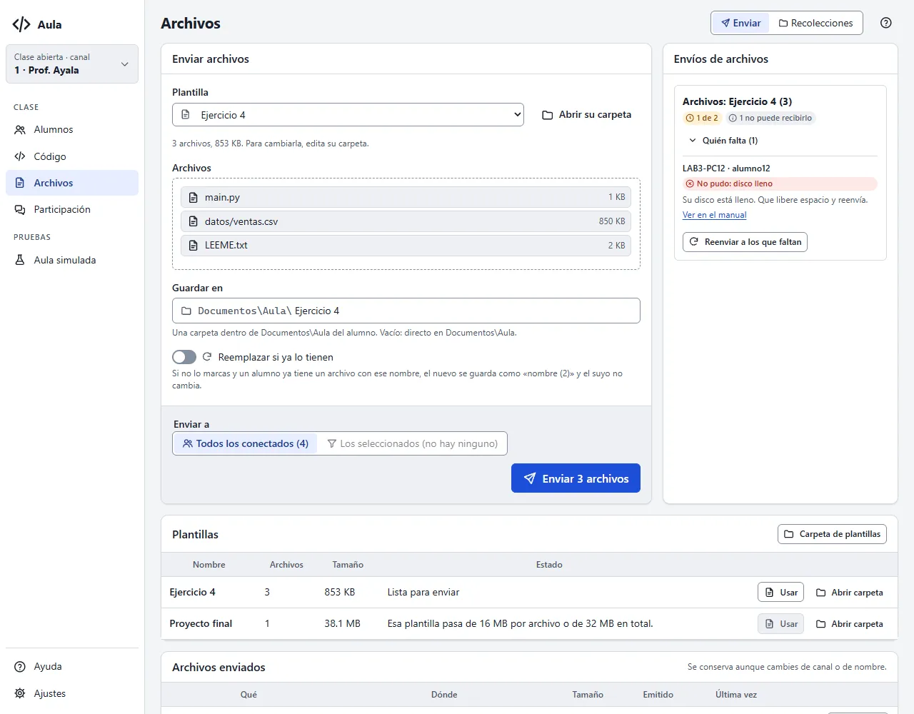

# La pantalla Archivos

Aquí repartes archivos a tus alumnos (un dataset, el esqueleto de un ejercicio, un documento) y
guardas las plantillas que usas en cada clase.

## Enviar archivos y plantillas

1. Pulsa **Elegir archivos…** y marca uno o varios, o elige una **Plantilla**.
2. En **Guardar en** escribe la carpeta donde lo recibirán, dentro de su `Documentos\Aula`; por
   ejemplo, `Ejercicio 4`. Vacío: directo en `Documentos\Aula`.
3. Elige **Enviar a** (todos o tu selección) y pulsa **Enviar**.

Cada alumno ve una tarjeta «Archivo recibido: datos.csv · Guardado en Documentos\Aula\Ejercicio 4»
con un botón para abrir la carpeta. Aula nunca abre ni ejecuta el archivo, y solo escribe dentro
de `Documentos\Aula` de quien tiene la sesión iniciada.

- **Si un alumno ya tiene un archivo con ese nombre**, el nuevo se guarda como `datos (2).csv` y el
  suyo no cambia. Marca **Reemplazar si ya lo tienen** solo cuando quieras pisarlo (por ejemplo,
  para corregir una plantilla); su tarjeta le avisa que se reemplazó.
- **Límites:** hasta 20 archivos por envío, de 16 MB cada uno y 32 MB en total.
- Un nombre que Windows no acepta (con `:` o `\`, que empieza con `..`, que se llama `CON`…) se
  rechaza antes de enviar.

## Envíos de archivos

Cada envío dice cuántos alumnos ya lo tienen, por ejemplo «7 de 8»: cuenta a los que guardaron
**todos** los archivos. **Quién falta** muestra a los demás y por qué, y **Reenviar a los que
faltan** lo manda otra vez solo a ellos.

## Plantillas de ejercicio

Una plantilla es una carpeta en `Documentos\Aula\plantillas` de tu equipo, con los archivos que
repartes siempre juntos (por ejemplo, `main.py`, `datos.csv` y `LEEME.txt`). Se conserva entre
clases.

- **Guardar como plantilla…** crea una con los archivos que elegiste.
- En la tabla **Plantillas**, **Usar** la carga arriba para enviarla y **Abrir carpeta** la abre en
  el Explorador: ahí agregas, quitas o cambias archivos, también en subcarpetas. **Carpeta de
  plantillas** abre la de todas.
- Al elegir una plantilla, su nombre se propone como carpeta de destino.

Si una plantilla tiene más de 20 archivos, pasa del tamaño o tiene un nombre que Windows no acepta,
su estado dice qué corregir y no se puede usar hasta arreglarla.

## Archivos enviados

Cada envío de la clase queda aquí con **Reenviar**, que lo manda otra vez a todos tal como está
ahora en tu equipo (si cambiaste un archivo o la plantilla, va la versión nueva).

{{diagrama:19-enviar-archivos}}

## Si un alumno no recibió los archivos

Abre **Quién falta** en el envío. Al lado de cada alumno dice por qué:

| Dice | Qué hacer |
|---|---|
| sin confirmar | Todavía los está recibiendo; espera unos segundos. |
| no respondió · se desconectó | Su equipo no confirmó o se fue a mitad. **Reenviar a los que faltan**. |
| disco lleno · Windows no dejó guardarlo | Que libere espacio o cierre el archivo, y reenvía. |
| no llegó completo · llegó dañado · estaba ocupado | Reenvía. |
| rechazó el nombre · ruta demasiado larga | Usa un nombre o una carpeta más cortos y sin símbolos. |
| no pudo recibir archivos | Nadie tiene la sesión iniciada en ese equipo. |

Un equipo sin la función (otra versión, Linux o macOS) cuenta como «no puede recibirlo»; lo ves en
su ficha, en **Qué puede hacer su equipo**.
