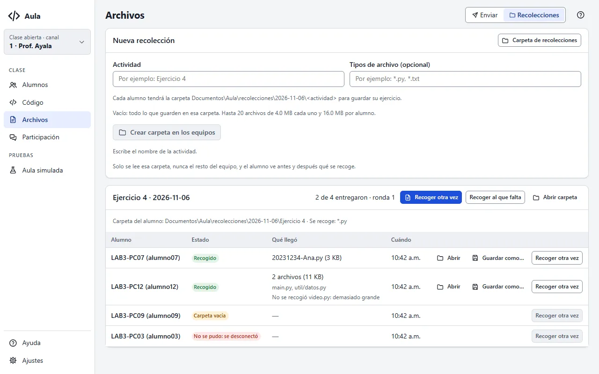

# La pantalla Archivos

Aquí repartes archivos a tus alumnos (un dataset, el esqueleto de un ejercicio, un documento),
guardas las plantillas que usas en cada clase y, en la pestaña **Recolecciones**, recoges su trabajo.

## Enviar archivos y plantillas

1. Pulsa **Elegir archivos…** y marca uno o varios, o elige una **Plantilla**.
2. En **Guardar en** escribe la carpeta donde lo recibirán, dentro de su `Documentos\Aula`; por
   ejemplo, `Ejercicio 4`. Vacío: directo en `Documentos\Aula`.
3. Elige **Enviar a** (todos o tu selección) y pulsa **Enviar**.

Cada alumno ve una tarjeta «Archivo recibido: datos.csv · Guardado en Documentos\Aula\Ejercicio 4»
con un botón para abrir la carpeta. Aula nunca abre ni ejecuta el archivo, y solo escribe dentro
de `Documentos\Aula` de quien tiene la sesión iniciada.

- **Si un alumno ya tiene un archivo con ese nombre**, el nuevo se guarda como `datos (2).csv` y el
  suyo no cambia. Marca **Reemplazar si ya lo tienen** solo cuando quieras pisarlo (por ejemplo,
  para corregir una plantilla); su tarjeta le avisa que se reemplazó.
- **Límites:** hasta 20 archivos por envío, de 16 MB cada uno y 32 MB en total.
- Un nombre que Windows no acepta (con `:` o `\`, que empieza con `..`, que se llama `CON`…) se
  rechaza antes de enviar.

## Envíos de archivos

Cada envío dice cuántos alumnos ya lo tienen, por ejemplo «7 de 8»: cuenta a los que guardaron
**todos** los archivos. **Quién falta** muestra a los demás y por qué, y **Reenviar a los que
faltan** lo manda otra vez solo a ellos.

## Plantillas de ejercicio

Una plantilla es una carpeta en `Documentos\Aula\plantillas` de tu equipo, con los archivos que
repartes siempre juntos (por ejemplo, `main.py`, `datos.csv` y `LEEME.txt`). Se conserva entre
clases.

- **Guardar como plantilla…** crea una con los archivos que elegiste.
- En la tabla **Plantillas**, **Usar** la carga arriba para enviarla y **Abrir carpeta** la abre en
  el Explorador: ahí agregas, quitas o cambias archivos, también en subcarpetas. **Carpeta de
  plantillas** abre la de todas.
- La papelera de su fila la **elimina**, después de confirmar: se borra su carpeta, con sus
  archivos. Lo que ya enviaste no cambia y sigue en **Archivos enviados**. Si Windows no la deja
  borrar, cierra sus archivos abiertos en otro programa y vuelve a intentarlo.
- Al elegir una plantilla, su nombre se propone como carpeta de destino.

Si una plantilla tiene más de 20 archivos, pasa del tamaño o tiene un nombre que Windows no acepta,
su estado dice qué corregir y no se puede usar hasta arreglarla.

## Archivos enviados

Cada envío de la clase queda aquí con **Reenviar**, que lo manda otra vez a todos tal como está
ahora en tu equipo (si cambiaste un archivo o la plantilla, va la versión nueva).

{{diagrama:19-enviar-archivos}}

## Si un alumno no recibió los archivos

Abre **Quién falta** en el envío. Al lado de cada alumno dice por qué:

| Dice | Qué hacer |
|---|---|
| sin confirmar | Todavía los está recibiendo; espera unos segundos. |
| no respondió · se desconectó | Su equipo no confirmó o se fue a mitad. **Reenviar a los que faltan**. |
| disco lleno · Windows no dejó guardarlo | Que libere espacio o cierre el archivo, y reenvía. |
| no llegó completo · llegó dañado · estaba ocupado | Reenvía. |
| rechazó el nombre · ruta demasiado larga | Usa un nombre o una carpeta más cortos y sin símbolos. |
| no pudo recibir archivos | Nadie tiene la sesión iniciada en ese equipo. |

Un equipo sin la función (otra versión, Linux o macOS) cuenta como «no puede recibirlo»; lo ves en
su ficha, en **Qué puede hacer su equipo**.

## Recolecciones

La pestaña **Recolecciones** recoge el trabajo de tus alumnos: cada uno guarda su ejercicio en una
carpeta acordada y tú lo recibes ordenado por alumno. Es en dos pasos:

1. **Crea la carpeta.** Escribe la **Actividad** (por ejemplo, `Ejercicio 4`) y, si quieres, los
   **Tipos de archivo** (`*.py, *.txt`; vacío: todo lo que guarden ahí). Pulsa **Crear carpeta en
   los equipos**. Cada alumno recibe una tarjeta «Recolección: Ejercicio 4 · Guarda tu ejercicio
   en `Documentos\Aula\recolecciones\2026-11-06\Ejercicio 4`» con **Abrir carpeta**. Quien se
   conecte más tarde la recibe al llegar.
2. **Recoge.** Cuando terminen, pulsa **Recoger**. Cada alumno ve antes un aviso «El profesor
   solicitó recoger tu ejercicio en …» y, al terminar, «Tu profesor recogió tu ejercicio:
   20231234-Ana.py (3 KB)». Puedes recoger las veces que quieras: **Recoger otra vez** trae una
   ronda nueva, **Recoger a los que faltan** solo a quien no entregó, y en la fila de un alumno,
   **Recoger otra vez** solo a él.

Aula solo lee esa carpeta (hasta 4 subcarpetas adentro), nunca el resto del equipo, y no borra ni
cambia nada del alumno. Los accesos directos a otras carpetas no se siguen.

- **Límites:** hasta 20 archivos por alumno, de 4 MB cada uno y 16 MB en total. Lo que pasa del
  límite no se recoge, y tanto tú como el alumno ven qué quedó fuera y por qué.
- Los alumnos simulados entregan el último código que les enviaste, como `Simulado 1.py`.

{{diagrama:07-acuses-recoleccion}}

### Dónde queda lo recogido

Al llegar, cada archivo se guarda en tu equipo, en
`Documentos\Aula\recolecciones\<fecha>\<actividad>\<equipo> (<usuario>)\`, con la misma
estructura de carpetas que tenía el alumno (los simulados, en `… (simulado)`). La carpeta está
también en **Ajustes › Acerca de**.

- En la fila de cada alumno: **Abrir** muestra su carpeta y **Guardar como…** copia lo recogido a
  donde elijas (nunca reemplaza: si ya hay una copia, crea `… (2)`).
- **Recoger otra vez** reemplaza tu copia de ese alumno por la ronda nueva; su original no cambia.
- Junto a los archivos queda `aula-recoleccion.json`: de qué ronda y hora es cada archivo y su
  huella, para revisar o calificar después.
- Aula no sube ni comparte lo recogido. Bórralo cuando ya no lo necesites.

### Si falta alguien

La columna **Estado** dice cómo le fue a cada alumno:

| Dice | Qué hacer |
|---|---|
| Carpeta lista | Ya tiene la carpeta; todavía no recoges. |
| Carpeta vacía | No guardó nada que coincida con los tipos. Que guarde ahí su ejercicio y **Recoger otra vez**. |
| No se pudo: se desconectó · no respondió a tiempo | **Recoger a los que faltan** cuando vuelva. |
| No se pudo: nadie tiene la sesión iniciada | Recoge cuando el alumno entre a su sesión. |
| No se recogió …: demasiado grande · está solo en la nube | Que lo haga más chico, o que en OneDrive elija «Mantener siempre en este dispositivo». |
| No se recogió …: otro programa lo tiene abierto | Que lo cierre (o guarde) y recoge otra vez. |

Un equipo sin la función (otra versión, Linux o macOS) no recibe la carpeta; lo ves en su ficha,
en **Qué puede hacer su equipo**.
