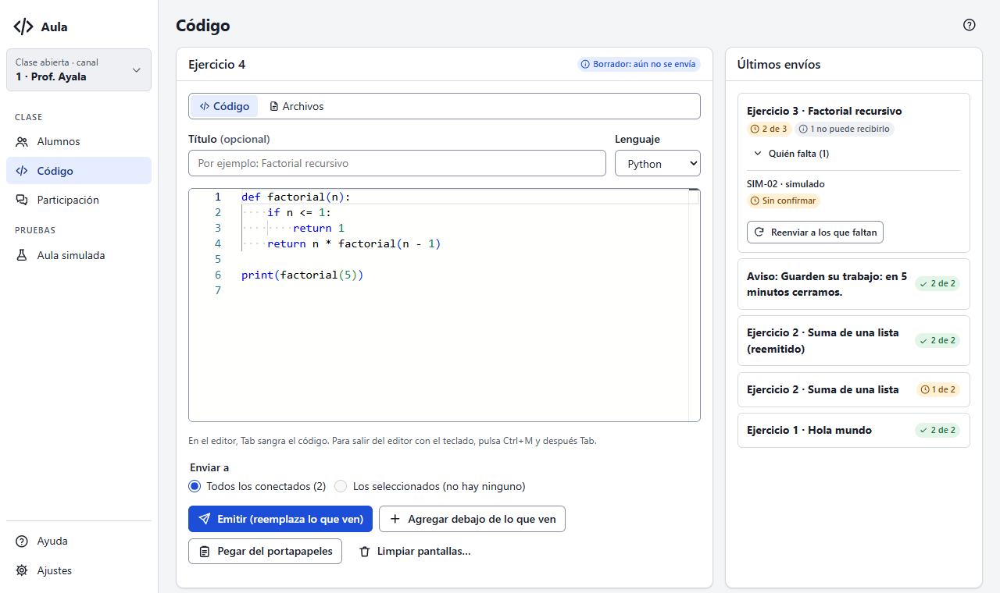
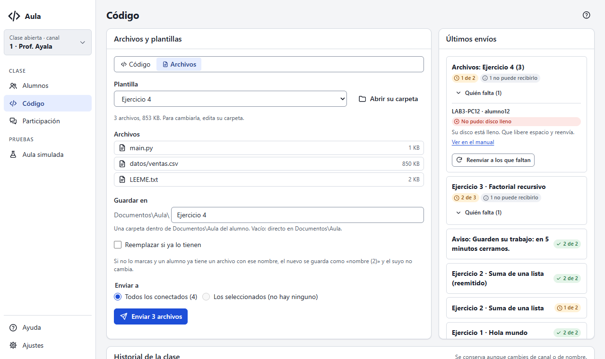

# La pantalla Código

Aquí preparas el código que verán tus alumnos y sigues quién ya lo tiene en pantalla.

## El editor

Escribe o pega tu código. Arriba eliges el **lenguaje** (para los colores) y un **título**
opcional. Cada envío es un ejercicio numerado: Ejercicio 1, 2, 3…

Para traer código de otro programa, cópialo (Ctrl+C) y pulsa **Pegar del portapapeles**. También
funciona con el atajo de teclado desde cualquier programa (lo ves en
[Ajustes](ajustes#acerca-de)).

> **Teclado:** dentro del editor, Tab sangra el código. Para salir del editor con el teclado,
> pulsa Ctrl+M y después Tab.

## Enviar

- **Emitir (reemplaza lo que ven)**: los alumnos ven solo este código.
- **Agregar debajo de lo que ven**: se suma a lo que ya tienen.
- **Limpiar pantallas**: borra el código que ven en Aula (lo que copiaron a su editor no se
  toca). Pide confirmación.

En **Enviar a** eliges a todos los conectados o solo a los que seleccionaste en
[Alumnos](alumnos#seleccionar-alumnos).

Si el código pasa de 256 KiB, divídelo en partes y envíalas con «Agregar debajo de lo que ven».

## Últimos envíos

Cada envío dice cuántos alumnos ya lo tienen en pantalla, por ejemplo «7 de 8». Que lo tengan en
pantalla no quiere decir que lo hayan leído o copiado.

- **Quién falta** muestra a los que no han confirmado y por qué (sin confirmar, desconectado…).
- **Reenviar a los que faltan** lo manda otra vez solo a ellos.

Los alumnos simulados se cuentan aparte, con su propia insignia.

## Historial de la clase

Todo lo que emites queda en el historial, aunque cambies de canal o de nombre. Para cada
ejercicio:

- **Abrir en el editor**: lo carga para corregirlo y emitirlo como uno nuevo.
- **Reemitir**: lo envía otra vez tal cual, con su mismo número. Pide confirmación porque
  reemplaza lo que ven.

## Enviar archivos y plantillas

Para repartir un archivo (un dataset, el esqueleto de un ejercicio, un documento), cambia arriba
de la tarjeta de **Código** a **Archivos**.

1. Pulsa **Elegir archivos…** y marca uno o varios, o elige una **Plantilla**.
2. En **Guardar en** escribe la carpeta donde lo recibirán, dentro de su `Documentos\Aula`; por
   ejemplo, `Ejercicio 4`. Vacío: directo en `Documentos\Aula`.
3. Elige **Enviar a** (todos o tu selección) y pulsa **Enviar**.

Cada alumno ve una tarjeta «Archivo recibido: datos.csv · Guardado en Documentos\Aula\Ejercicio 4»
con un botón para abrir la carpeta. Aula nunca abre ni ejecuta el archivo, y solo escribe dentro
de `Documentos\Aula` de quien tiene la sesión iniciada.

- **Si un alumno ya tiene un archivo con ese nombre**, el nuevo se guarda como `datos (2).csv` y el
  suyo no cambia. Marca **Reemplazar si ya lo tienen** solo cuando quieras pisarlo (por ejemplo,
  para corregir una plantilla); su tarjeta le avisa que se reemplazó.
- **Límites:** hasta 20 archivos por envío, de 16 MB cada uno y 32 MB en total.
- Un nombre que Windows no acepta (con `:` o `\`, que empieza con `..`, que se llama `CON`…) se
  rechaza antes de enviar.

Los envíos de archivos aparecen en **Últimos envíos** como el código: «7 de 8» cuenta a los que ya
guardaron **todos** los archivos. En el **Historial de la clase**, «Archivos enviados» guarda cada
envío con **Reenviar**, que lo manda otra vez a todos tal como está ahora en tu equipo.

## Plantillas de ejercicio

Una plantilla es una carpeta en `Documentos\Aula\plantillas` de tu equipo, con los archivos que
repartes siempre juntos (por ejemplo, `main.py`, `datos.csv` y `LEEME.txt`). Se conserva entre
clases.

- **Guardar como plantilla…** crea una con los archivos que elegiste.
- **Carpeta de plantillas** (o **Abrir su carpeta**, con una elegida) la abre en el Explorador:
  ahí agregas, quitas o cambias archivos, también en subcarpetas.
- Al elegir una plantilla, su nombre se propone como carpeta de destino.

Si una plantilla tiene más de 20 archivos, pasa del tamaño o tiene un nombre que Windows no acepta,
aparece marcada «no se puede enviar» y la consola dice qué corregir.

{{diagrama:19-enviar-archivos}}

## Si un alumno no recibió los archivos

Abre **Quién falta** en el envío. Al lado de cada alumno dice por qué:

| Dice | Qué hacer |
|---|---|
| sin confirmar | Todavía los está recibiendo; espera unos segundos. |
| no respondió · se desconectó | Su equipo no confirmó o se fue a mitad. **Reenviar a los que faltan**. |
| disco lleno · Windows no dejó guardarlo | Que libere espacio o cierre el archivo, y reenvía. |
| no llegó completo · llegó dañado · estaba ocupado | Reenvía. |
| rechazó el nombre · ruta demasiado larga | Usa un nombre o una carpeta más cortos y sin símbolos. |
| no pudo recibir archivos | Nadie tiene la sesión iniciada en ese equipo. |

Un equipo sin la función (otra versión, Linux o macOS) cuenta como «no puede recibirlo»; lo ves en
su ficha, en **Qué puede hacer su equipo › Recibir archivos**.
