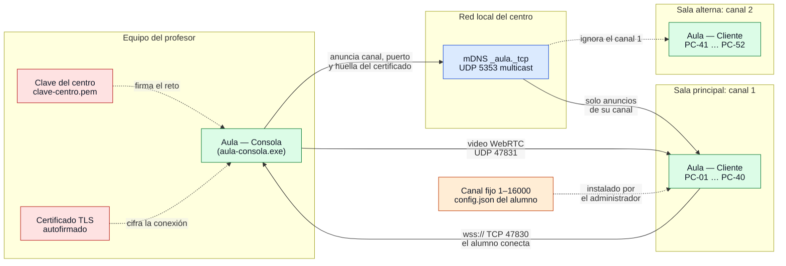

# Contexto del sistema

¿Qué hay en un laboratorio con Aula y hacia dónde va cada conexión?

## Lo que no es obvio

- **Siempre conecta el alumno al profesor.** La consola solo escucha (TCP 47830 por defecto,
  `port` en `docs/configuracion.md`); nunca abre conexiones hacia los equipos de alumno. Por eso
  el firewall que importa es el del equipo del profesor.
- **El canal no es un aula virtual**: es un número fijo de cada computadora de alumno que solo el
  administrador cambia. La consola arranca en su canal predeterminado y el maestro puede
  cambiarlo; si lo cambia al 2, ve a la sala alterna y la principal lo pierde.
- **mDNS solo sirve para encontrar.** Cualquiera en la LAN puede anunciar cualquier canal; la
  confianza la dan el certificado fijado y la firma con la clave del centro (diagrama 04). Una
  sola clave por centro, no por maestro: la tienen todas las consolas, y los alumnos solo su
  parte pública.
- El video de la transmisión de pantalla (diagrama 14) va por un segundo puerto, UDP
  `ws_port + 1`, directo de la consola a cada alumno; su señalización viaja por el WebSocket.
- Si la red bloquea multicast, el alumno puede usar `direct` (`host:puerto`) en su configuración y
  saltarse mDNS.

## Fuentes en el código

- `apps/teacher/main.go`, `apps/teacher/class.go`, `apps/teacher/machine.go`
- `apps/student/main.go`, `apps/student/config.go`
- `internal/discovery/announce.go`, `internal/discovery/browse.go`
- `internal/transport/server.go`, `internal/transport/client.go`
- `internal/security/sitekey.go`, `internal/security/tls.go`
- `internal/broadcast/pion.go`
- `docs/protocol.md` §1 y §10
