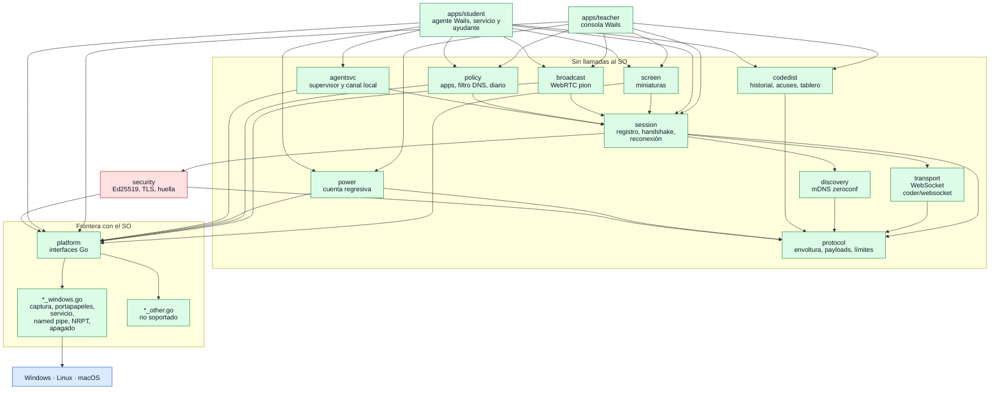

# Componentes y dependencias

¿Qué paquete hace qué, de quién depende y dónde está la frontera con el sistema operativo?

## Lo que no es obvio

- **La regla de oro**: `protocol`, `discovery`, `transport`, `session`, `codedist`, `screen`,
  `broadcast`, `agentsvc`, `policy` y `power` no llaman APIs del SO. Lo que toca pantalla,
  portapapeles, teclado, servicios, DNS o energía pasa por una interfaz de `internal/platform`,
  con una implementación por SO (`*_windows.go`) y un fallback `*_other.go` que devuelve
  `ErrNotSupported`. Por eso esos paquetes se prueban con dobles en los tres SO del CI.
- `discovery` y `transport` sí usan red (sockets UDP y TCP de la biblioteca estándar y sus
  librerías), que es portable; no es "SO" en el sentido de la regla.
- `security` usa `platform` solo para proteger archivos con la ACL correcta
  (`RestrictToOwner`, `RestrictMachineSecret`).
- `agentsvc` no importa `go-winio`: el named pipe entre servicio y ayudante lo abre
  `platform.ListenLocal`; `agentsvc` solo ve un `net.Conn`.
- Las apps solo consumen `internal/*`; no hay dependencias entre `apps/teacher` y
  `apps/student`. Las flechas son los `import` reales (`go list`), simplificadas: se omite
  `protocol` cuando ya llega por otro paquete.

## Fuentes en el código

- `internal/*/doc.go` de cada paquete
- `internal/platform/platform.go` (`ErrNotSupported`) y sus pares `*_windows.go` / `*_other.go`
- `apps/teacher/main.go`, `apps/student/main.go`
- `go.mod`
- CLAUDE.md, sección «Arquitectura»
