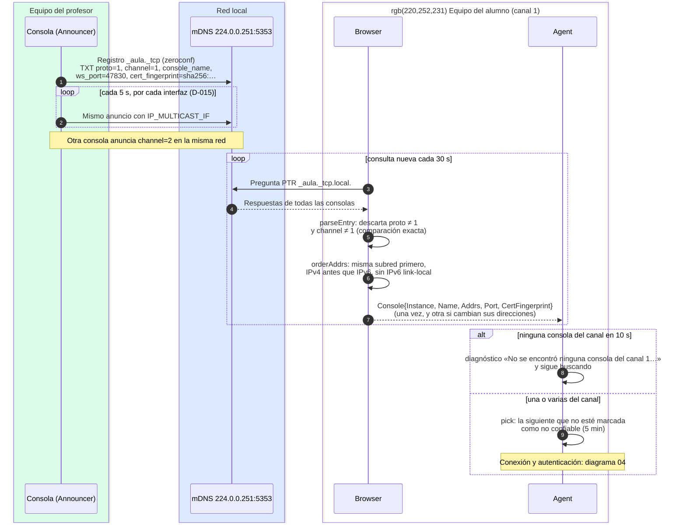

# Descubrimiento de canal (mDNS)

¿Cómo encuentra el alumno la consola de **su** canal, y qué hace con las demás?

## Lo que no es obvio

- **El filtro por canal es local y exacto.** La consola anuncia su canal en los TXT; cada alumno
  descarta los que no coinciden con el suyo. Varias salas conviven en la misma red sin verse.
- **mDNS no es confiable**: cualquiera puede anunciar el canal 1 con cualquier huella. El
  descubrimiento solo produce *candidatos*; la confianza la decide la firma (diagrama 04). Una
  consola que falla la firma queda marcada como no confiable 5 minutos y el agente prueba la
  siguiente.
- **Por qué se reanuncia por interfaz** (D-015): en Windows zeroconf no elige la interfaz de
  salida, y en un equipo con Hyper-V el anuncio salía por el conmutador virtual. La consola
  envía además el anuncio en cada interfaz con `IP_MULTICAST_IF`.
- **Por qué se reinicia la consulta cada 30 s**: zeroconf deja de preguntar tras la primera
  respuesta; sin reiniciar, una consola abierta después nunca se vería.
- Tras 3 fallos seguidos contra la misma consola, el agente vuelve a descubrir (pudo cambiar de
  IP o de puerto). Con `direct` en la configuración no hay mDNS: `StaticSource` entrega una
  dirección fija.
- La red debe ser Privada o de Dominio: en perfil Público las reglas de firewall no cubren mDNS
  (D-012).

## Fuentes en el código

- `internal/discovery/announce.go`, `internal/discovery/multicast.go`
- `internal/discovery/browse.go`, `internal/discovery/console.go`
- `internal/session/agent.go` (`Run`, `pick`, `waitConsole`, `StaticSource`)
- `internal/protocol/channel.go`
- `docs/protocol.md` §1.1 y §1.3
