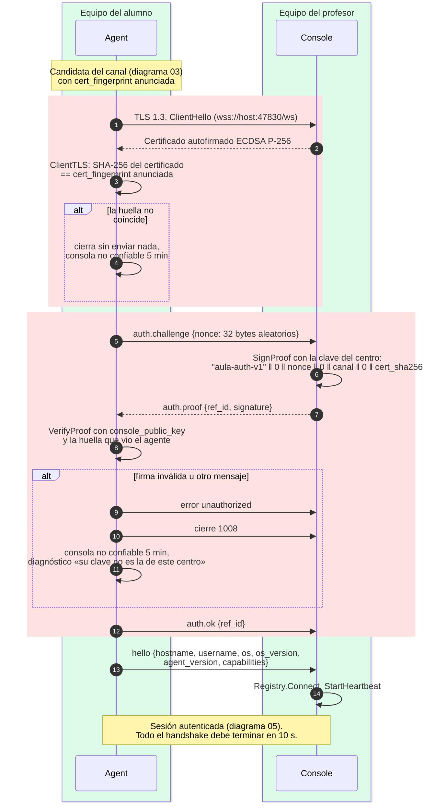

# Autenticación y fijado de certificado

¿Qué comprueba el agente antes de obedecer a una consola, y en qué orden?

## Lo que no es obvio

- **El agente se autentica primero y se presenta después.** `hello` (con equipo y usuario) solo
  sale tras `auth.ok`: una consola sin la clave del centro nunca sabe quién es el alumno.
- **Qué liga cada parte de la firma**: la etiqueta `aula-auth-v1` impide reutilizar una firma de
  otro contexto; el `nonce` nuevo por conexión impide repetir una prueba vieja; el `canal` liga la
  prueba a la sala; y `cert_sha256` es la huella del certificado **que vio el agente**: si un
  intermediario reenvía el reto a la consola legítima, esta firma *su* huella, no la del
  intermediario, y la verificación falla.
- **Conexión directa** (`direct`, sin mDNS): no hay huella anunciada que fijar, así que el agente
  acepta el certificado presentado, pero la firma sigue ligada a esa huella; un intermediario con
  su propio certificado no puede producir una firma válida.
- Antes de `auth.ok` el agente solo acepta `auth.proof` y `error`; la consola solo
  `auth.challenge`, `auth.ok` y `error`. Cualquier otra cosa → `error unauthorized` y cierre
  `1008` (nada llega a `OnMessage`).
- **Lo que no cubre v0**: la consola no autentica al agente (cualquier equipo con el agente puede
  unirse al canal; el profesor ve equipo y usuario), y quien robe la clave del centro puede
  suplantar consolas. Ver `docs/protocol.md` §10.3.
- Nunca se registran el nonce, la firma ni las claves.

## Fuentes en el código

- `internal/session/agent.go` (`session`, `authenticate`)
- `internal/session/console.go` (`handshake`)
- `internal/security/tls.go` (`ClientTLS`, `ServerTLS`, `LoadOrCreateCertificate`)
- `internal/security/auth.go` (`SignProof`, `VerifyProof`), `internal/security/identity.go`
- `internal/security/sitekey.go`
- `docs/protocol.md` §3.2 y §10
