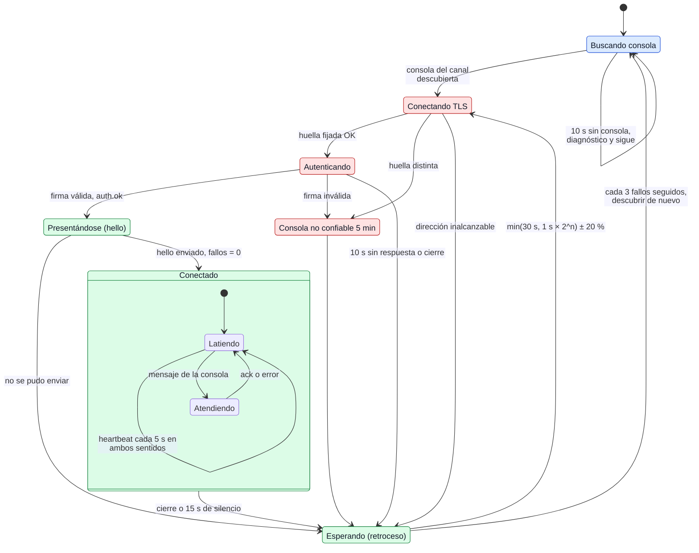

# Ciclo de sesión y heartbeat

¿En qué estados está la conexión de un agente, qué la tumba y cómo se recupera?

## Lo que no es obvio

- **Lado del agente.** El diagrama es la máquina de `session.Agent.Run`. La consola no reconecta:
  solo acepta conexiones y lleva un registro con dos estados por sesión, `conectado` y
  `desconectado`.
- **`n` es el número de fallos consecutivos** y vuelve a 0 solo cuando la sesión se estableció
  (se envió `hello`). Secuencia típica: 1, 2, 4, 8, 16, 30, 30… s, con ±20 % de azar para que
  40 equipos no reconecten en el mismo instante tras reiniciar la consola.
- **Silencio de 15 s** (3 latidos perdidos): cualquier mensaje cuenta como señal de vida, no solo
  `heartbeat`. Lo aplican los dos extremos: `transport` cierra la conexión muda y el registro de
  la consola marca la sesión `desconectado` en su barrido (`Registry.Sweep`).
- **Al reconectar es una sesión nueva**, pero la consola reemplaza la tarjeta vieja del mismo
  equipo en vez de duplicarla, y el agente conserva el código que mostraba. Al cerrarse la
  sesión, el agente detiene miniaturas, transmisión y restricciones; la cuenta regresiva de
  apagado sigue (diagramas 08, 14–16).
- Una consola que falló la autenticación se salta 5 minutos aunque siga anunciándose; si todas
  las conocidas están marcadas, el agente espera con el mismo retroceso.

## Fuentes en el código

- `internal/session/agent.go` (`Run`, `session`, `authenticate`, `untrustedFor`,
  `failuresBeforeRediscover`)
- `internal/session/backoff.go`
- `internal/session/registry.go` (`Connect`, `Touch`, `Sweep`, `Disconnect`)
- `internal/session/console.go`
- `internal/transport/conn.go` (heartbeat y cierre por silencio)
- `docs/protocol.md` §3.4 y §3.5
