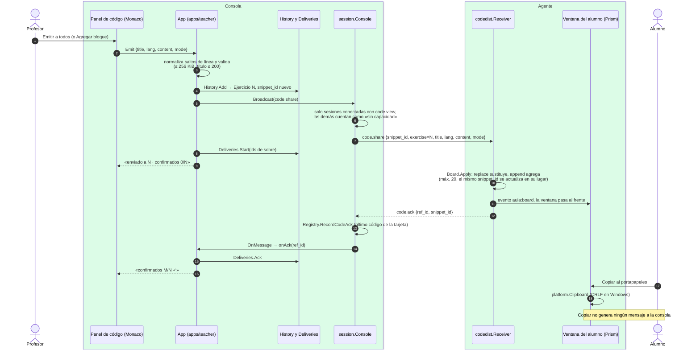

# Emisión y recepción de código

¿Cómo viaja un fragmento de código del editor del profesor a la pantalla del alumno, y qué
significa el acuse?

## Lo que no es obvio

- **El acuse significa «se mostró», no «se leyó» ni «se copió».** Aula no avisa a la consola
  cuando el alumno copia.
- **Reemitir conserva el número y el `snippet_id`**: el alumno ve el mismo ejercicio
  actualizado, no uno duplicado. Reemitir siempre usa `replace`.
- **`code.clear`** sigue el mismo camino (acuse con `snippet_id` vacío) y **`msg.show`** también,
  con `msg.ack`. Los tres se cuentan en `Deliveries` (diagrama 07).
- **Capacidades**: la consola nunca envía `code.share` a un agente que no declaró `code.view` en
  `hello`; lo cuenta como «sin capacidad» y desactiva el botón si nadie la tiene. Si llegara de
  todos modos, el agente respondería `error unsupported_capability`.
- **Nada de esto se guarda en disco**: el historial y los acuses viven en memoria de la consola
  mientras dura la clase, y el tablero del alumno en memoria del agente (diagrama 11). Los logs
  registran tipos e IDs, nunca el código.
- Con el agente como servicio, `Receiver` corre en el servicio y la ventana es la del ayudante;
  el evento y el portapapeles cruzan el canal local (diagrama 13).

## Fuentes en el código

- `apps/teacher/app.go` (`Emit`, `Reemit`, `ClearScreens`, `SendNotice`, `broadcast`, `onAck`)
- `internal/codedist/history.go`, `internal/codedist/deliveries.go`
- `internal/session/console.go` (`Send`, `Broadcast`), `internal/session/registry.go`
- `internal/codedist/receiver.go`, `internal/codedist/board.go`
- `apps/student/app.go` (`onMessage`, `onBoard`, `Copy`), `internal/platform/clipboard.go`
- `docs/protocol.md` §5.1–5.5, `docs/eventos-ui.md`
