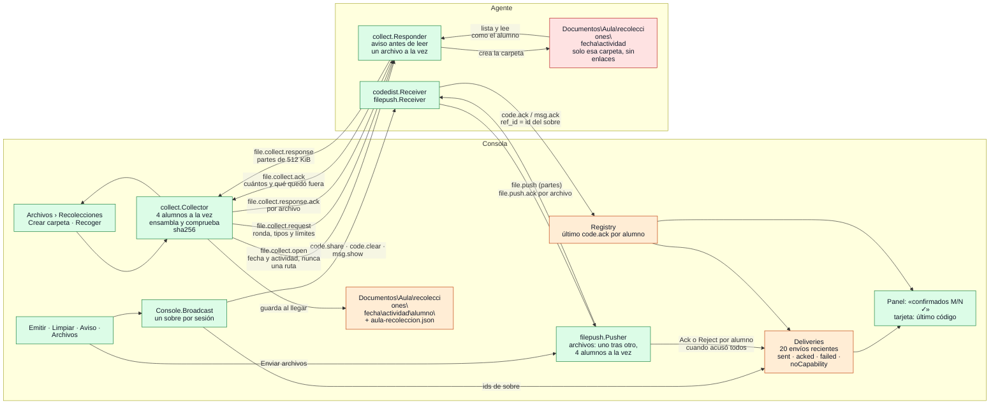

# Acuses y recolección de código/archivos

¿Cómo sabe la consola cuántos alumnos recibieron un envío, y cómo recoge de vuelta el ejercicio
de cada uno sin leer nada fuera de la carpeta acordada?

## Lo que no es obvio

- **Se cuenta por sobre, no por alumno.** Cada `Broadcast` devuelve el `id` del sobre enviado a
  cada sesión; el acuse trae ese `id` en `ref_id`. `Deliveries.Ack` cuenta cada sobre una sola
  vez e ignora referencias desconocidas o repetidas, así que un acuse tardío de un envío viejo no
  infla el conteo de otro.
- **Cuatro tipos de envío** se rastrean igual: `code` (`code.share`), `clear` (`code.clear`),
  `notice` (`msg.show`) y `file` (`file.push`, prompt 10.9). `failed` son sesiones a las que no se pudo escribir;
  `noCapability`, las que no declararon la capacidad.
- **Un envío de archivos se cuenta por alumno, no por sobre.** Cada archivo viaja en partes y
  tiene su propio `file.push.ack`; `filepush.Pusher` espera el acuse de un archivo antes de mandar
  el siguiente (60 s como mucho) y, al terminar con un alumno, cuenta un `Ack` si guardó todos o un
  `Reject` con el motivo (`no_space`, `timeout`, `gone`…), que «Quién falta» explica. El detalle
  está en el diagrama 19.
- Solo se recuerdan los **20 envíos más recientes**, en memoria; al cerrar la consola se pierden
  (diagrama 11).
- **La recolección no pasa por `Deliveries`.** Tiene su propia tabla por alumno en
  Archivos › Recolecciones (`collect.Summary`): carpeta lista, recogido, carpeta vacía o no se
  pudo, con el motivo.
- **La consola nunca manda una ruta.** `file.collect.open` y `.request` llevan la fecha y el
  nombre de la actividad; el agente arma `recolecciones/<fecha>/<actividad>` y la comprueba con las
  reglas de ruta de §5.20. En modo servicio lee el ayudante, con el token del alumno, y vuelve a
  comprobar que la ruta es una carpeta de actividad (`collect.CheckWorkPath`).
- **Al revés que `file.push`:** aquí el agente es quien trocea y espera el acuse de cada archivo
  antes del siguiente; la consola pide de 4 en 4 alumnos para no saturar la red. Las partes no
  llegan antes de que la consola prepare dónde escribirlas: el `ack` `sending` las precede.
- **El alumno sabe antes y después** (`docs/privacidad.md` reglas 61–62): la tarjeta al abrir, un
  aviso antes de leer y otro con lo recogido; nada de eso le quita el foco.
- **Cada ronda reemplaza la copia del profesor** de ese alumno en un solo cambio (carpeta temporal
  y renombrado): una ronda a medias no deja archivos sueltos. El original del alumno no cambia.
- `code.collect` (entregar desde el overlay) sigue reservado (`docs/protocol.md` §6).
- Hay otros acuses con su propio rastreo, fuera de `Deliveries`: `app.block.ack` y
  `web.filter.ack` (diagrama 15) y `power.ack` (diagrama 16).

## Fuentes en el código

- `internal/codedist/deliveries.go`
- `internal/filepush/pusher.go`, `apps/teacher/files.go`
- `internal/collect/collector.go`, `internal/collect/responder.go`, `internal/collect/store.go`,
  `apps/teacher/collect.go`, `apps/student/collect.go`
- `internal/platform/workfolder_read_windows.go`, `internal/agentsvc/proxy_collect.go`
- `internal/session/console.go` (`Broadcast`, `route`), `internal/session/registry.go`
  (`RecordCodeAck`)
- `apps/teacher/app.go` (`broadcast`, `onAck`), `apps/teacher/class.go`
- `internal/codedist/receiver.go`
- `docs/protocol.md` §5.2, §5.5, §5.20 y §5.21
