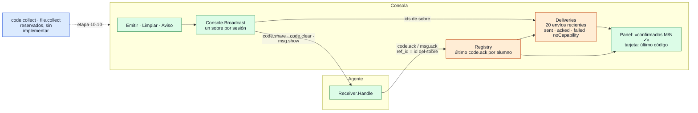

# Acuses y recolección de código/archivos

¿Cómo sabe la consola cuántos alumnos recibieron un envío, y qué se recoge hoy de vuelta?

## Lo que no es obvio

- **Se cuenta por sobre, no por alumno.** Cada `Broadcast` devuelve el `id` del sobre enviado a
  cada sesión; el acuse trae ese `id` en `ref_id`. `Deliveries.Ack` cuenta cada sobre una sola
  vez e ignora referencias desconocidas o repetidas, así que un acuse tardío de un envío viejo no
  infla el conteo de otro.
- **Tres tipos de envío** se rastrean igual: `code` (`code.share`), `clear` (`code.clear`) y
  `notice` (`msg.show`). `failed` son sesiones a las que no se pudo escribir;
  `noCapability`, las que no declararon la capacidad.
- Solo se recuerdan los **20 envíos más recientes**, en memoria; al cerrar la consola se pierden
  (diagrama 11).
- **La recolección no existe todavía.** `code.collect` y `file.collect` están reservados en el
  protocolo (§6) y sus capacidades no las declara ningún agente; se diseñan en la etapa 10.10.
  Este diagrama se amplía cuando lleguen.
- Hay otros acuses con su propio rastreo, fuera de `Deliveries`: `app.block.ack` y
  `web.filter.ack` (diagrama 15) y `power.ack` (diagrama 16).

## Fuentes en el código

- `internal/codedist/deliveries.go`
- `internal/session/console.go` (`Broadcast`, `route`), `internal/session/registry.go`
  (`RecordCodeAck`)
- `apps/teacher/app.go` (`broadcast`, `onAck`), `apps/teacher/class.go`
- `internal/codedist/receiver.go`
- `docs/protocol.md` §5.2, §5.5 y §6
