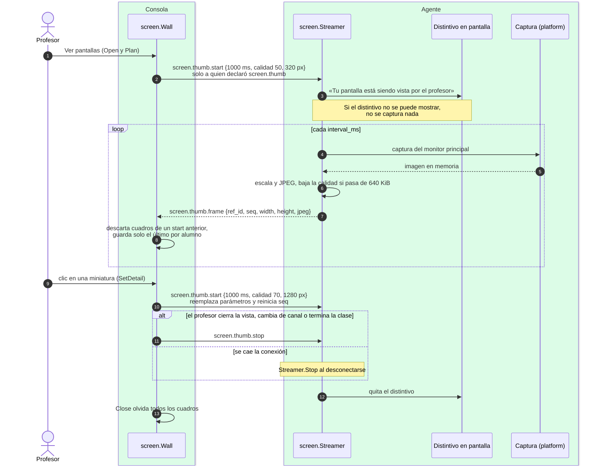

# Monitoreo: miniaturas y pantalla

¿Qué ocurre al abrir «Ver pantallas», y qué garantiza que el alumno lo sepa?

## Lo que no es obvio

- **Solo se transmite mientras el profesor mira**: la consola envía `start` al abrir la vista y
  `stop` al cerrarla; no hay captura en segundo plano.
- **El distintivo va antes del primer cuadro**, y si no se puede mostrar no hay captura. Con el
  agente como servicio, la captura solo existe en el ayudante, que es quien muestra el distintivo
  (diagrama 13).
- **Sin disco en ningún extremo**: las imágenes solo viven en memoria; la consola muestra la
  última de cada equipo y la olvida al cerrar la vista. Los logs registran `seq` y tamaños, nunca
  la imagen.
- Si la captura falla (sesión bloqueada, por ejemplo), el agente responde **una sola vez**
  `error internal` y sigue intentando; el distintivo sigue visible.
- Hoy solo Windows declara `screen.thumb`; Linux y macOS devuelven «no soportado».
- **Pantalla en blanco (`screen.freeze`) no está implementada**: está documentada como pendiente
  (`docs/protocol.md` §5.9–5.11, D-013) y ningún agente declara su capacidad, por eso no aparece
  aquí.

## Fuentes en el código

- `internal/screen/wall.go`, `internal/screen/streamer.go`
- `internal/platform/screen.go`, `internal/platform/screen_windows.go`,
  `internal/platform/screen_other.go`
- `apps/teacher/app.go` (`OpenScreens`, `CloseScreens`, `ViewScreen`, `onFrame`)
- `apps/student/app.go` (`enableScreen`, `onViewed`)
- `docs/protocol.md` §5.6–5.8, `docs/privacidad.md` reglas 6–8
