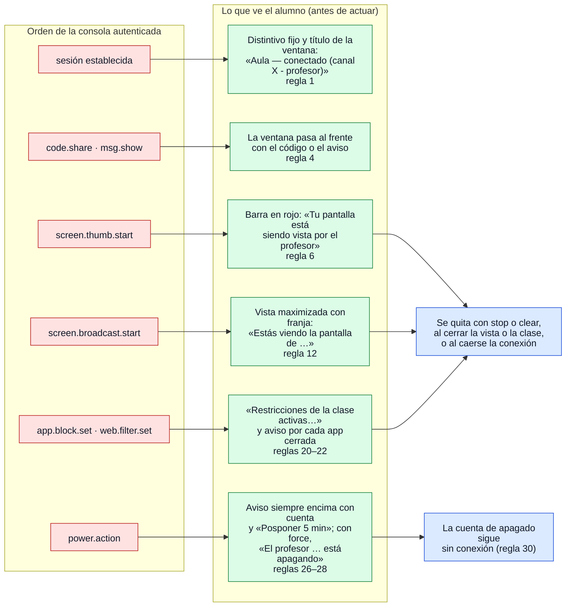

# Transparencia: avisos e indicadores al alumno

¿Qué aviso aparece en el equipo del alumno por cada acción del profesor, y cuándo desaparece?

## Lo que no es obvio

- **El aviso va antes que la acción**, y el código lo hace cumplir: `Streamer` no captura si no
  pudo mostrar el distintivo; `Viewer` muestra la vista antes de procesar la oferta WebRTC;
  `policy.Manager` avisa antes de aplicar; `Countdown` llama a `OnChange` con el aviso antes de
  responder a la consola.
- **Toda orden viene de una consola autenticada** (rojo): nada de esto se procesa antes de
  `auth.ok` (diagrama 04).
- **Al perderse la conexión el alumno no queda vigilado ni restringido**: miniaturas,
  transmisión y restricciones terminan solas. La única excepción es la cuenta regresiva de
  apagado, porque la orden ya llegó de la consola legítima; el alumno aún puede posponerla.
- **Con el agente como servicio** todos estos avisos los muestra el ayudante en la sesión del
  alumno; el servicio no tiene ventana ni puede capturar (reglas 17–18, diagrama 13).
- Lo que el profesor recibe a cambio (acuses) dice «se mostró», nunca «se leyó» ni qué sitios
  intentó abrir el alumno (regla 23).
- La pantalla en blanco (reglas 9–10) está pendiente y no aparece.
- Los textos exactos y las reglas completas están en `docs/privacidad.md`; si cambian, se
  revisa este diagrama.

## Fuentes en el código

- `docs/privacidad.md` reglas 1–31
- `apps/student/app.go` (`setStatus`, `onViewed`, `onBoard`, `onNotice`, `setRestrictions`,
  `appClosed`), `apps/student/events.go`, `apps/student/power.go`, `apps/student/broadcast.go`
- `internal/screen/streamer.go`, `internal/broadcast/viewer.go`, `internal/policy/manager.go`,
  `internal/power/countdown.go`
