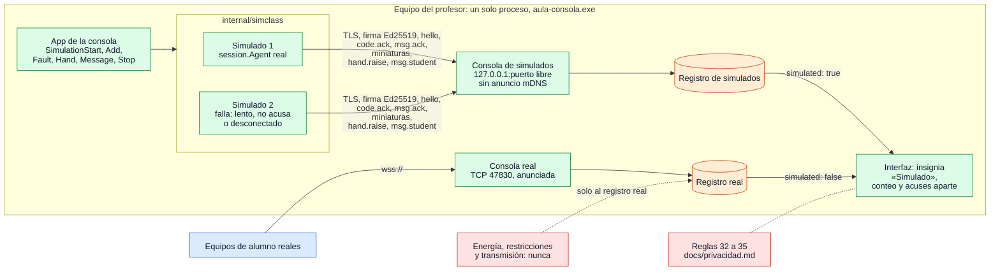

# Aula simulada y simulación de fallas

¿De dónde salen los alumnos simulados, por dónde se conectan y qué los separa de los reales?

## Lo que no es obvio

- **Son agentes de verdad.** Cada simulado es un `session.Agent` como el de un equipo de alumno:
  verifica el certificado y la firma con la clave de la consola, se presenta con `hello`, late
  cada 5 s y responde con `codedist.Receiver` y `screen.Streamer`. Si algo funciona con ellos,
  funciona por el mismo camino con un equipo real.
- **Se distinguen por dónde llegaron, no por cómo se llaman.** Llegan a un segundo servidor de la
  consola, en `127.0.0.1` y en un puerto libre, con su propio registro. Un equipo real llamado
  «Simulado 1» llega al registro real y sigue siendo real.
- **No se anuncian.** El puerto de los simulados no viaja por mDNS y solo escucha en el propio
  equipo: ningún alumno del laboratorio puede llegar a él. No hay mensajes nuevos en el
  protocolo.
- **Solo reciben lo que no tiene efecto en un equipo:** código, avisos, miniaturas y capturas.
  Solo pueden declarar `code.view`, `msg.show`, `screen.thumb`, `screen.snapshot`, `hand` y
  `msg.student`, y la consola calcula energía, restricciones y transmisión solo sobre el registro
  real.
- **Levantan la mano y escriben cuando el profesor se lo pide** («Levantar la mano» y «Escribir»
  en su fila): usan el mismo `participation.Desk` que un alumno real, y lo que mandan llega a
  Participación marcado como simulado y se borra al cerrar el aula simulada (diagrama 18).
- **Las fallas usan estados que la consola ya conoce:**
  - «lento» contesta tarde (de 0,5 a 10 s, menos que los 15 s de silencio que tumban una sesión);
  - «no acusa» muestra el código pero no manda `code.ack`, y el envío queda incompleto;
  - «desconectado» cierra la sesión hasta volver a «ninguna».
- **Nada persiste.** El aula simulada se cierra con «Cerrar el aula simulada», al cambiar de canal
  o de nombre y al cerrar la clase. La pantalla de un simulado se dibuja en memoria, con la
  franja «Tu pantalla está siendo vista por el profesor» mientras se ve.
- En la consola, la vista **Aula simulada** crea y quita alumnos (SO y capacidades), dispara las
  fallas y muestra qué tiene cada uno en pantalla. En **Alumnos** aparecen al final, en su propio
  grupo. El comprobador de conexión del prompt 18 (Fase 6.3) sigue pendiente.

## Fuentes en el código

- `internal/simclass/class.go`, `internal/simclass/screen.go`
- `apps/teacher/class.go` (`simulationHost`, `StartSimulation`, `simulatedMessages`)
- `apps/teacher/simulation.go`, `apps/teacher/restrictions.go` (`studentsIn`, `simSessionsOf`)
- `apps/teacher/frontend/dist/main.js` (vista Aula simulada)
- `internal/codedist/deliveries.go` (`AddSimulated`)
- `apps/teacher/simulation_test.go`, `internal/simclass/class_test.go`
- `docs/privacidad.md` reglas 32–35
