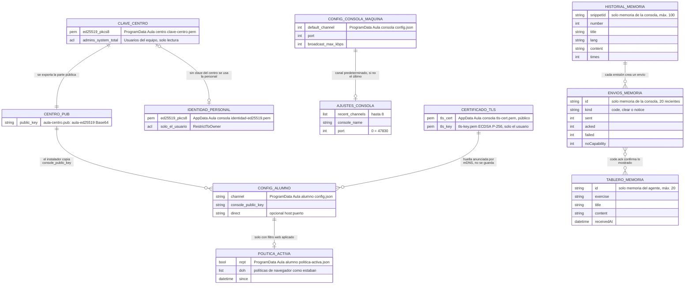

# Modelo de datos local

¿Qué escribe Aula en disco en el equipo del profesor y en el del alumno, y qué se pierde al
cerrar?

## Lo que no es obvio

- **Lo único secreto en disco es la clave privada** (la del centro o la personal) y la del
  certificado TLS. Se escriben con un archivo temporal ya protegido que luego se renombra, para
  que en ningún instante otro usuario pueda leerlas. Nunca se registran ni viajan por la red, y
  nunca se instalan en equipos de alumno.
- **Riesgo aceptado**: los usuarios del equipo del profesor pueden *leer* la clave del centro,
  para que cualquier maestro dé clase ahí (`docs/protocol.md` §10.1).
- **El historial de código, los acuses y el tablero del alumno no se guardan**: viven en memoria
  y se pierden al cerrar la app. Tampoco se escriben capturas de pantalla, video ni cuadros
  (`docs/privacidad.md` reglas 7 y 16).
- **El certificado y la clave son independientes**: regenerar el certificado no obliga a
  reconfigurar alumnos (la huella viaja en el anuncio); cambiar la clave del centro sí.
- **Precedencia de la configuración del alumno**: argumentos `-canal`/`-clave`/`-directo` >
  `ProgramData\Aula\alumno\config.json` (instalador, protegido) >
  `AppData\Aula\alumno\config.json` (usuario). El agente la relee cada 3 s.
- **`politica-activa.json` existe solo mientras hay filtro web** y se escribe *antes* de tocar el
  equipo, para poder deshacerlo tras un corte de luz (diagrama 15). El bloqueo de apps no deja
  nada en disco.
- **Logs** (no dibujados): `LOCALAPPDATA\Aula\<app>\aula-*.log` con rotación de 1 MiB, y
  `ProgramData\Aula\alumno\logs` con el agente como servicio. Nunca contienen código, textos,
  imágenes, nonces, firmas ni claves.
- `erDiagram` no admite las clases de color en todas las versiones de Mermaid, por eso este
  diagrama va sin colores.

## Fuentes en el código

- `internal/security/sitekey.go`, `internal/security/identity.go`, `internal/security/files.go`,
  `internal/security/tls.go`
- `internal/platform/paths.go`, `internal/platform/machinesecret.go`,
  `internal/platform/fileperm.go`, `internal/platform/logfile.go`
- `apps/teacher/settings.go`, `apps/teacher/machine.go`, `apps/teacher/cli.go`
- `apps/student/config.go`, `internal/session/agentconfig.go`
- `internal/policy/journal.go`, `internal/platform/policy.go` (`SavedSetting`)
- `internal/codedist/history.go`, `internal/codedist/deliveries.go`, `internal/codedist/board.go`
- `docs/configuracion.md`
