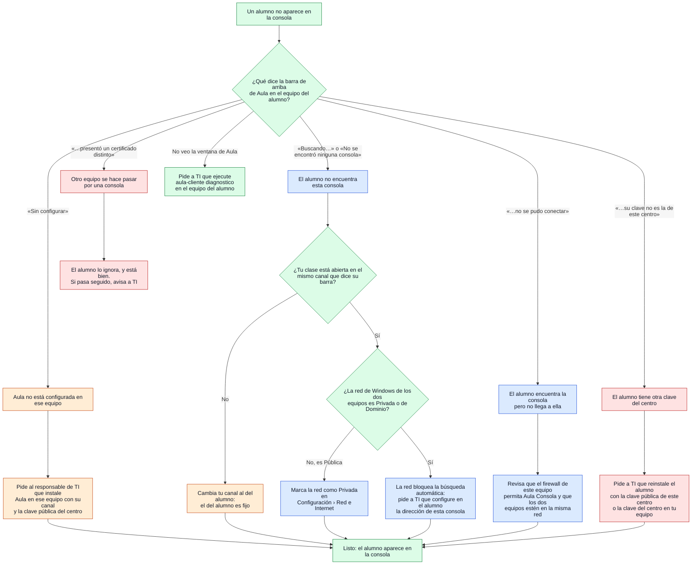

# Diagnóstico: «Mi alumno no conecta»

¿Qué reviso, y en qué orden, cuando un equipo no aparece en la consola?

## Lo que no es obvio

- **Las preguntas salen de mensajes reales**: cada rama corresponde a un texto que el agente
  muestra bajo su barra (`Agent.OnDiagnostic`). Si un mensaje cambia en el código, cambia este
  diagrama; **la consola genera de aquí el asistente «¿Falta un alumno?»** (`internal/manual.ParseTree`):
  los nodos `{…}` son preguntas y las etiquetas de sus flechas, las respuestas. Por eso las
  etiquetas están escritas para el profesor.
- **El canal del alumno no se toca en clase**: es fijo por computadora. Si no coincide, se cambia
  el de la consola; reubicar un equipo de sala es reinstalar con `/CANAL=N`.
- **La red Pública es la causa más común** (prueba real del 29/10/2026, D-012): las reglas de
  firewall de los instaladores cubren Privada y Dominio, salvo que se marque «Permitir también
  en redes Públicas».
- **Certificado distinto o clave ajena no se «arreglan» en el alumno**: el agente hace bien en
  ignorar esa consola. Lo primero es comprobar si es la consola correcta.
- **Un equipo de profesor con Hyper-V** ya no es causa (D-015: anuncio por cada interfaz), pero
  con una consola anterior a la 0.3.0-rc.2 sí lo era.
- `aula-cliente diagnostico` hace lo mismo que el agente durante unos 20 s y lo imprime, para
  distinguir un problema de red de uno de clave o canal. Los logs están en
  `LOCALAPPDATA\Aula\alumno\aula-cliente.log`.
- **Antes de preguntar, la consola puede comprobarse sola**: «Comprobar la conexión», arriba de
  este asistente (`internal/connectcheck`), recorre desde el equipo del profesor el anuncio, el
  puerto, la conexión segura con la clave del centro y la red y el firewall. Usa las mismas causas
  que el agente (`session.Cause`; una prueba lo compara con un agente real), pero no ve el equipo
  del alumno: su canal, su clave y su firewall siguen siendo estas preguntas.

## Fuentes en el código

- `internal/session/agent.go` (`diagnose` y sus mensajes en `Run` y `connect`),
  `internal/session/cause.go` (`Cause`)
- `internal/connectcheck` (el comprobador de la consola), `apps/teacher/connectcheck.go`
- `apps/student/diagnose.go` (`runDiagnose`)
- `apps/student/app.go` (`onDiagnostic`, `setStatus`), `apps/student/config.go`
- `internal/discovery/multicast.go` (D-015)
- `docs/uso-hito1.md`, `docs/prueba-vms.md` §10, `docs/decisiones.md` D-012 y D-015
- `internal/manual/tree.go` (`ParseTree`: este diagrama → asistente de la consola),
  `apps/teacher/frontend/dist/main.js` (`pintarArbol`)
