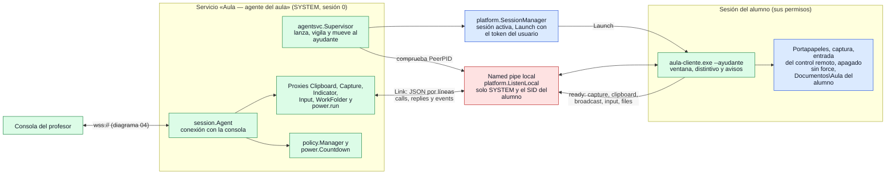

# El agente como servicio de Windows

¿Qué corre como SYSTEM, qué corre en la sesión del alumno y cómo se hablan?

## Lo que no es obvio

- **El servicio no ve la pantalla.** Corre en la sesión 0, sin ventana: captura, portapapeles,
  distintivo y avisos solo existen en el ayudante, que es un `aula-cliente.exe` con los permisos
  normales del alumno. El servicio los usa a través del canal local (`agentsvc` Clipboard,
  Capture, Indicator).
- **Las capacidades siguen al ayudante.** El `hello` declara solo lo que el ayudante dijo poder
  hacer en su evento `ready`. Sin ayudante (nadie inició sesión, o acaba de cerrarla) el agente
  se reconecta declarando solo `power`; cuando alguien entra, se reconecta con un `hello` nuevo
  con su usuario.
- **Solo el ayudante que lanzó el servicio puede hablarle**: el pipe admite solo a SYSTEM y al
  SID del usuario de la sesión, y el supervisor comprueba que el PID del cliente es el del
  proceso que lanzó (`PeerPID`).
- **El canal local no es el protocolo de la consola**: es JSON por líneas que nunca sale del
  equipo (límite de 24 MiB por línea, por una captura nativa o un archivo de `file.push`).
- **Si el alumno cierra el ayudante**, el supervisor lo vuelve a abrir con retroceso; si cambia
  el usuario, lo mueve; al cerrar sesión lo detiene y las restricciones se quitan.
- **El control remoto inyecta desde el ayudante** (`input.inject`, `input.local`): `SendInput` solo
  llega al escritorio de la sesión que lo llama. El ayudante no está elevado, así que no controla
  ventanas de administrador (UIPI); recuerda lo que quedó presionado y lo suelta si el servicio
  desaparece (diagrama 17).
- **Los archivos del profesor los escribe el ayudante** (`file.write`, `folder.open`): el servicio
  arma y comprueba el archivo (`filepush.Receiver`) y el ayudante lo guarda en `Documentos\Aula`
  del alumno con su token, así que el archivo es del alumno y nunca de SYSTEM. El ayudante vuelve
  a comprobar la ruta y la carpeta de trabajo no sigue enlaces (diagrama 19, `docs/privacidad.md`
  regla 55). Un archivo de 16 MiB viaja en una sola línea del canal (≈ 21 MiB en Base64).
- **Apagar sin `force` con alguien en sesión lo hace el ayudante** (`power.run`): desde SYSTEM,
  Windows lo rechaza con `ERROR_SHUTDOWN_USERS_LOGGED_ON` (diagrama 16).
- Solo Windows; en los demás SO `NewSessionManager` y `ListenLocal` devuelven «no soportado».

## Fuentes en el código

- `internal/agentsvc/supervisor.go`, `internal/agentsvc/link.go`, `internal/agentsvc/proxy.go`
- `internal/platform/service.go`, `internal/platform/service_windows.go`,
  `internal/platform/session_windows.go`, `internal/platform/service_other.go`
- `apps/student/service.go`, `apps/student/helper.go`
- `internal/platform/workfolder_windows.go`, `internal/filepush/receiver.go`
- `docs/privacidad.md` reglas 17–19, `docs/decisiones.md` D-016, 55
