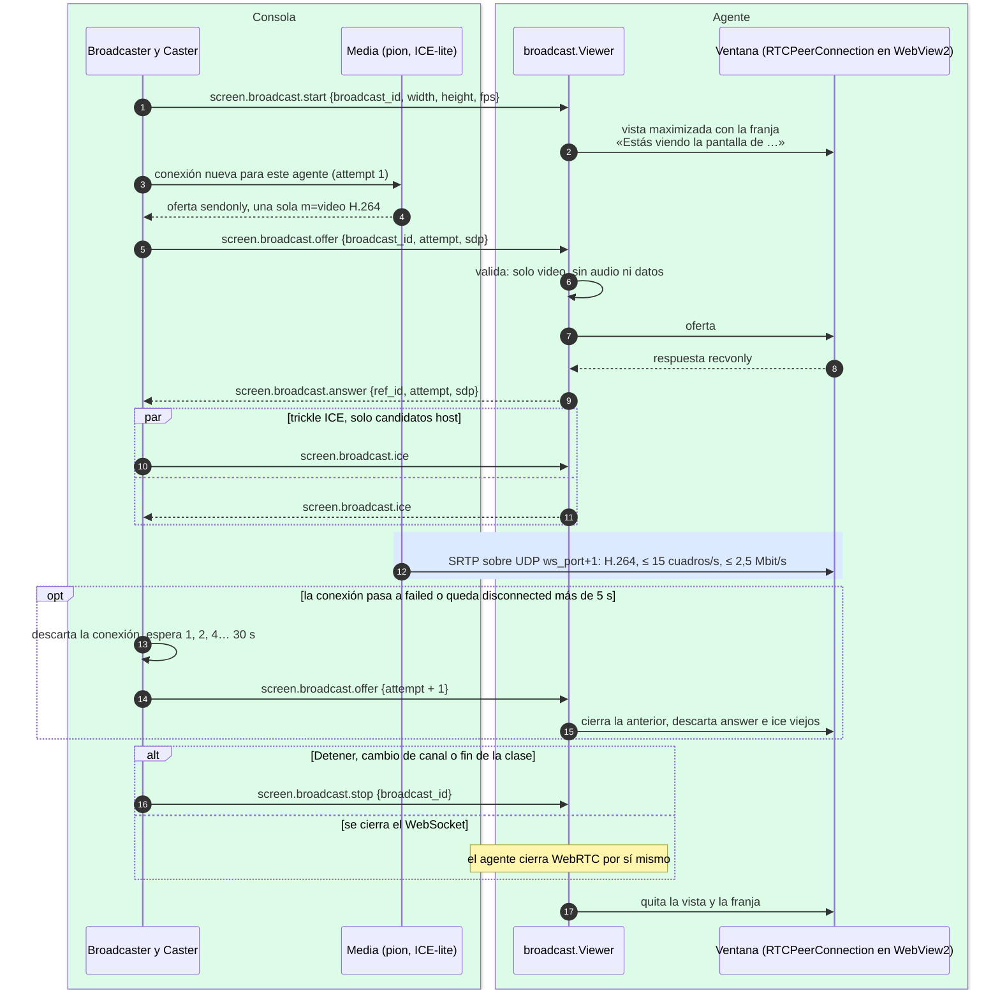

# Transmisión de la pantalla del profesor

¿Cómo se negocia el video WebRTC por la sesión autenticada y cómo se recupera un alumno que
pierde la imagen?

## Lo que no es obvio

- **El WebSocket solo lleva la señalización**; el video va directo de la consola a cada alumno por
  WebRTC, dentro de la LAN. La consola codifica una sola vez y comparte la misma pista H.264 con
  todas las conexiones.
- **Sin servidores externos**: no hay STUN ni TURN. La consola es ICE-lite y escucha en un único
  puerto UDP, `ws_port + 1` (47831), que la regla de firewall por programa ya cubre.
- **Recibir no expone al alumno**: el agente rechaza ofertas con audio, canal de datos o más de un
  video, y nunca envía medios propios. Como el SDP (con la huella DTLS) viaja por la sesión
  autenticada, solo acepta video de la consola legítima.
- **La vista va antes que la oferta** (regla 12): si no se puede mostrar, el agente responde
  `error internal` y no procesa la oferta.
- **El reintento no tumba la sesión**: cada intento lleva un `attempt` mayor y el agente descarta
  lo de intentos viejos. Si el agente se reconecta mientras la transmisión sigue, la consola le
  reenvía `start` y `offer`.
- Una transmisión a la vez por consola; no se graba en ningún extremo. Solo Windows declara
  `screen.broadcast`, y solo si el WebView2 tiene `RTCPeerConnection` y H.264.

## Fuentes en el código

- `internal/broadcast/broadcaster.go`, `internal/broadcast/caster.go`,
  `internal/broadcast/pion.go`, `internal/broadcast/sdp.go`, `internal/broadcast/source.go`
- `internal/broadcast/viewer.go`
- `internal/platform/broadcast.go`, `internal/platform/h264_windows.go`
- `apps/teacher/broadcast.go`, `apps/student/broadcast.go`
- `docs/protocol.md` §5.12, `docs/privacidad.md` reglas 12–16, `docs/decisiones.md` D-014
