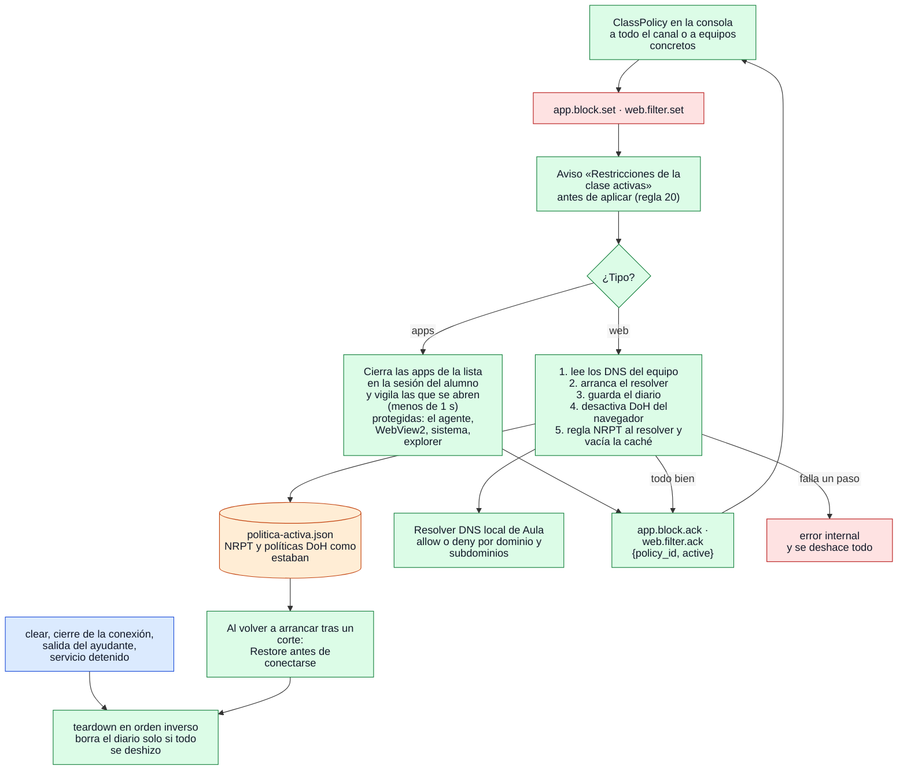

# Restricciones de la clase: apps y filtro web

¿Qué hace el agente al recibir una política, y qué garantiza que el equipo quede como estaba?

## Lo que no es obvio

- **Una política por tipo, de la clase**: un `set` nuevo reemplaza al anterior. La consola lleva
  qué tiene cada alumno y **la reenvía al reconectar**; el agente nunca la conserva entre
  sesiones.
- **El diario se escribe antes de tocar el navegador y el DNS**, así que un corte de luz a mitad
  de clase no deja el equipo filtrado: al arrancar, el agente quita la regla NRPT marcada como de
  Aula y restaura las políticas guardadas antes de conectarse. El bloqueo de apps no cambia nada
  persistente y no necesita diario.
- **El filtro es por nombre** (DNS): no mira rutas ni contenido, no descifra HTTPS y no registra
  qué sitios se consultaron (regla 23). Bloquea siempre los servidores DoH conocidos, que lo
  saltarían.
- **Lo que no se puede garantizar** se le dice al profesor: un administrador local puede detener
  el agente, renombrar un ejecutable evita el bloqueo por nombre y entrar por IP evita el filtro
  (regla 25).
- Solo Windows y solo con el agente como servicio y su ayudante (diagrama 13): sin ellos el
  agente no declara `app.block` ni `web.filter`.

## Fuentes en el código

- `internal/policy/manager.go` (`Handle`, `applyWeb`, `teardown`, `Clear`, `Restore`)
- `internal/policy/apps.go`, `internal/policy/web.go`, `internal/policy/resolver.go`,
  `internal/policy/journal.go`, `internal/policy/class.go`
- `internal/platform/policy.go`, `internal/platform/policy_windows.go`
- `apps/teacher/restrictions.go`, `apps/student/service.go` (`newPolicyManager`, `policyJournal`)
- `docs/protocol.md` §5.13–5.14, `docs/privacidad.md` reglas 20–25, `docs/decisiones.md` D-017
