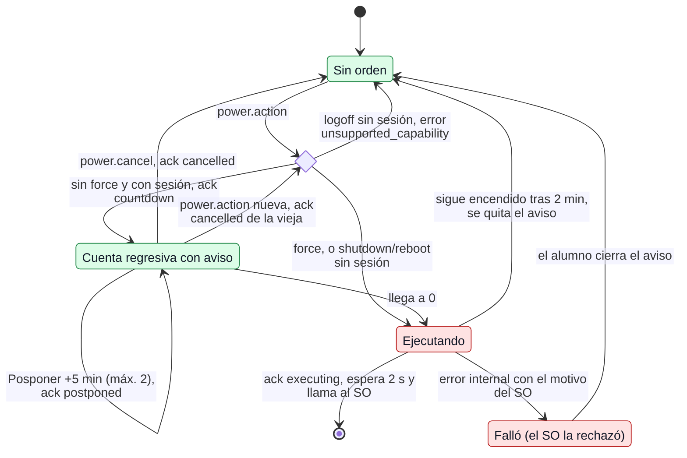

# Energía: apagar, reiniciar y cerrar sesión

¿Por qué estados pasa una orden `power.action` en el agente, y qué puede hacer el alumno?

## Lo que no es obvio

- **Una orden a la vez**: una `power.action` nueva reemplaza a la vigente; el agente envía
  `cancelled` de la vieja (con su `ref_id`) y empieza la nueva. `power.cancel` de otra orden, o
  sin orden vigente, se ignora.
- **La cuenta no depende de la red** (regla 30): si se cae la conexión, el aviso sigue, se puede
  posponer y al llegar a 0 se ejecuta. Los `ack` que no salen solo quedan en el log. Tampoco se
  reenvía al reconectar: es una orden puntual.
- **`executing` sale antes de llamar al SO** y el agente espera hasta 2 s para que el acuse
  llegue antes de que se corte la conexión. Todo se registra (acción, `force`, aplazamientos)
  antes de llamar al SO.
- **Sin `force`, Windows deja que las apps pidan guardar** y el alumno puede cancelar en la
  pantalla de Windows; por eso, si el equipo sigue encendido 2 minutos después, el aviso se quita.
- **Quién llama al SO**: sin `force` y con sesión iniciada, el propio agente de la sesión (en modo
  servicio, el ayudante, diagrama 13), porque desde SYSTEM Windows rechaza el apagado con
  usuarios conectados. Con `force`, o sin sesión, el servicio.
- **Sin sesión iniciada** no hay a quién avisar ni trabajo que perder: `shutdown` y `reboot` se
  ejecutan de inmediato y `logoff` no tiene sentido.
- Solo Windows declara `power`.

## Fuentes en el código

- `internal/power/countdown.go` (`Handle`, `start`, `cancel`, `Postpone`, `execute`, `staleAfter`,
  `DefaultFlushWait`)
- `internal/power/tracker.go` (lado de la consola)
- `internal/platform/power.go`, `internal/platform/power_windows.go`
- `apps/student/power.go`, `apps/teacher/power.go`
- `docs/protocol.md` §5.15, `docs/privacidad.md` reglas 26–31, `docs/decisiones.md` D-018
