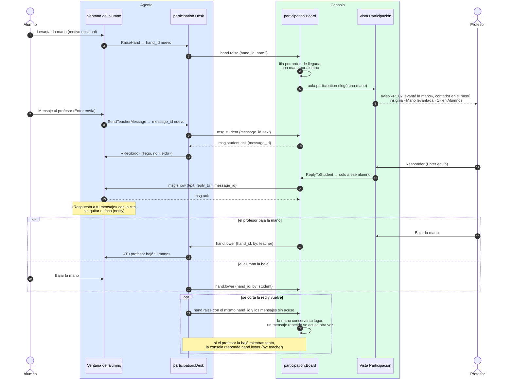

# Manos y mensajes del alumno

¿Qué pasa desde que el alumno pulsa «Levantar la mano» o escribe un mensaje hasta que el profesor
le responde o baja su mano?

## Lo que no es obvio

- **Lo inicia siempre el alumno, y no toca su equipo**: no hay banda ni aviso de transparencia, y
  nada trae su ventana al frente. Las capacidades `hand` y `msg.student` las declara cualquier
  agente con ventana, en cualquier sistema; también los alumnos simulados.
- **El acuse dice «llegó a la consola»**, no que el profesor lo leyó, igual que `msg.ack`.
- **La respuesta reutiliza `msg.show`** con el campo opcional `reply_to` (diagrama 06): un agente
  anterior la muestra como un aviso normal.
- **Ritmo**: el agente deja un mensaje cada 3 s y como mucho 5 sin acuse; la consola, por si
  acaso, admite ráfagas de 5 y descarta lo que pase con `error invalid_message`. Guarda 20
  mensajes por alumno.
- **Nada se guarda en disco ni en los registros**: la fila y la bandeja viven en la memoria de la
  consola hasta cerrar la clase; los logs llevan `hand_id`, `message_id` y longitudes, nunca el
  texto (`docs/privacidad.md` reglas 50–52).
- Con el agente como servicio, la ventana es la del ayudante: sus botones llegan al servicio por
  el canal local (`CallBinding`, diagrama 13), que es quien tiene la conexión con la consola.

## Fuentes en el código

- `internal/participation/board.go` (consola), `internal/participation/desk.go` (agente)
- `apps/teacher/participation.go` (`onClassroomMessage`, `LowerHand`, `ReplyToStudent`)
- `apps/student/participation.go` (`RaiseHand`, `LowerHand`, `SendTeacherMessage`, `onConnect`)
- `internal/session/console.go` (capacidad de los mensajes que inicia el agente),
  `internal/session/agent.go` (`OnConnect`)
- `internal/simclass/participation.go` (alumnos simulados)
- `docs/protocol.md` §5.18, `docs/eventos-ui.md`
