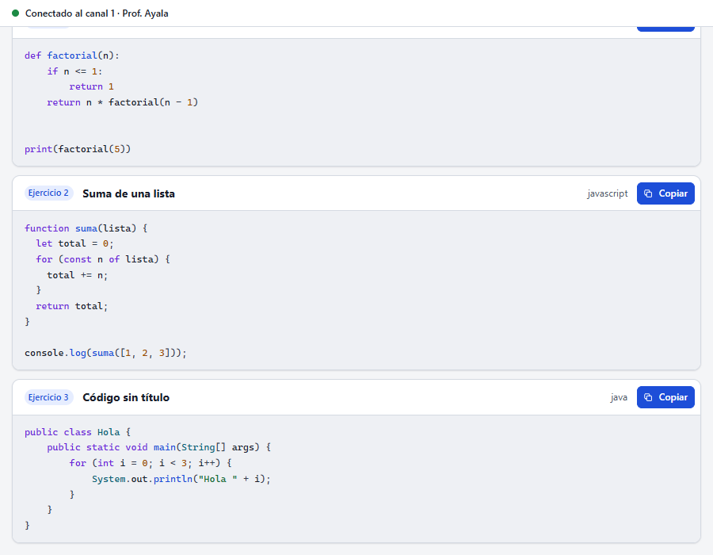
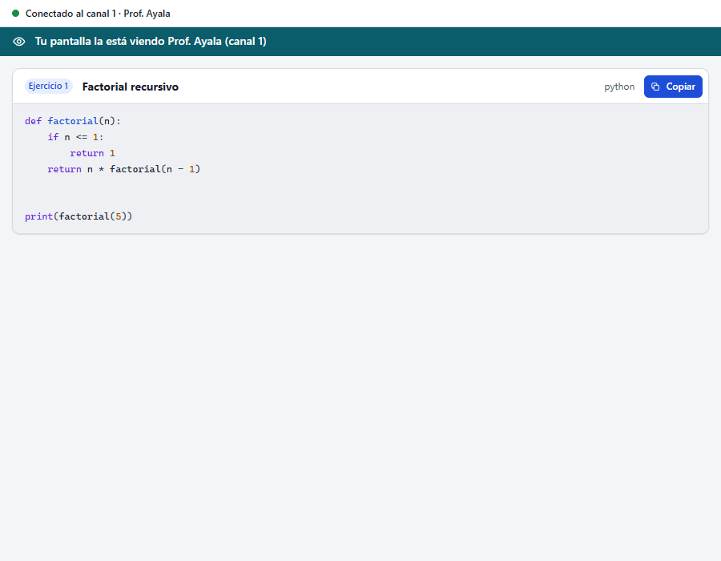
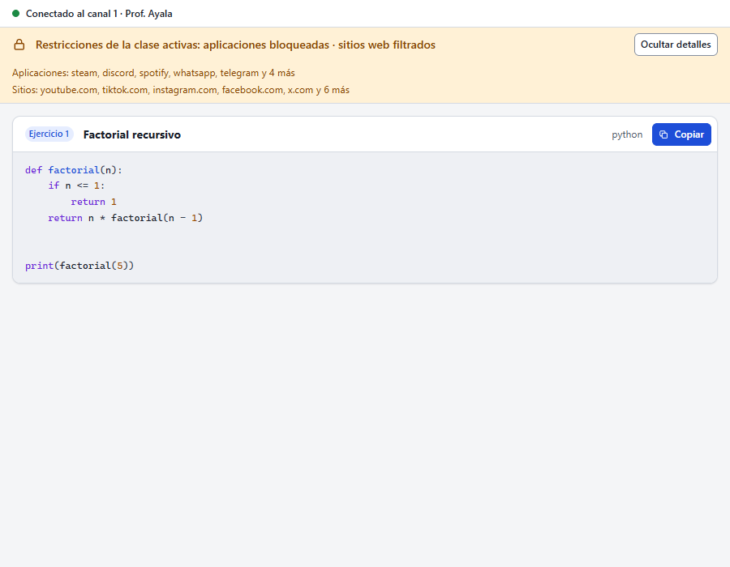
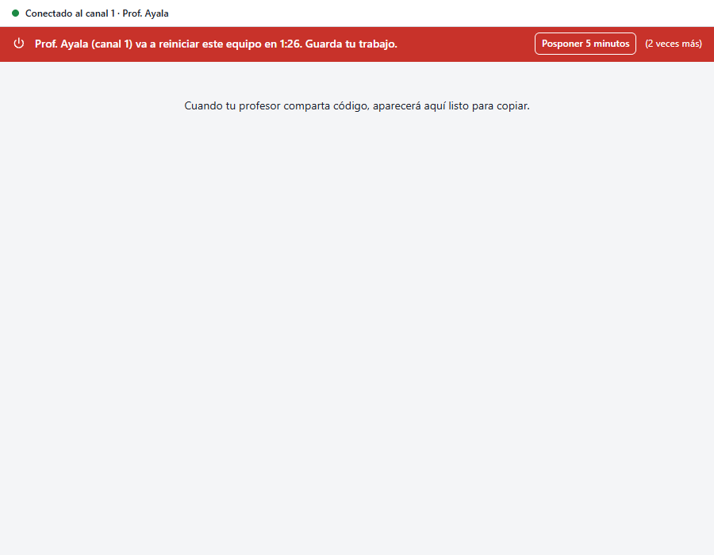
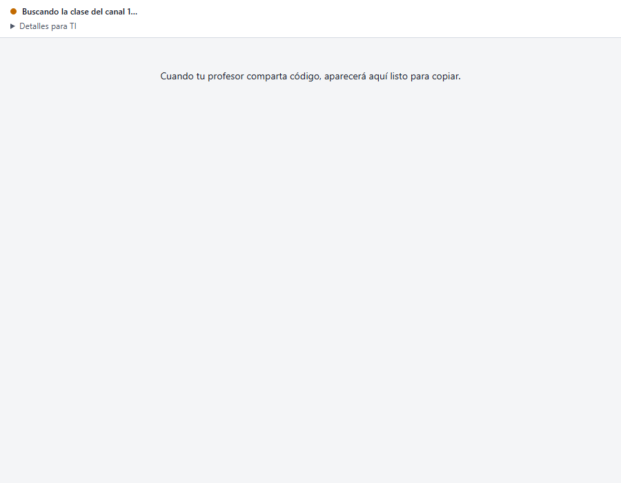
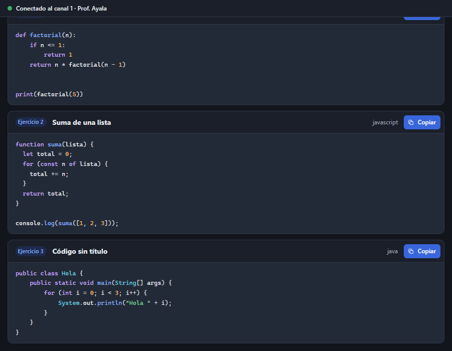
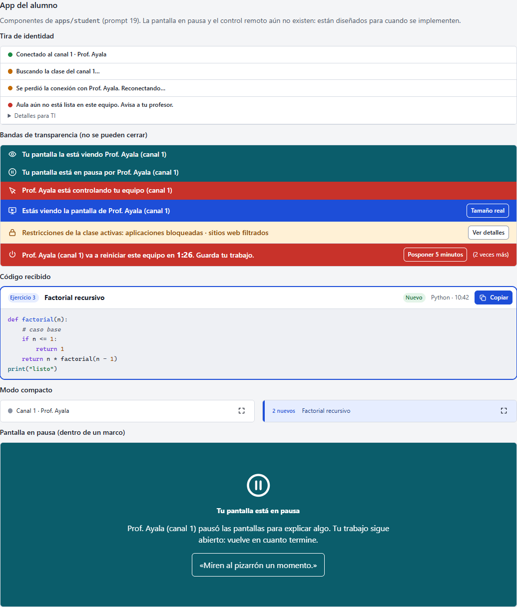
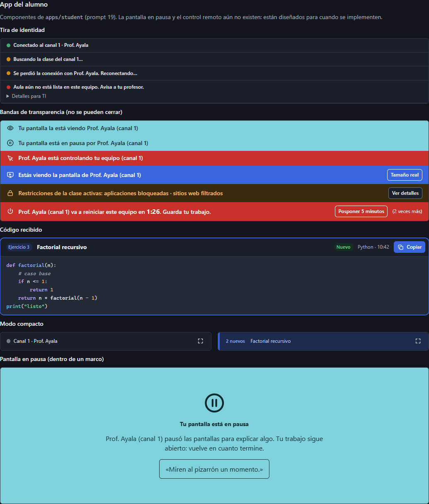

# Entrega B: el sistema de diseño en la app del alumno

Estado: **para aprobación**. Fase 2 del prompt 19. Sin cambios al protocolo ni al comportamiento:
la app hace lo mismo que antes, con el sistema de diseño de `internal/ui` y sus textos en un
archivo.

## Qué cambió

- **Una sola fuente de estilo.** La app carga `sistema/tokens.css` y `sistema/componentes.css`, y
  su `style.css` queda solo con la composición de la página, sin colores sueltos.
  - Tokens nuevos en `internal/ui/tokens.css`, en claro y oscuro, todos en la prueba de contraste
    (WCAG AA):
    - los colores de sintaxis del código;
    - `--c-vista-solido` para «tu pantalla se ve»: verde azulado, no el rojo de error;
    - el fondo del video de la transmisión.
  - Iconos nuevos en el sprite: `ojo`, `pausa`, `control` y `contraer`. Reemplazan ⏻ y 🔒, que
    no siempre se ven.
- **Componentes del alumno en `internal/ui/componentes.css`**, también en el catálogo de
  `tools/vistaprevia` («App del alumno»):
  - `.estado-conexion`, la tira de identidad, con «Detalles para TI» plegado;
  - las bandas de transparencia, como variantes de `.franja` sin botón de cerrar: vista,
    recibiendo, restricciones, urgente (energía), y pausa y control solo diseñadas;
  - `.btn--sobre-color` para los botones sobre una banda de color;
  - `.codigo-recibido`, con su lista `.codigos`;
  - `.pantalla-pausa` (solo diseño) y `.modo-compacto` (para la entrega D).
  - Se reutilizan los de la consola: `.vacio`, `.toast`, `.insignia` y `.btn`.
- **Textos:** todos en `apps/student/frontend/dist/textos.es-MX.js`.
  - `apps/student/textos_test.go` exige un texto por cada estado, acción de energía, nivel de
    aviso y modo de restricción que Go puede mandar, y que no sobre ninguno.
  - Sin `innerHTML` salvo la salida de Prism.
- **Go manda estados, no frases:**
  - `Status` pierde `banner`; `BroadcastView` pierde `notice`; `PowerView` pierde `verb`.
  - La ventana arma los textos y pone su propio título, que también se ve en la barra de tareas,
    en el agente independiente y en el ayudante del servicio.
  - El único texto que sigue en Go es el del distintivo nativo de la regla 6.
- **Lo que ya se nota:**
  - la tira dice «Conectado al canal 1 · Prof. Ayala»;
  - el diagnóstico técnico va plegado en «Detalles para TI»;
  - la pantalla vista tiene su banda con icono, no la barra roja;
  - la energía dice «Prof. Ayala (canal 1) va a reiniciar…» en lugar de «El profesor Prof.
    Ayala…»;
  - «Copiar» lleva icono, y si falla el motivo se ve junto al código;
  - el aviso lleva icono y título según su nivel (info o importante).
- **Arnés:** los dobles reflejan los datos nuevos. El recorrido del alumno (25 capturas) pasa sin
  errores de JS ni violaciones de axe. Las dos violaciones que había (sin `h1` y el rol del
  encabezado) quedaron resueltas.

## Lo que sigue igual a propósito

Lo resuelven las próximas entregas:
- **C:** la lista que salta al último código;
- **D:** traer la ventana al frente, y que cerrar termine el agente;
- **E:** los avisos dentro de la página, y el mismo estado vacío en todos los casos;
- **F:** que el aviso de app cerrada se esfume a los 8 s.

## Capturas

| | |
|---|---|
|  |  |
|  |  |
|  |  |
|  |  |

En las capturas del catálogo, el título de la pantalla en pausa sale pequeño. Ya está corregido
(`.pantalla-pausa__titulo`); se verá bien en la próxima captura.

## Verificación

- Pasan `gofmt`, `go vet` (también con `GOOS=linux`) y staticcheck.
- `go test -race` pasa en `apps/student`, `internal/ui`, `apps/teacher` y `docs`.
- El recorrido del alumno pasa sin errores, y el de la consola se vuelve a correr como regresión
  porque `componentes.css` es compartido.
