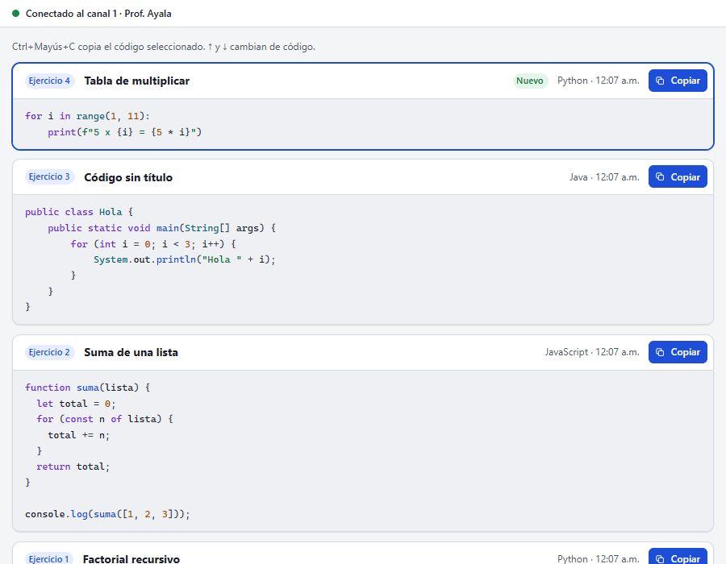
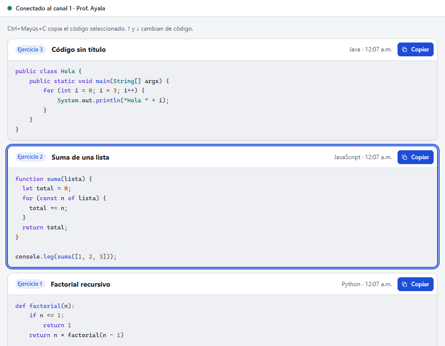
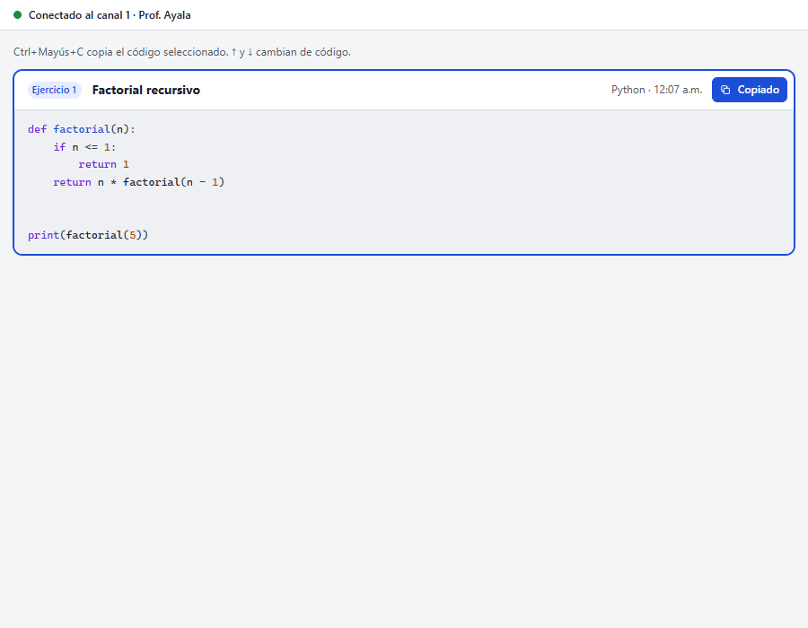
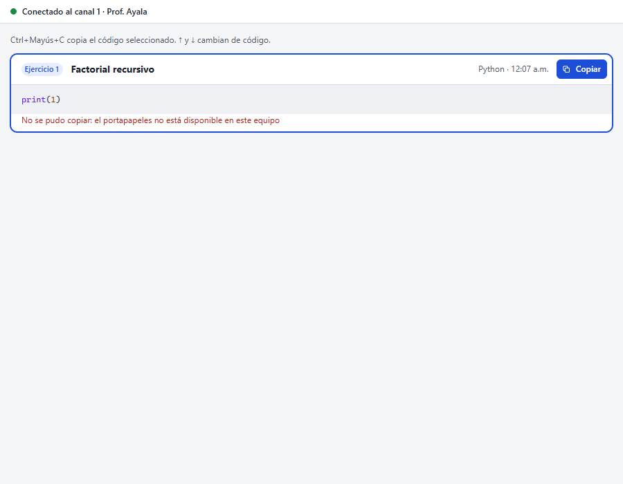
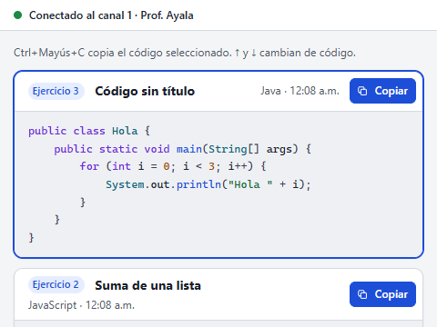
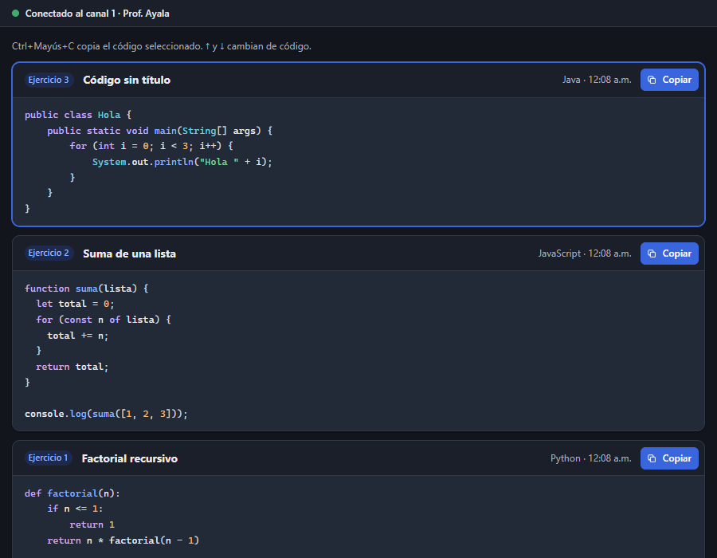

# Entrega C: el código que recibe el alumno

Estado: **para aprobación**. Prompt 19, Fase 3, punto 1 (sin la parte de la ventana, que es la
entrega D). Resuelve C3, M3 y M5 de `ANALISIS.md`. Sin cambios en Go ni en el protocolo.

## Qué cambió

- **Lo más nuevo, arriba.** Antes llegaba abajo y la página saltaba al final.
- **Sin saltos.** La lista se dibuja por partes: solo entra o sale lo que cambió. Si el alumno lee
  más abajo y llega un código, lo que tiene en pantalla no se mueve.
  - El scroll anchoring de Chromium no lo cubría con la cabecera fija, así que la página guarda
    la posición del fragmento visible y la compensa.
  - Se quitó el `scrollIntoView` que movía la página.
- **«Nuevo».** Lo que llega con la ventana abierta lleva la marca «Nuevo», que se quita al
  seleccionarlo o copiarlo. Lo que ya estaba al abrir no la lleva.
- **Cabecera útil:**
  - ejercicio, título, «Nuevo», el nombre legible del lenguaje («JavaScript» en vez de
    «javascript») y la hora de llegada;
  - si no hay título, dice «Código sin título»;
  - «Copiar» queda siempre a la derecha, también a 480×360.
- **Teclado:**
  - ↑ y ↓ cambian de código. Dentro del bloque de código desplazan el código, como siempre.
  - **Ctrl+Mayús+C** copia el código seleccionado. Una línea arriba de la lista lo dice.
  - Si el alumno no ha elegido ninguno, la selección sigue a lo más nuevo, así que Ctrl+Mayús+C
    copia justo lo que acaba de llegar. Si eligió otro, se respeta su elección.
- **Copiar:**
  - lo sigue haciendo Go, del fragmento exacto (sangría y saltos);
  - «Copiado» se anuncia también al lector de pantalla;
  - si falla, el motivo se ve junto al código.
  - El nombre accesible del botón incluye el título («Copiar Factorial recursivo») y siempre
    contiene el texto visible (axe encontró y se corrigió esa discrepancia).
- **`replace` y `clear`:** `replace` deja solo el nuevo; `clear` vuelve al estado vacío.

## Pruebas

**`scripts/ux/pruebas-alumno.mjs` (nuevo, en el CI)**, con 9 casos que pasan:
- orden;
- «Nuevo»;
- la selección sigue a lo más nuevo y respeta la elección del alumno;
- sin saltos (comprobado: sin la compensación, lo que se leía se movía 158 px);
- ↑/↓ y Ctrl+Mayús+C (copia el id correcto);
- las flechas dentro del código no cambian de fragmento;
- **llega código y el foco del alumno no se mueve**;
- `replace` y `clear`;
- error al copiar.

**Además:**
- `recorrido-alumno.mjs`: 27 capturas sin errores de JS ni violaciones de axe; también entra en
  el CI.
- `go test -race ./apps/student ./internal/ui` pasa.

## Capturas

| | |
|---|---|
|  |  |
|  |  |
|  |  |

## Para probar en la ventana real

Con la consola local y el agente:
- emite tres códigos con «Agregar»: el último queda arriba con «Nuevo»;
- baja hasta el primero y emite otro: lo que ves no se mueve;
- sin tocar nada, pulsa Ctrl+Mayús+C y pégalo en el Bloc de notas: se pega el último, con su
  sangría.

En WebView2, Ctrl+Mayús+C no abre herramientas de desarrollo en la versión compilada; en
`wails dev`, sí podría.
