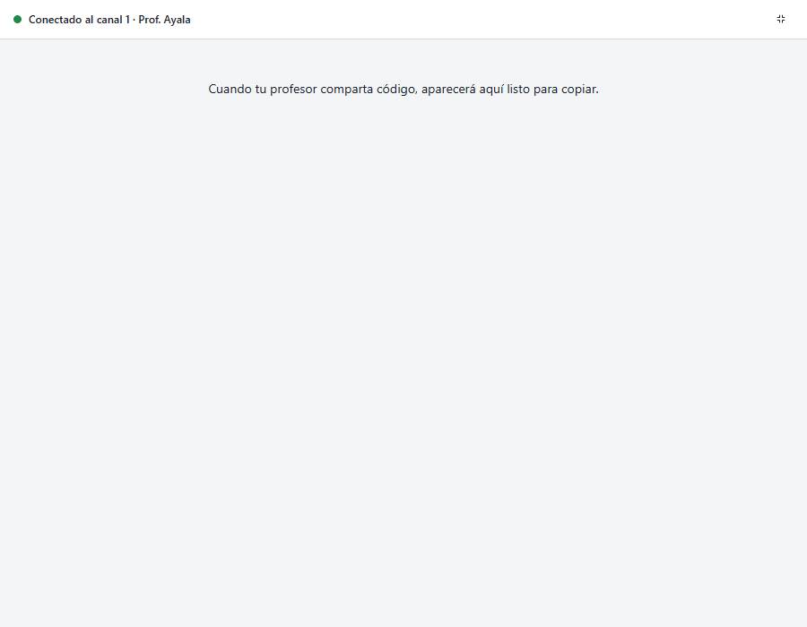
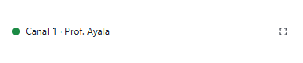
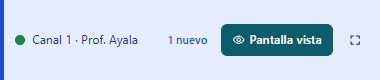

# Entrega D: la ventana no interrumpe y no se pierde

Estado: **para aprobación**. Prompt 19, Fase 3, punto 1 (avisar sin quitar el foco y minimizar a
una insignia) y la decisión del 04/11 de cerrar al área de notificación. Resuelve C1, C2 y M7 de
`ANALISIS.md`. Sin cambios al protocolo.

## Qué cambió

- **El código y los avisos ya no traen la ventana al frente.** Antes la desminimizaban y la ponían
  «siempre encima» 1,5 s. Ahora:
  - **ventana visible:** se actualiza en su lugar (con la lista sin saltos de la entrega C);
  - **minimizada:** se queda minimizada, el botón de la barra de tareas parpadea hasta que el alumno
    la abre, y el título dice cuántos hay nuevos («(2) Aula — conectado…»);
  - **cerrada al área de notificación:** solo se marca el icono (un punto azul).
- **Solo las acciones del profesor sobre el equipo la traen al frente:** energía, restricciones y
  su transmisión (reglas 12, 20 y 26). También la sacan del área de notificación y del modo
  compacto.
- **Cerrar ya no termina el agente** (regla 2). La X oculta la ventana y deja el icono de Aula en
  el área de notificación («Mostrar iconos ocultos»):
  - el texto del icono es el título de la ventana, con el estado y el contador de nuevos;
  - un clic, o el menú «Abrir Aula», la vuelve a abrir;
  - el icono se reinstala solo si el Explorador se reinicia;
  - en modo servicio, el ayudante ya no termina al cerrar, así que el servicio ya no lo relanza
    (la ventana que reaparecía sola).
  - Donde no hay área de notificación (Linux y macOS por ahora), cerrar minimiza.
- **Modo compacto.** El botón junto al estado encoge la ventana a una tira de 380×112 en la esquina
  inferior derecha de su monitor:
  - no la deja encima de las demás ni le da el foco;
  - muestra canal y profesor, «N nuevos» resaltado y «Pantalla vista» si el profesor la está
    viendo;
  - el otro botón la devuelve a su tamaño y lugar, también si estaba maximizada.

## Cómo está hecho

- **`internal/platform`:**
  - `AppWindow`: `Flash` (solo el botón de la barra de tareas) y `Compact` (tamaño y lugar sin
    activarla, y restaurar).
  - `Tray`: el icono con `Shell_NotifyIcon`, en una ventana oculta propia con su hilo y su bucle de
    mensajes, con su menú.
  - En Linux y macOS, «no soportado», y la app usa lo que ofrece Wails.
- **`apps/student/window.go`:**
  - `notify` (código y avisos), `raise` (acciones del profesor), `beforeClose` y `setCompact`;
  - el icono normal y el marcado se generan de `build/appicon.png`.
- **Bindings nuevos:** `SetCompact(on)` y `ReportWindow(title)`. Actúan sobre la ventana de este
  proceso y no se reenvían al servicio.
- **Eventos nuevos:**
  - `aula:compact`, de Go a la ventana;
  - `agentsvc.EventNotify`, del servicio al ayudante.
- `docs/privacidad.md`, reglas 2 y 4, reescritas; `docs/eventos-ui.md` actualizado.

### Una decisión que conviene que revises

Aprobaste «mostrar sin activar». Al probarlo vi que restaurar una ventana minimizada la pone
encima del editor, aunque no le quite el teclado. Por eso, minimizada se queda minimizada y solo
parpadea. Si prefieres que aparezca (sin foco), es un cambio de una línea en `notify`.

## Pruebas

- **Ventana real** (`go run ./tools/medir-alumno -ventana`), contra el agente compilado. Actúa solo
  sobre la ventana de Aula; nunca usa teclado ni mouse. Las seis comprobaciones pasan:
  - minimizada, llega código: sigue minimizada;
  - minimizada, llega código: el primer plano no cambia (siguió siendo VS Code);
  - cerrar con la X (`WM_CLOSE`): el agente sigue en ejecución;
  - cerrar: la ventana queda oculta;
  - oculta, llega código: no reaparece;
  - oculta: la ventana sigue existiendo.
- **Go:**
  - código y avisos llaman a `notify` y nunca a `raise`;
  - en modo servicio, el ayudante recibe `notify` y no `raise`;
  - energía y transmisión siguen trayéndola al frente;
  - el icono se crea, cambia, se marca y se quita, y se rechaza un segundo icono o datos malos. En
    el CI se salta, porque no hay barra de tareas.
- **Arnés:**
  - `pruebas-alumno.mjs`: 11 casos, ahora con el modo compacto (encoge, avisa a Go, muestra
    «Pantalla vista», vuelve con `aula:compact`) y el contador del título (y que llega al icono);
  - `recorrido-alumno.mjs`: 29 capturas sin errores de JS ni violaciones de axe.
- `gofmt`, `go vet` (Windows, Linux y macOS), staticcheck y `go test -race -p 4 ./...`: pasan.
  `internal/screen` falló una vez por el problema de tiempos conocido y pasó sola.

## Capturas

| | | |
|---|---|---|
|  |  |  |

## Para revisar a ojo en la ventana real

Esto no lo puedo comprobar sin hacer clics en tu escritorio:
1. Cierra la ventana con la X: el icono de Aula queda en «Mostrar iconos ocultos». Al pasar el
   puntero muestra «Aula — conectado (canal …)».
2. Emite código desde la consola: el icono se marca con un punto azul y la ventana no aparece.
   Haz clic en el icono: la ventana vuelve y el punto se quita.
3. Clic derecho en el icono: «Abrir Aula».
4. Pulsa el botón de compactar: la ventana queda como una tira abajo a la derecha. Emite código:
   la tira resalta «1 nuevo» y no te quita el teclado. Pulsa restaurar: vuelve a su lugar.
5. Con la ventana minimizada, emite código: el botón de la barra de tareas parpadea.
