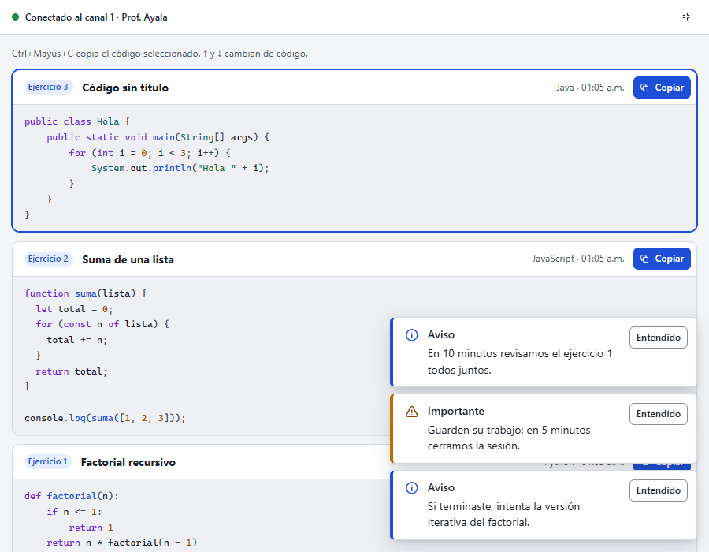
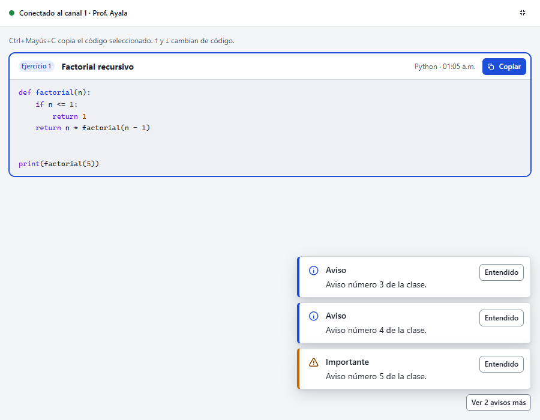
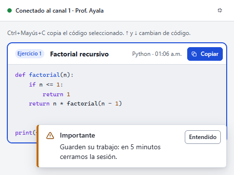
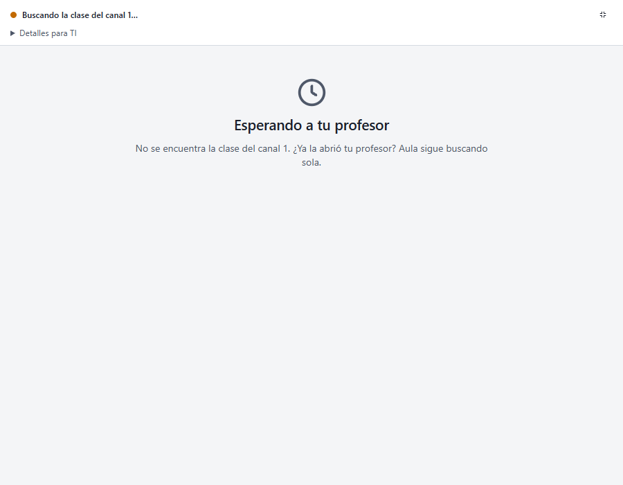
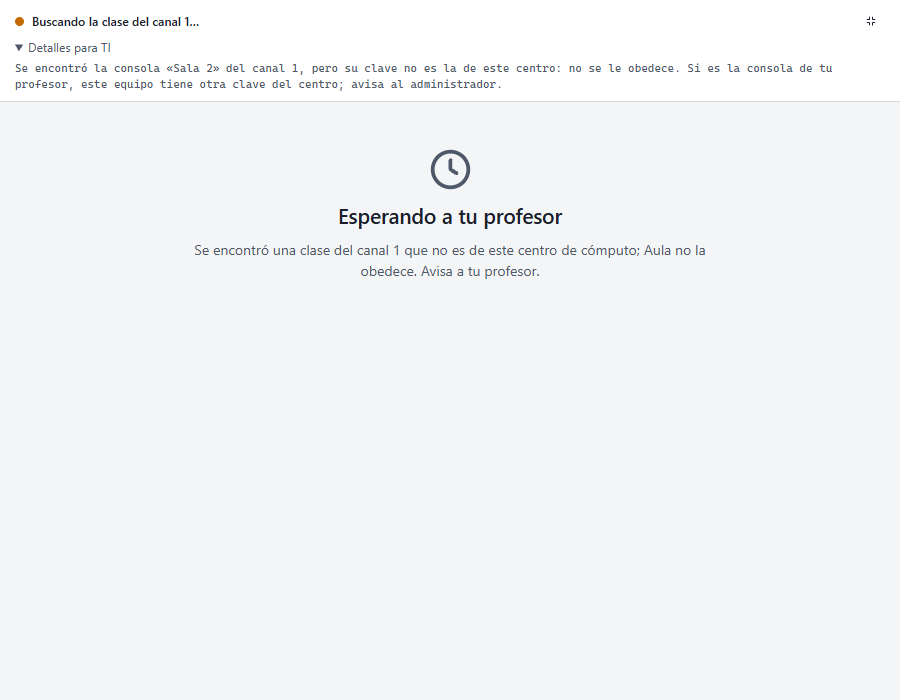
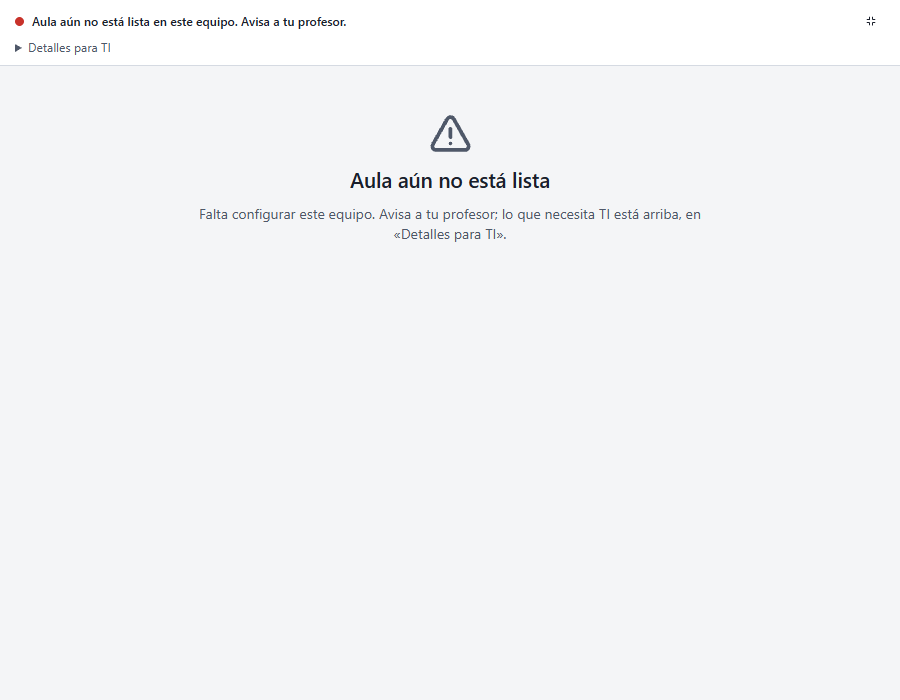
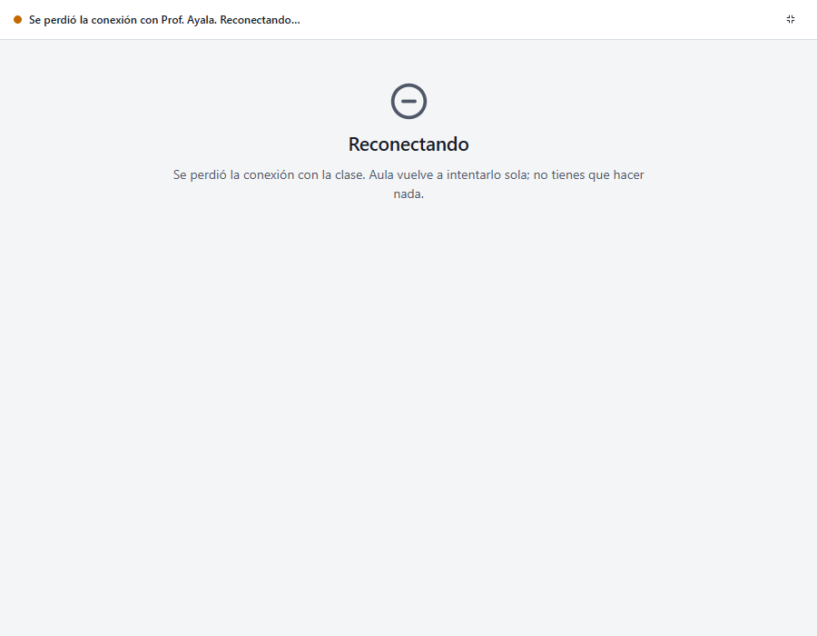
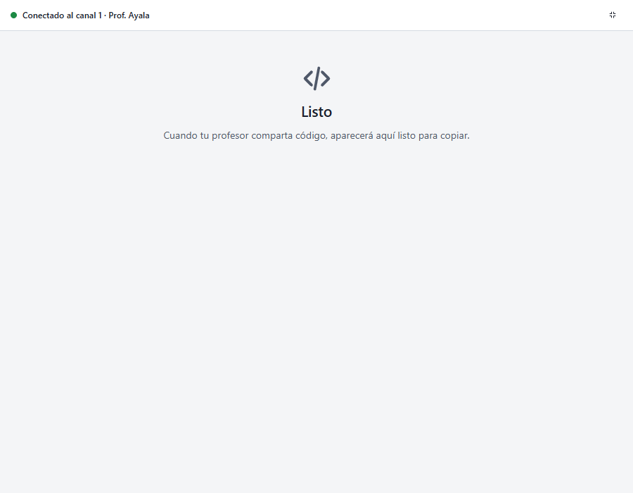

# Entrega E: avisos y estado de la conexión

Estado: **para aprobación**. Prompt 19, Fase 3, puntos 2, 3 y 6. Resuelve A2, A3, A4, M4 y B2 de
`ANALISIS.md`. Sin cambios al protocolo.

## Qué cambió

- **Avisos del profesor en una esquina.** Antes entraban arriba del código y lo empujaban. Ahora:
  - flotan abajo a la derecha, sin mover lo que el alumno lee;
  - cada aviso lleva icono, título según el nivel («Aviso» o «Importante»), color y texto: ya no
    se distinguen solo por el color;
  - se ven los 3 más recientes y «Ver N avisos más» muestra el resto; en una ventana angosta
    (≤ 600 px), uno solo;
  - se cierran con «Entendido» o con Esc;
  - la página deja espacio abajo para que el último código no quede tapado;
  - cuentan como «sin ver» en el título («(2) Aula — …») y en el modo compacto;
  - en el modo compacto no se dibujan: la tira dice cuántos hay.
  - `msg.ack` sigue saliendo al mostrarse, sin cambios.
- **Estado vacío según la situación.** Antes era una sola frase, incluso sin configurar o sin
  conexión.

  | Situación | Título | Texto |
  |---|---|---|
  | Conectado | Listo | «Cuando tu profesor comparta código, aparecerá aquí listo para copiar.» |
  | Buscando | Esperando a tu profesor | «Aula está lista. Cuando tu profesor abra la clase del canal 1, te conectarás solo.» |
  | Sin conexión | Reconectando | Aula vuelve a intentarlo sola; no hay que hacer nada |
  | Sin configurar | Aula aún no está lista | Avisa a tu profesor; lo de TI, en «Detalles para TI» |

- **Por qué no conecta, en palabras llanas.**
  - Go manda la causa clasificada (`Status.Cause`, la misma `session.Cause` del comprobador de la
    consola).
  - Ejemplos: «No se encuentra la clase del canal 1. ¿Ya la abrió tu profesor?» o «Se encontró
    una clase del canal 1 que no es de este centro de cómputo; Aula no la obedece. Avisa a tu
    profesor.»
  - El diagnóstico técnico sigue plegado en «Detalles para TI».
- **Regla 1 de privacidad** alineada con los textos finales: el título (barra de tareas e icono)
  y la tira de identidad, con el contador de nuevos.

## Pruebas

- **Go:** `TestStatusCarriesTheCause` (la causa llega mientras busca y desaparece al conectar).
  `TestTextsAreComplete` exige un texto por cada causa de `session.Cause` y por cada estado del
  vacío.
- **Arnés, `pruebas-alumno.mjs`:** 14 casos. Los nuevos:
  - los avisos están en una esquina fija, se ven 3, aparece «Ver 2 avisos más» y al pulsarlo se
    ven los 5;
  - Esc cierra el aviso con foco;
  - el título cuenta los avisos;
  - a 480×360 se ve uno solo;
  - el vacío dice la causa.
- **Recorrido:** 33 capturas sin errores de JS ni violaciones de axe.
- `go test -race ./apps/student`, `go vet` y staticcheck pasan.

## Capturas

| | |
|---|---|
|  |  |
|  |  |
|  |  |
|  |  |
