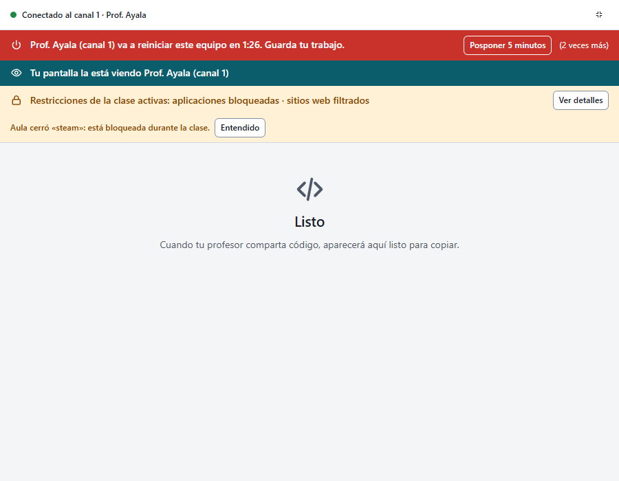
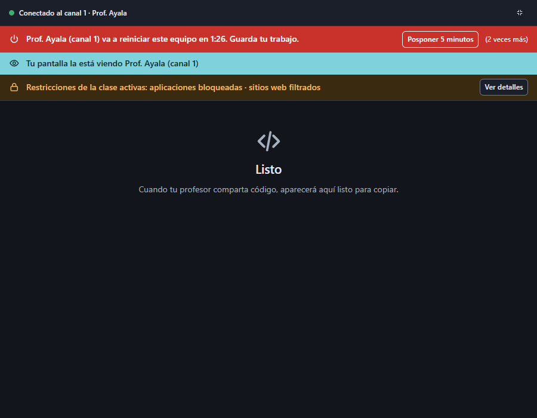
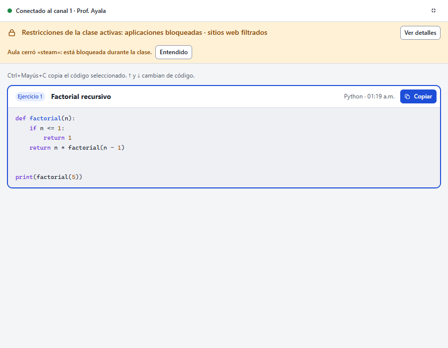
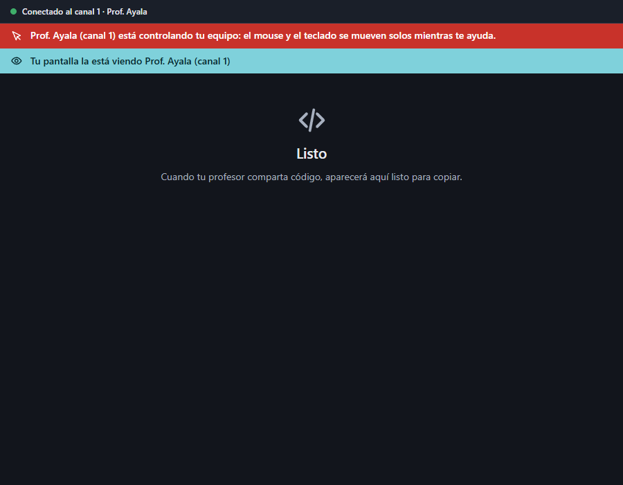
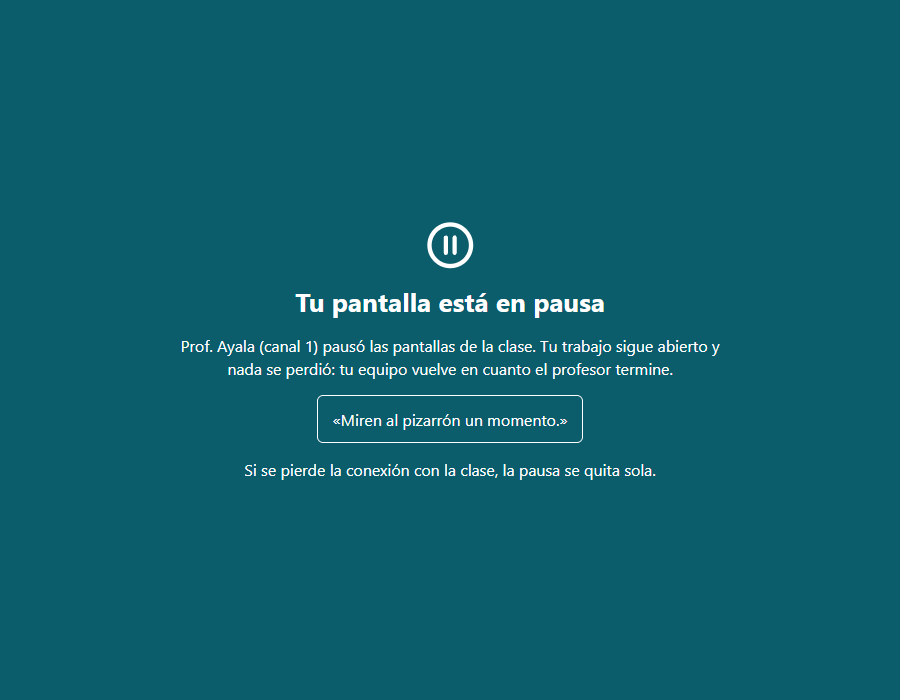
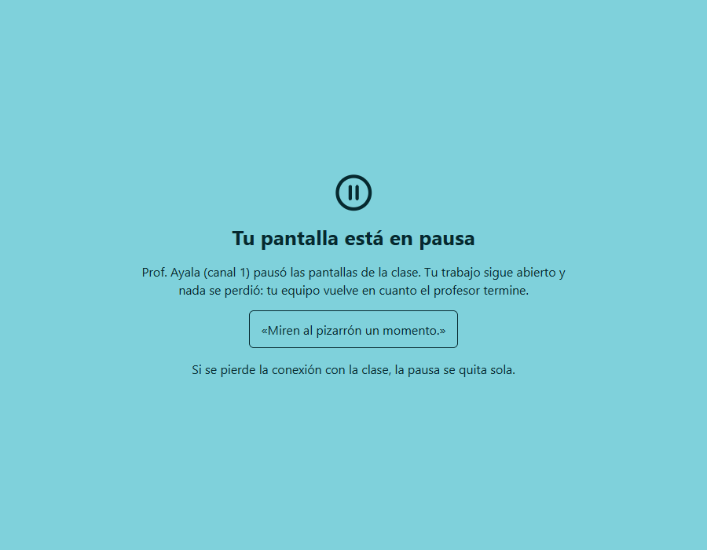

# Entrega F: la banda de transparencia permanente

Estado: **para aprobación**. Prompt 19, Fase 3, puntos 4 y 5, y Fase 5.2. Resuelve A1, M2 y M6 de
`ANALISIS.md`. Sin cambios al protocolo.

## Qué cambió

- **Un sistema de bandas con orden fijo.** Lo que el profesor hace con el equipo se ve en bandas
  arriba de la ventana, siempre en este orden:
  1. energía, primero porque es lo urgente;
  2. control remoto, cuando exista;
  3. pantalla vista, o en pausa cuando exista;
  4. restricciones.

  La transmisión lleva su banda sobre el video. Cada banda tiene su color, su icono y un texto
  que dice quién y en qué canal.
- **Ninguna se puede cerrar ni ocultar.** No tienen botón de cerrar y Esc no las quita;
  desaparecen solas cuando el profesor termina. Los botones que sí tienen son acciones previstas:
  «Ver detalles», «Posponer 5 minutos», «Tamaño real» y «Entendido» (este último en la orden de
  energía fallida y en «Aula cerró…»).
- **«Aula cerró…» ya no se esfuma.** Antes desaparecía a los 8 s. Ahora va dentro de la banda de
  restricciones, junta las apps («Aula cerró «steam», «discord»: están bloqueadas…») y se queda
  hasta que el alumno pulsa «Entendido» o se quitan las restricciones.
- **Lo que el profesor hace sobre el equipo saca la ventana del modo compacto**, también si ya
  estaba al frente. Go ya lo hacía al traerla; ahora la página lo cubre por su cuenta.
- **Pantalla en pausa y control remoto: diseñados, sin conectar.** Sus funciones no existen
  (protocolo §5.9 y prompt 10.4). Los prototipos están en
  `apps/teacher/frontend/dev/prototipo/alumno-pausa.html` y `alumno-control.html`, con los
  componentes del sistema; pasan axe en claro y oscuro.
  - **Pausa:** cubre la pantalla, dice quién y por qué, y aclara que el trabajo sigue abierto y que
    se quita sola si se pierde la clase, para que no parezca un cuelgue.
  - **Control remoto:** la banda roja «Prof. Ayala (canal 1) está controlando tu equipo: el mouse
    y el teclado se mueven solos mientras te ayuda».
- **Privacidad:** `docs/privacidad.md` describe las bandas y su orden, y los textos de las reglas
  6, 12, 20, 22, 26 y 28 quedan como se ven ahora (sin ⏻ ni 🔒, que no se veían en todos los
  equipos).

## Pruebas (Fase 5.2)

- **Arnés, `pruebas-alumno.mjs`:** 21 casos. Los 7 nuevos:
  - **cada banda** (pantalla vista, restricciones, energía, transmisión):
    - se ve cuando su función está activa;
    - no tiene más controles que los permitidos;
    - no se oculta con Esc;
    - se va cuando el profesor termina;
  - el **orden** con todas activas: energía, vista, restricciones;
  - «Aula cerró…» sigue a los 9 s, junta las apps, y «Entendido» lo quita sin quitar la banda;
  - las restricciones sacan la ventana del modo compacto.
- **Go:**
  - `TestNoBindingTurnsOffTransparency` lista cada función de la ventana con por qué no puede
    ocultar un indicador. Una función nueva hace fallar la prueba hasta que alguien la revise.
  - `TestDismissOnlyAFailedNotice` (en `internal/power`): `DismissPower` no quita una cuenta
    regresiva ni una orden en curso, solo el aviso de una que falló. Comprobé que la prueba falla
    si `Dismiss` cierra cualquier aviso.
- **Recorrido:** 35 capturas sin errores de JS ni violaciones de axe.
- `go test -race` de `apps/student` e `internal/power`, `go vet` y staticcheck pasan.

## Capturas

| | |
|---|---|
|  |  |
|  |  |
|  |  |
