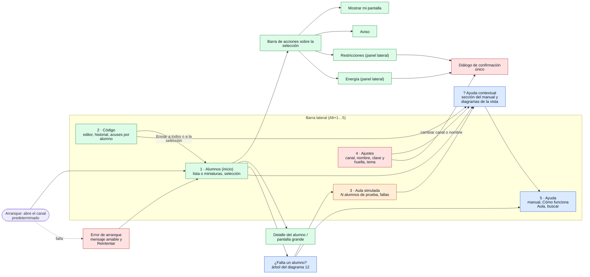

# Análisis de la consola del profesor (Fase 1)

Estado: **para aprobación**. Base: `develop` en `5af6107` (Aula Consola 0.6.0-dev).
Alcance: UX/UI, manual, diagramas y aula simulada, **sin funciones nuevas de aula**.

---

## 1. Resumen

La consola funciona, pero está organizada alrededor del **editor de código**, no de los
**alumnos**. Cada función que se agregó después (pantallas, transmisión, restricciones,
energía) llegó como un botón más en la barra superior que abre una capa a pantalla completa.
Esa capa tapa la lista de alumnos, que es justamente donde se eligen los destinatarios.

Los cuatro problemas que más pesan para un profesor no técnico:

1. **Elegir a quién va una acción obliga a ir y venir.** Para aplicar restricciones o apagar
   solo algunos equipos hay que cerrar la capa, marcar casillas en las tarjetas y volver a
   abrirla (§4, C1).
2. **«Guardar» el nombre reinicia la clase sin avisar.** Desconecta a todos y borra el
   historial y los acuses (C2).
3. **Si un alumno no aparece, la consola no ayuda.** Solo dice «Esperando alumnos en este
   canal…»; el diagnóstico existe solo en el equipo del alumno (C3).
4. **No se puede probar sin laboratorio.** Los alumnos simulados se lanzan desde la línea de
   comandos y se ven igual que equipos reales (C4).

La meta («de recién instalado a primer código emitido con un alumno simulado en menos de
5 minutos») **hoy no se puede cumplir** sin usar la terminal.

---

## 2. Método

- **Recorrido sin tocar el escritorio.** Cargué el frontend real
  (`apps/teacher/frontend/dist`, sin modificar) en Chromium headless, el mismo motor que
  WebView2 y con las mismas fuentes de este Windows. Un doble de los bindings de Wails le
  entrega datos de demostración con la forma exacta de los tipos de `apps/teacher/events.go`.
  La CSP de la consola se mantuvo activa.
- **Datos de demostración:**
  - escena «2 simulados»: canal 1, `SIM-01` y `SIM-02` tal como los crea
    `examples/muchos_alumnos` (usuario `simulado`, agente `0.1.0-sim`, solo `code.view` y
    `msg.show`) y `SIM-03` desconectado;
  - historial de 3 ejercicios y 5 envíos, uno incompleto («confirmados 2/3 · 1 no lo soporta
    · 1 fallaron»);
  - escena «laboratorio» con equipos Windows con todas las capacidades, uno sin sesión
    iniciada y uno Linux, para poder abrir Pantallas, Restricciones y Energía.
- **Accesibilidad:** axe-core 4 (reglas WCAG 2.0/2.1 A y AA más buenas prácticas) en 13
  estados, y el orden de foco con Tab.
- **Límites:**
  - Los diálogos nativos (`window.confirm`) no se pueden capturar; se registró su texto en
    `antes/06-confirmar-limpiar-texto.txt`.
  - No hubo red real. Los estados dependen del doble, pero el HTML, el CSS y el JS son los
    reales.
  - Las herramientas de captura quedaron fuera del repositorio. Propongo versionarlas en la
    entrega E1 para repetir las mismas capturas al final («después»).
- `docs/compatibilidad.md`, citado en la consigna, **no existe** en el repositorio.

### Capturas (`antes/`)

| # | Estado | # | Estado |
|---|---|---|---|
| 01 | Arranque: «Abriendo el canal 1…» | 14 | Pantallas: detalle de un alumno |
| 02 | Arranque: error de puerto ocupado | 15 | Pantallas: vacía (solo simulados) |
| 03 | Consola sin alumnos | 16 | Transmitiendo mi pantalla |
| 04 | Consola con 2 simulados, historial y acuse incompleto | 17 | Restricciones: sin reglas |
| 05 | Editor con código | 18 | Restricciones activas |
| 06 | (texto) confirmación nativa de «Limpiar pantallas» | 19 | Restricciones: nadie puede recibirlas |
| 07 | Aviso de error (portapapeles vacío) | 20 | Energía |
| 08 | Captura del portapapeles cargada | 21 | Energía: confirmación forzada |
| 09 | Sin clave del centro (clave personal) | 22 | Energía: órdenes pendientes en las tarjetas |
| 10 | Atajo global ocupado | 23 | Ventana mínima 900×600 |
| 11 | Laboratorio: tarjetas con capacidades | 24 | Ventana mínima, laboratorio |
| 12 | Laboratorio: alumnos marcados | 25 | Modo oscuro |
| 13 | Pantallas: cuadrícula | 26 | Modo oscuro: energía |

---

## 3. Flujos clave: hoy y propuesta

Clics contados desde la pantalla principal con la clase abierta. «N» = número de alumnos.

### a) Ver quién está conectado y quién no

| | Hoy | Propuesta |
|---|---|---|
| Pasos | 0 clics: columna izquierda de 17 rem. | 0 clics: la vista **Alumnos** es la de inicio. |
| Fricciones | Cada tarjeta mide ~110–190 px por los chips de capacidades: a 1280×760 caben **3–4 alumnos**; un laboratorio de 40 exige desplazarse ~10 pantallas (04, 11). El estado se ve como un punto y texto gris pequeño. Los desconectados se atenúan al 60 % y no pasan contraste (axe). No hay orden ni filtro. | Tabla densa (una fila por equipo) que pasa a cuadrícula de miniaturas o a tarjetas si la ventana se encoge. Columnas: estado (icono + color + texto), equipo, alumno, último código, avisos. Filtro «solo desconectados» y orden por estado. Contadores arriba: «38 conectados · 2 desconectados · 1 simulado». |

### b) Entender por qué un alumno no aparece y qué hacer

| | Hoy | Propuesta |
|---|---|---|
| Pasos | **No hay camino en la consola.** Hay que ir al equipo del alumno, leer su barra o ejecutar `aula-cliente diagnostico` en una terminal (manual de etapa 08). | 1 clic: «¿Falta un alumno?» en la vista Alumnos y en el estado vacío. Abre el árbol de preguntas del diagrama 12, con los datos que pide el instalador listos para copiar: canal, puerto, nombre e IP de este equipo, huella corta. Desde ahí, «Probar con alumnos simulados». |
| Fricciones | El estado vacío solo dice «Esperando alumnos en este canal…» (03). Una consola sin clave del centro lo explica en una franja con un comando de terminal (09). | Mensajes «qué pasó + por qué + qué hacer», con enlace a la sección del manual. |

### c) Ver miniaturas, transmitir pantalla, recoger código

| | Hoy | Propuesta |
|---|---|---|
| Miniaturas | 1 clic («Ver pantallas»): una capa a pantalla completa tapa la lista, los avisos y el historial (13). Detalle: 1 clic; volver: 1 clic o Esc. Solo dice «2 de 4»: no explica que el Linux y el equipo sin sesión no pueden. | Un modo de la vista Alumnos (Lista ⇄ Miniaturas) con la misma selección y la misma barra de acciones. Los equipos que no pueden muestran un recuadro con el motivo («Linux: aún no comparte pantalla»). El aviso de privacidad sigue visible mientras se ven las miniaturas. |
| Transmitir | 2 clics (monitor + Transmitir) en la barra superior; banda roja visible (16). Funciona bien. | Igual en clics, pero dentro de la barra de acciones («Mostrar mi pantalla»), con el monitor en un menú del mismo botón. La banda roja se queda. |
| Recoger código | **No existe** (`code.collect` está reservado, protocolo §6). | Fuera de alcance: no se agregan funciones. La navegación deja el hueco previsto. |

### d) Emitir código → ver acuses → reemitir del historial

| | Hoy | Propuesta |
|---|---|---|
| Pasos | Pegar o capturar (atajo o botón flotante) → 1 clic «Emitir a todos». Acuse en la línea inferior y en «Confirmaciones». Reemitir: 1 clic. | Igual de corto en el módulo **Código**, más «Enviar a: todos / seleccionados». |
| Fricciones | «confirmados 2/3 · 1 no lo soporta · 1 fallaron» no dice **quiénes** (04). No se puede reenviar solo a los que faltan. «Reemitir» envía **de inmediato** y siempre reemplaza. Para **cargar** un ejercicio en el editor hay que hacer doble clic, indicado solo en un `title` (A6). | Cada envío se despliega con la lista de alumnos y su estado (✓ mostrado / pendiente / no lo soporta / falló), y un botón «Reenviar a los que faltan». En el historial, «Ver/editar» y «Reemitir». La columna «último código» de Alumnos dice qué ejercicio tiene cada uno. |

---

## 4. Hallazgos priorizados

Heurísticas de Nielsen: **H1** visibilidad del estado · **H2** lenguaje del usuario · **H3**
control y libertad · **H4** consistencia · **H5** prevención de errores · **H6** reconocer
antes que recordar · **H7** flexibilidad · **H8** diseño minimalista · **H9** ayudar a
reconocer y corregir errores · **H10** ayuda y documentación.

### Críticos

**C1. Las acciones se aplican en capas a pantalla completa que tapan a los alumnos.**
Capturas 12, 13, 17, 20 · H6, H3, H7, H4.

- Pantallas, Restricciones y Energía son `position: fixed; inset: 0`, y cada una trae su
  propio formulario. Para elegir destinatarios hay que:
  1. abrir Restricciones;
  2. ver «Alumnos marcados (0)»;
  3. cerrar;
  4. marcar N casillas en las tarjetas;
  5. reabrir;
  6. elegir «marcados»;
  7. escribir o elegir la lista;
  8. Aplicar.

  Son 6 + N clics y un cambio de contexto. Energía repite el mismo rodeo.
- Las tres capas se comportan distinto:
  - Esc solo cierra Pantallas;
  - Restricciones y Energía están fuera de `#console` en el HTML;
  - las capas no atrapan el foco: con Tab se llega a los controles que hay debajo.

**Propuesta, al estilo LanSchool.** La vista **Alumnos** es el centro: primero se
seleccionan alumnos (todos, ninguno, clic, Mayús/Ctrl, «solo conectados») en lista o en
miniaturas. Después, una **barra de acciones** fija aplica la función a la selección: Mostrar
mi pantalla · Aviso · Restricciones · Energía · Ver pantalla. Cada función abre un **panel
lateral** con su formulario corto, que deja ver la selección y permite cambiarla. Las
confirmaciones van en el mismo diálogo propio de Energía. Con esto también se resuelve el
punto 5 de la consigna: emitir código se va a su módulo.

**C2. «Guardar» el nombre (y «Cambiar» el canal) reinicia la clase sin aviso.**
Captura 04 (barra superior) · H5, H1, H3.

- Los dos formularios llaman a `StartClass`, que primero ejecuta `EndClass()`
  (`apps/teacher/app.go:168-219`).
- Eso desconecta a todos los alumnos, detiene la transmisión, quita las restricciones, olvida
  las órdenes de energía y **vacía el historial y los acuses**.
- El botón dice «Guardar» y no hay confirmación. Corregir una errata en el nombre a mitad de
  clase borra el trabajo de la sesión.

**Propuesta:**

- Llevar nombre y canal a **Ajustes**.
- Al cambiarlos, mostrar un diálogo que diga qué pasa: «Los N alumnos se reconectarán en
  unos segundos; se quitan las restricciones y se detiene la transmisión».
- **Conservar el historial** de código al cambiar de nombre o de canal (es de la consola, no
  del canal). Es un cambio de lógica en `apps/teacher`, sin tocar el protocolo; lo dejo a tu
  decisión (§11).

**C3. Sin ayuda cuando un alumno no aparece.** Capturas 03 y 09 · H10, H9, H1.

- Hoy:
  - El estado vacío es una sola línea gris.
  - La consola no muestra lo que el instalador necesita: canal, puerto, IP, si la red es
    Pública, huella de la clave.
  - El aviso de «clave personal» remite a un comando de terminal.
- El diagrama 12 y los mensajes del agente ya cubren estas causas, pero solo del lado del
  alumno.

**Propuesta:**

- Estado vacío con acción sugerida.
- Asistente «¿Falta un alumno?», generado a partir del diagrama 12.
- Panel «Datos para el instalador» con botón Copiar.
- «Probar con alumnos simulados».

**C4. No se puede probar sin laboratorio, y los simulados se confunden con equipos reales.**
Capturas 04 y 15 · H1, H10, transparencia.

- Hoy hay que abrir una terminal y ejecutar `muchos_alumnos -n 2 -canal 1 -clave
  aula-ed25519:… -directo IP:47830`.
- `SIM-01` aparece como un equipo Windows más («windows · simulado · agente 0.1.0-sim»): en
  la lista, en los conteos y en los acuses.
- No declara pantalla, así que «Ver pantallas» queda vacía con ellos (15).

**Propuesta:** el modo **Aula simulada** (§10), marcado con una insignia y una franja
permanente, y separado de los equipos reales en la lista, los conteos, los acuses y los logs.

### Altos

**A1. La ventana mínima (900×600) rompe el diseño.** Capturas 23 y 24 · H8, WCAG 1.4.10.

- La cuadrícula pasa a 2 columnas, pero el editor de Monaco se desborda sobre el panel de
  Aviso y tapa sus botones.
- El botón flotante tapa «Reemitir».
- La barra superior ocupa 2 filas (~100 px) en cualquier ancho.

**Propuesta:** una sola barra de navegación compacta, contenido con desplazamiento propio y
puntos de quiebre probados a 900, 1100 y 1280 px. Todo se verifica con capturas automáticas en
CI.

**A2. Trampa de teclado en el editor y orden de foco poco útil.** Orden de foco (axe y Tab) ·
WCAG 2.1.2 y 2.4.3.

- Desde el inicio, Tab recorre 9 controles de la barra y una casilla por alumno (40 en un
  laboratorio) antes de llegar al editor.
- Ya dentro de Monaco, **Tab inserta tabuladores y no sale**. Monaco solo libera el foco con
  Ctrl+M, y eso no se indica en ninguna parte.
- Los chips de canales recientes tienen `tabIndex=-1`: no se alcanzan con el teclado.

**Propuesta:**

- Enlaces «Saltar a…».
- Navegación por teclado entre módulos (Alt+1…5).
- Una nota visible «Ctrl+M: salir del editor con Tab», o activar el modo de Tab de Monaco al
  entrar con el teclado.
- Selección de alumnos accesible: casillas con etiqueta y atajos de lista.

**A3. Mensajes de error técnicos y que se esfuman.** Capturas 02 y 07 · H9, H2.

- Mezclan la causa interna y el texto del SO en inglés: «el puerto 47830 está ocupado (¿hay
  otra consola abierta?): listen tcp :47830: bind: Only one usage of each socket address…».
- `class.go` y `broadcast.go` envuelven errores crudos: «clave del centro: %w»,
  «certificado: %w», «no se pudo transmitir: %w».
- Los errores llegan en un aviso que **desaparece a los 5 s**, igual que un éxito. Algunos
  quedan en minúsculas y sin acción («el editor está vacío»).

**Propuesta:**

- Un catálogo de mensajes con la fórmula «qué pasó + por qué + qué hacer + enlace al manual»,
  indexado por código: los errores de Go se convierten en códigos estables y el frontend los
  traduce.
- Los errores se quedan hasta que se cierran.
- El detalle técnico se muestra en «Ver detalles», plegado.

**A4. Los acuses no dicen quién falta.** Captura 04 · H1, H9.

- «Ejercicio 3 — enviado a 3 · confirmados 2/3 · 1 no lo soporta · 1 fallaron»: no se sabe
  quién.
- La tarjeta dice «código recibido 10:42», pero no qué ejercicio.
- No hay forma de reintentar a los que faltan.

**Propuesta:** el desglose por alumno (§3 d) y «Reenviar a los que faltan». Usa
`session.Console.Send` por sesión, que ya existe; no cambia el protocolo.

**A5. Jerga técnica en primer plano.** Capturas 04, 09 y 11 · H2, H8.

- La barra superior muestra «Clave del centro: K7QD-3MX2-…» sin explicar qué es.
- Cada tarjeta lista capacidades con nombres internos («código», «avisos», «pantalla», «ve tu
  pantalla», «bloqueo de apps», «filtro web», «energía»), más «agente 0.5.0» y «windows ·
  10.0.19045».
- «ve tu pantalla» confunde: significa «puede recibir tu transmisión».

**Propuesta:** en la vista normal, solo lo que el profesor usa: estado, equipo, alumno,
último código y avisos activos. Las capacidades se muestran **solo como ausencia** y en
lenguaje llano («No puede mostrar su pantalla: equipo Linux»). Versión, SO y huella van al
detalle del alumno y a Ajustes, con su explicación en el glosario (§6).

**A6. «Reemitir» actúa sin confirmar y cargar en el editor está escondido.** Captura 04 ·
H3, H5, H6.

- Un clic en «Reemitir» reemplaza el código en todas las pantallas.
- Para editar un ejercicio anterior hay que hacer doble clic; solo un `title` lo indica.

**Propuesta:**

- Dos botones visibles: «Abrir en el editor» y «Reemitir».
- Reemitir con «Deshacer» durante 5 s, o con confirmación si alguien recibió otro ejercicio
  después.
- Indicar el modo: «reemplaza lo que ven».

**A7. La jerarquía no refleja la tarea.** Capturas 04 y 11 · H8, H4.

- Se abre en el editor, con dos columnas laterales compitiendo.
- La barra mezcla 9 controles de importancia distinta en 2 filas: canal, nombre, clave,
  3 funciones y transmisión.
- Hay dos botones primarios azules a la vista («Transmitir mi pantalla» y «Emitir a todos»),
  además del botón flotante, también azul.

**Propuesta:** la navegación del §7 y una sola acción primaria por vista.

### Medios

**M1. Confirmaciones inconsistentes.** Captura 06 (texto), H4, H5.

- «Limpiar pantallas» y «Quitar todas las restricciones» usan `window.confirm` nativo, sin
  decir a cuántos alumnos afecta ni qué se pierde.
- Energía tiene su propio diálogo, bien hecho (21).

**Propuesta:** un solo componente de confirmación: título con verbo y número, consecuencia y
botón de peligro con el verbo.

**M2. Acciones habilitadas que no pueden funcionar.** Captura 19, H5, H1.

- Con 0 de 2 alumnos capaces, Restricciones deja escribir y «Aplicar». El error solo aparece
  después.
- «Alumnos marcados» se puede elegir con 0 marcados.

**Propuesta:** estado vacío explicativo («Ningún alumno conectado puede recibir
restricciones: necesitan el agente como servicio en Windows») y el botón deshabilitado con su
motivo.

**M3. El símbolo ⏻ se ve como un cuadro vacío.** Capturas 22 y 26 · H4.

- Las fuentes de este Windows no tienen U+23FB.
- Chromium y WebView2 usan las mismas fuentes del sistema, así que es muy probable que pase
  igual en la app (falta confirmarlo en la ventana real).
- Lo mismo puede ocurrir con 🔒 en sistemas sin fuente de emoji.

**Propuesta:** un sprite de iconos SVG embebido (Fase 2).

**M4. Sin estados de carga.**

- Abrir, Cambiar canal, Transmitir, Aplicar y Energía no muestran progreso.
- Durante «Abriendo el canal 1…» (01), el formulario sigue activo y se puede lanzar una
  segunda apertura.

**Propuesta:** botones con estado «trabajando», formularios bloqueados mientras esperan y
esqueletos de carga en las listas.

**M5. Las miniaturas no permiten actuar.** Capturas 13 y 14.

- No hay selección ni acciones sobre las miniaturas.
- El detalle ocupa toda la ventana y oculta las franjas de energía y transmisión.

**Propuesta:** se integran en la vista Alumnos (C1).

**M6. Modo oscuro incompleto.** Capturas 25 y 26.

- Los desconectados no pasan contraste (axe).
- Los botones deshabilitados se dibujan con `opacity: 0.5`: el texto queda por debajo de 3:1.
- Monaco elige su tema solo al arrancar.
- No hay selector manual de tema.

**Propuesta:** tokens con contraste AA en ambos temas y un selector Claro / Oscuro / Sistema
(Fase 2).

**M7. Estructura semántica.** axe, todas las vistas:

- la consola no tiene `h1`;
- el contenido está fuera de *landmarks* (33–45 nodos);
- las casillas de las tarjetas tienen solo `title`, sin etiqueta;
- el combo del botón flotante no pasa contraste.

**Propuesta:** `header` / `nav` / `main` / `aside`, un `h1` por vista, etiquetas reales y
`aria-live` solo donde corresponde.

**M8. Textos dispersos.** Los textos están repartidos entre `index.html`, `main.js` y los
errores de Go. No hay un archivo único para i18n.

**Propuesta:** `frontend/dist/textos.es-MX.js` (un objeto plano por clave) y códigos de
error desde Go. Una prueba falla si una clave falta o sobra.

### Bajos

- **B1.** El canal es un `input type=number` con flechas (un clic accidental cambia de
  canal) y no explica qué es un canal.
- **B2.** Pluralización y formato:
  - «1 líneas»;
  - «1 equipo(s)»;
  - «Alumnos marcados (0)»;
  - «(sin usuario)» cuando nadie inició sesión; mejor: «Sin sesión iniciada».
- **B3.** El botón flotante «Capturar portapapeles» tapa contenido (24) y su combo no pasa
  contraste. Mejor: un botón en el módulo Código con el atajo indicado.
- **B4.** «Confirmaciones» mezcla avisos y código y corta textos largos sin forma de verlos
  completos.
- **B5.** La franja de energía pendiente usa un `
` con un botón dentro y está duplicada en
  las tarjetas. Conviene unificarla con las demás franjas de estado.

---

## 5. Accesibilidad (WCAG 2.1 AA)

| Criterio | Estado | Dónde | Hallazgo |
|---|---|---|---|
| 1.4.3 Contraste | ❌ | Tarjetas desconectadas (opacidad 0.6, claro y oscuro), combo del botón flotante, botones deshabilitados | M6, M7 |
| 1.4.10 Reajuste | ❌ | 900×600: editor sobre el panel de Aviso | A1 |
| 1.4.1 Uso del color | ⚠️ | Acuses completos solo en verde (tienen ✓, pero los incompletos no tienen icono) | A4 |
| 2.1.1 Teclado | ⚠️ | Chips de canal sin foco; la selección de alumnos depende de casillas pequeñas | A2 |
| 2.1.2 Sin trampas | ❌ | Monaco retiene Tab (solo Ctrl+M libera) | A2 |
| 2.4.1 Saltar bloques | ❌ | Sin enlaces de salto; 9 + N paradas antes del editor | A2 |
| 2.4.3 Orden de foco | ⚠️ | Las capas no atrapan el foco | C1 |
| 2.4.6 Encabezados y etiquetas | ❌ | Sin `h1` en la consola; casillas con solo `title` | M7 |
| 2.4.7 Foco visible | ✅ | Contorno de 2 px en `:focus-visible` | — |
| 3.3.1 / 3.3.3 Errores | ⚠️ | Los errores van en un aviso efímero, sin sugerencia ni foco en el campo | A3 |
| 4.1.3 Mensajes de estado | ✅ | Avisos y franjas con `role=status` / `aria-live` | — |

Diálogo de energía: ✅ (`<dialog>` modal, foco en «Volver», botón de peligro con el verbo).

---

## 6. Textos

### Errores (hoy → propuesta)

| Hoy | Propuesta (qué pasó · por qué · qué hacer) |
|---|---|
| «el puerto 47830 está ocupado (¿hay otra consola abierta?): listen tcp :47830: bind: Only one usage…» | **No se pudo abrir la clase.** Otra copia de Aula Consola ya está abierta en este equipo. Ciérrala y pulsa «Reintentar». [Ver detalles] |
| «clave del centro: …» / «certificado: …» | **No se pudo leer la clave del centro de este equipo.** Puede estar dañada o sin permisos. Pide al administrador que la reinstale. [Manual › Clave del centro] |
| «el editor está vacío» | Escribe o pega código antes de emitir. |
| «el portapapeles está vacío: copia el código primero (Ctrl+C)» | No hay texto copiado. Copia el código (Ctrl+C) y vuelve a intentarlo. |
| «no se pudo transmitir: …» | **No se pudo mostrar tu pantalla.** … [Ver detalles] |
| «Marca al menos un alumno o elige «Todo el canal».» | Desaparece: con la selección primero, no puede pasar. |

### Términos técnicos sin explicar

| Término | Dónde aparece | Propuesta (glosario y ayuda contextual) |
|---|---|---|
| Canal | Barra superior, arranque | «Número de tu sala. Cada computadora de alumno tiene el suyo; ves a los de tu número.» |
| Clave del centro / huella | Barra superior, arranque | Va a Ajustes: «Prueba de que esta consola es del centro. Los alumnos solo obedecen a consolas con esta clave.» La huella corta sirve para comparar de palabra con el administrador. |
| Capacidades | Chips de cada tarjeta | Ya no se muestran como lista; solo lo que **no** puede hacer un equipo, en lenguaje llano. |
| Agente | Tarjeta («agente 0.5.0») | «Aula en el equipo del alumno». La versión va al detalle. |
| Heartbeat | (No aparece; el estado «desconectado» lo implica) | «Si un equipo deja de responder 15 s, se marca como desconectado.» |
| Certificado | Errores | Solo en «Ver detalles» y en el manual. |

### Confirmaciones y estados vacíos

- **Confirmaciones:** todas las acciones destructivas (limpiar pantallas, quitar
  restricciones, energía, cambiar canal o nombre) usan el mismo diálogo y dicen a cuántos
  alumnos afectan y qué se pierde. Detener la transmisión no lo necesita: no se pierde nada.
- **Estados vacíos con acción sugerida:**
  - **Sin alumnos:** «¿Falta un alumno?» y «Probar con alumnos simulados».
  - **Historial:** «Pega código (Ctrl+V) o usa Ctrl+Alt+Shift+C desde cualquier programa».
  - **Pantallas:** quién no puede compartir y por qué.
  - **Restricciones y Energía:** quién no puede recibirlas y por qué.

---

## 7. Arquitectura de navegación propuesta

Sin funciones nuevas: «Recoger» y «Recursos» (de la etapa 18 original) se omiten porque sus
funciones no existen. La navegación deja el hueco para agregarlas.

- **Franjas globales**, siempre visibles arriba del contenido:
  - transmitiendo (rojo);
  - energía pendiente;
  - sin clave del centro;
  - **aula simulada activa** (color «simulado», con «Salir»).
- **Aula simulada** está en la navegación para la meta de los 5 minutos. En una instalación de
  laboratorio puede pasar a Ayuda › «Probar sin laboratorio» si se prefiere esconderla (§11).

---

## 8. Inventario de diagramas (`docs/v1/diagramas/`)

La consigna dice `docs/diagramas/`; la ruta real es `docs/v1/diagramas/` (etapa 17). Hay
15 diagramas, todos escritos el 29/10/2026 contra el código actual y validados con
`go test ./docs`. Ninguno está desactualizado respecto al código. Lo que **sí cambiará** con
esta etapa es su campo `pantallas`, que hoy apunta a los `<section>` actuales (`setup`,
`console`, `screens`, `restr`, `power`). La prueba obligará a actualizarlo con la nueva
navegación.

| # | Tipo | De qué trata | Público | Pantallas donde aporta (nueva navegación) |
|---|---|---|---|---|
| 01 | flowchart | Contexto: consola, alumnos, red, canal | profesor, TI | Ayuda; Ajustes (canal); estado vacío de Alumnos |
| 02 | flowchart | Paquetes y regla de oro | integrador | Ayuda › Cómo funciona (solo galería) |
| 03 | sequence | Descubrimiento mDNS por canal | TI | ¿Falta un alumno?; Ajustes (canal) |
| 04 | sequence | TLS, huella y firma Ed25519 | TI, auditor | Ajustes (clave y huella) |
| 05 | state | Ciclo de sesión y reconexión | integrador, TI | Alumnos (estado conectado/desconectado) |
| 06 | sequence | Emisión y acuse de código | profesor | Código |
| 07 | flowchart | Acuses (recolección reservada) | integrador | Código (acuses por alumno) |
| 08 | sequence | Miniaturas y aviso al alumno | profesor | Alumnos › Miniaturas |
| 09 | flowchart | Avisos que ve el alumno | profesor, alumno | Alumnos (barra de acciones); Ayuda |
| 10 | — | **Pendiente:** aula simulada y fallas | profesor | Aula simulada (se escribe en la Fase 6) |
| 11 | er | Datos locales y qué persiste | TI, auditor | Ayuda; Ajustes |
| 12 | flowchart | «Mi alumno no conecta» | profesor, TI | **¿Falta un alumno?** (fuente del árbol) |
| 13 | flowchart | Agente como servicio | TI | ¿Falta un alumno? (rama «no puede recibir»), Ayuda |
| 14 | sequence | Transmisión WebRTC | profesor, integrador | Mostrar mi pantalla |
| 15 | flowchart | Restricciones y su diario | profesor, auditor | Restricciones |
| 16 | state | Energía: cuenta, posponer, forzar | profesor | Energía |

Los mínimos que pedía la consigna (arquitectura general, sesión y autenticación,
descubrimiento por canal, diagnóstico de conexión) ya existen: 01/02, 04/05, 03 y 12.

---

## 9. Evaluación: cómo mostrar los diagramas en la consola (Fase 5)

Medido en este equipo con los 15 diagramas actuales:

| Opción | Peso en el binario | Sin internet | Seguridad / CSP | Fidelidad | `go build` sin Node |
|---|---|---|---|---|---|
| **a) Pre-render a SVG** con mermaid-cli (claro y oscuro) y embebido | 15 SVG = **792 KB** por tema (~1,6 MB los dos; **~270 KB** comprimidos). El ejecutable actual pesa 19,6 MB | ✅ | ✅ SVG sin `<script>` ni `on*`; con `htmlLabels:false` no hay `foreignObject` (verificado: 0 en los 15). Solo traen `<style>` interno y los namespaces de W3C. Se sanitizan igual con una lista blanca | ✅ La del Mermaid del pipeline (11.x) | ✅ Los SVG se generan antes y se versionan; el hash en el manifiesto detecta desfases |
| b) Mermaid en el navegador, solo en Ayuda | `mermaid.min.js` = **3,5 MB** (980 KB comprimido), sumado a los 4,3 MB de Monaco | ✅ si se embebe | ⚠️ Hay que revisar la CSP (estilos e inyección en el DOM) y depender de la sanitización de Mermaid en tiempo de ejecución | ✅ | ✅ |
| c) Híbrido: SVG y, si falta, el código Mermaid como texto | ≈ a) | ✅ | ✅ | ✅ | ✅ |

**Recomendación: (a) con el respaldo de (c).**

- La consola embebe SVG claros y oscuros ya sanitizados, sin JavaScript de Mermaid.
- Si un SVG falta, muestra el bloque Mermaid como código, como ya pide la consigna.
- El pipeline (`scripts/docs/generar-diagramas.{sh,ps1}`) usa la misma mermaid-cli 11 con la
  que se validaron los diagramas en la etapa 17.
- El CI regenera los SVG y falla si cambian («Diagramas desactualizados…»).
- Ahorro frente a (b): ~3 MB de binario y una superficie de ataque menor.

---

## 10. Reutilización para el aula simulada (Fase 6)

Lo que ya existe:

| Pieza | Dónde | Sirve para |
|---|---|---|
| Agente completo (descubrir, TLS, firma, `hello`, latidos, reconexión) | `session.Agent` | Los simulados hablan el protocolo real: si funcionan con ellos, funcionan con equipos de verdad |
| Conexión directa sin mDNS | `session.StaticSource` | Conectar sin anunciarse en la red ni depender del multicast |
| Recepción de código y avisos con su acuse | `codedist.Receiver` + `codedist.Board` | El simulado «muestra» lo que recibe y responde `code.ack` / `msg.ack` |
| Miniaturas | `screen.Streamer` con un `platform.ScreenCapture` falso (como en sus pruebas) | Que «Ver pantallas» tenga contenido con simulados |
| N agentes en un proceso | `examples/muchos_alumnos` (`-n`, `-prefijo`, `-directo`) | Patrón ya probado con 15 agentes y reinicios de la consola |
| Consola y agentes en un proceso, clave temporal | `examples/dos_alumnos -rol todo` | Patrón «todo en uno» |
| Servidor sobre cualquier `net.Listener` | `transport.Server.Serve(ctx, ln)` | Un **segundo listener solo para simulados**, aislado del de los equipos reales |

**Diseño propuesto (a confirmar en la Fase 6):**

- Los simulados corren **dentro del proceso de la consola**.
- Se conectan a un **listener aparte en `127.0.0.1:0`**, que no se anuncia por mDNS, con su
  propio `session.Console` y `Registry`, la misma identidad y el mismo certificado.
- La consola sabe que son simulados **por el registro al que llegaron**, no por el nombre de
  equipo. Un equipo real que se llame `SIM-01` no puede pasar por simulado ni al revés, y no
  hace falta cambiar el protocolo.
- En la interfaz llevan la insignia «Simulado» y su propio conteo.
- No cuentan en los acuses reales, o cuentan aparte.
- En los logs llevan `simulated=true`.
- Restricciones y energía **no se les envían**: responderían sin tocar nada, pero el
  profesor podría creer que funcionó en un equipo real.
- Se pueden simular fallas: desconectar, tardar en confirmar y rechazar por capacidad.
- Al cerrar la clase o salir del modo, se detienen todos.

---

## 11. Entregas pequeñas propuestas y decisiones pendientes

Cada entrega lleva sus pruebas, capturas «después» y `go test ./...`. Ninguna cambia el
protocolo ni el modelo de confianza.

| # | Entrega | Resuelve |
|---|---|---|
| E1 | **Sistema de diseño** (Fase 2): tokens claro/oscuro con selector, componentes, sprite SVG, catálogo solo en desarrollo y **prototipo de 3 pantallas** (Alumnos con selección y barra de acciones; Código con acuses por alumno; ¿Falta un alumno?). Versiona la herramienta de capturas. → **tu aprobación** | M3, M6, M7, B3 |
| E2 | Textos en un archivo (`textos.es-MX.js`) y catálogo de errores con código desde Go, con su prueba | A3, M8, B2 |
| E3 | Navegación nueva y vista **Alumnos** (lista ⇄ miniaturas, selección, barra de acciones, estados vacíos, detalle) | C1, A5, A7, M5, a) y c) |
| E4 | Restricciones, Energía, Aviso y Mostrar mi pantalla como **paneles laterales** sobre la selección, con la confirmación única | C1, M1, M2 |
| E5 | Módulo **Código**: acuses por alumno, «Reenviar a los que faltan», historial con Abrir/Reemitir, teclado | A2, A4, A6, d) |
| E6 | **Ajustes**: canal y nombre con confirmación (y conservar el historial), clave y huella explicadas, tema | C2, B1 |
| E7 | **Manual** en `docs/administracion/`, Ayuda con búsqueda, «?» contextual, «¿Falta un alumno?» desde el diagrama 12 | C3, H10 |
| E8 | **Diagramas en la consola**: pipeline SVG + manifiesto + visor + galería | §9 |
| E9 | **Aula simulada** y su diagrama 10 | C4 |
| E10 | Verificación: capturas «después», prueba del usuario nuevo (< 5 min) y ventana mínima | Meta |

**Decisiones (tomadas por el usuario el 29/10/2026):**

1. **Navegación del §7: aprobada.** Alumnos es la vista de inicio y Código va aparte. Las
   acciones se aplican a la selección desde la barra de acciones, en paneles laterales.
2. **C2: conservar y confirmar.** El historial de código y los acuses se conservan al cambiar
   de nombre o de canal. Un diálogo dice qué pasa:
   - los alumnos se reconectan;
   - se quitan las restricciones;
   - se detiene la transmisión.

   Cambiar el nombre sigue reconectando, porque el nombre viaja en el anuncio mDNS. Es un
   cambio solo en `apps/teacher`.
3. **A4: sí, es UX.** Va el desglose por alumno de cada envío y «Reenviar a los que faltan»
   (`code.share` a esas sesiones con `Console.Send`), sin cambiar el protocolo.
4. **Aula simulada: en la navegación principal**, también accesible desde el estado vacío de
   Alumnos, siempre con la franja «Aula simulada activa» y la insignia «Simulado».
