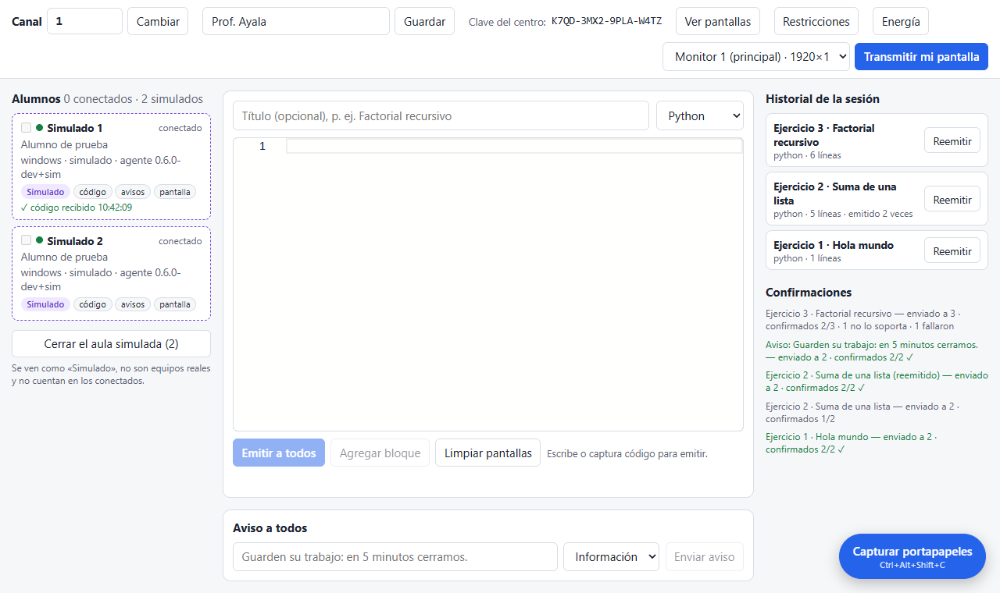
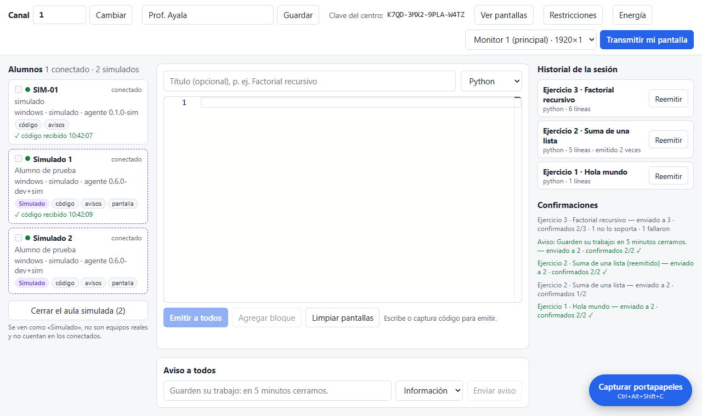
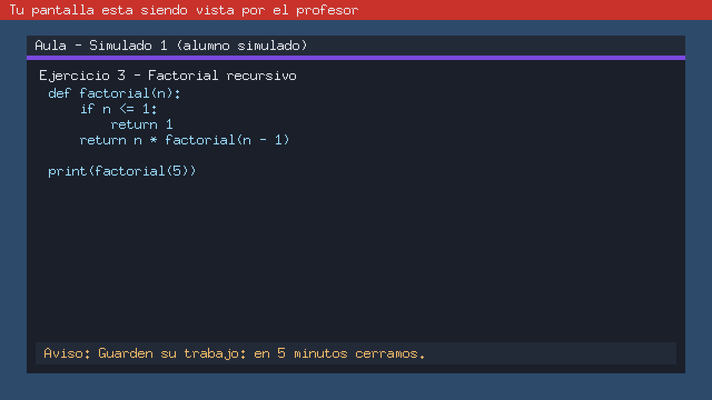

# Entrega: aula simulada (Fase 6.1)

Estado: **para aprobación**. Va primero, como sugiere el prompt 18, porque el asistente de
primer uso y las pruebas de las entregas siguientes la usan.

## Qué hace

- **Alumnos simulados dentro de la consola** (`internal/simclass`). Cada uno es un
  `session.Agent` real: verifica certificado y firma, manda `hello` y latidos, muestra el código
  y los avisos como la app del alumno (`codedist.Receiver`) y responde miniaturas con una
  pantalla dibujada en memoria (`screen.Streamer`).
- **Aislados de los reales.**
  - Se conectan a un segundo servidor de la consola, en `127.0.0.1` y en un puerto libre, que no
    se anuncia por mDNS y tiene su propio registro.
  - Ser simulado depende del puerto por el que llegaron, no del nombre: un equipo real llamado
    «Simulado 1» sigue siendo real (prueba `TestRealStudentNamedLikeSimulatedStaysReal`).
  - El protocolo no cambia.
- **Nunca se cuentan como reales.**
  - `Students.connected` cuenta solo reales y `simulated` va aparte.
  - Los acuses van en `simSent`/`simAcked`.
  - Cada línea de log que los menciona lleva `simulated=true` (verificado en
    `TestSimulatedClassEndToEnd`).
- **No reciben energía, restricciones ni la transmisión.** Solo pueden declarar código, avisos y
  pantalla, y la consola calcula esas funciones sobre el registro real.
- **Fallas para probar:**
  - «lento»: contesta de 0,5 a 10 s tarde, sin llegar a desconectarse;
  - «no acusa»: muestra el código, pero el envío queda incompleto;
  - «desconectado»: se va hasta volver a «ninguna».
- **No persisten.** El aula simulada se cierra con su botón, al cambiar de canal o de nombre y al
  cerrar la clase.

## Bindings para la interfaz

`Simulation`, `SimulationStart(n)`, `SimulationAdd({os, capabilities})`,
`SimulationRemove(id)`, `SimulationFault(id, fault, delayMs)` y `SimulationStop`, más el evento
`aula:simulation`. Están documentados en `docs/eventos-ui.md`. La pantalla «Aula simulada» del
prototipo los usará en la entrega de la nueva navegación.

## En la consola actual (mínimo, hasta la nueva navegación)

Un botón «Probar con alumnos simulados» bajo la lista abre 2 alumnos de prueba. Llevan la
insignia «Simulado» y un borde punteado, el conteo dice «1 conectado · 2 simulados» y las
confirmaciones muestran «simulados M/N» aparte.

| Solo simulados | Reales y simulados (`SIM-01` es un agente real de `muchos_alumnos`) |
|---|---|
|  |  |

La «pantalla» de un simulado, tal como llega a «Ver pantallas»: muestra la franja que tendría un
equipo real, su ventana de Aula con lo que recibió y el último aviso.

## Documentación

- CLAUDE.md: `internal/simclass` en la arquitectura y en la regla de oro.
- `docs/privacidad.md`: reglas 32–35.
- Diagrama 10 nuevo («Aula simulada y simulación de fallas»).
- Diagrama 02 con el paquete nuevo.
- `docs/eventos-ui.md`.

## Pruebas

- `internal/simclass` contra una consola real en loopback: unirse, mostrar y acusar; las tres
  fallas; miniaturas con el aviso de pantalla vista; quitar y cerrar; solo capacidades seguras.
- `apps/teacher`, de punta a punta con la clase real:
  - 2 simulados reciben el primer código;
  - acuses aparte y «no acusa»;
  - energía sin destinatarios reales;
  - miniaturas;
  - logs marcados;
  - cambio de canal;
  - nombre engañoso.
- `codedist`: acuses de simulados contados aparte.
- `gofmt`, `go vet ./...`, `staticcheck ./...` y `go test -race ./...` sin errores.

## Pendiente de la Fase 6

- La pantalla «Aula simulada» (crear y quitar, SO y capacidades, fallas y vista en vivo), con la
  nueva navegación.
- El asistente de primer uso que ofrece el aula simulada.
- El comprobador de conexión (6.3).
