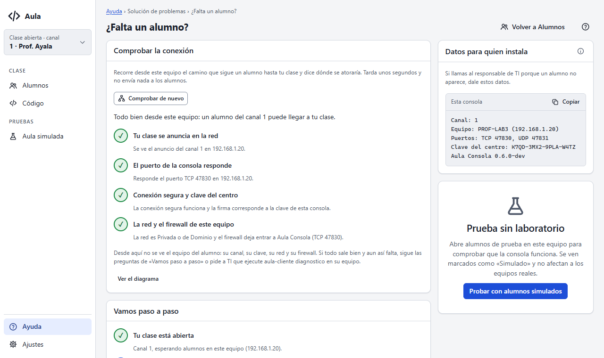
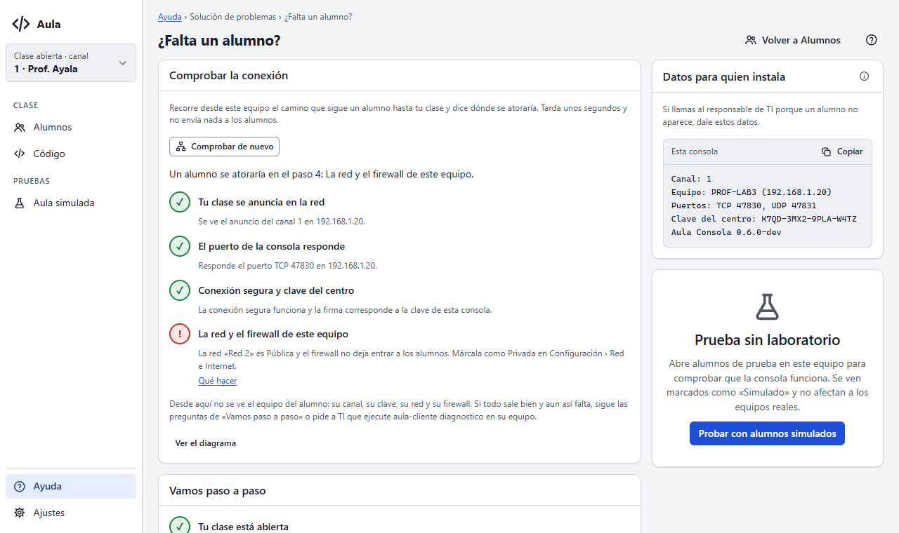
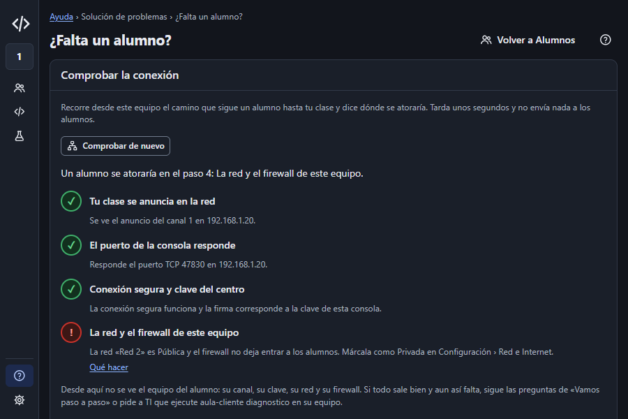

# Entrega E11: comprobar la conexión

Estado: **para aprobación**. Cierra la Fase 6.3 del prompt 18 según el diseño aprobado
(`DISENO-E11.md`). Sin mensajes nuevos en el protocolo.

## Qué cambió

- **Consola:** en «¿Falta un alumno?», la tarjeta **Comprobar la conexión**, arriba de «Vamos paso a
  paso».
  - Corre solo con el botón y tarda unos segundos.
  - Muestra cuatro pasos con su estado (bien, aviso, falla o «no se puede comprobar»), un resumen
    («Un alumno se atoraría en el paso 4…») y «Qué hacer» con la sección del manual en cada paso
    que falla.
  - Al final dice lo que no se ve desde aquí (canal, clave, red y firewall del alumno) y ofrece «Ver
    el diagrama» (12).
- **`internal/connectcheck`** (paquete nuevo, en `CLAUDE.md` y en la regla de oro):
  1. **Anuncio:** busca el anuncio del canal por mDNS y reconoce el de esta consola por su puerto
     y por las direcciones del equipo. Avisa si otra consola anuncia el mismo canal.
  2. **Puerto:** conexión TCP a cada dirección de la LAN, nunca a `127.0.0.1`, que es donde vive el
     aula simulada.
  3. **Conexión segura:** hace lo mismo que un agente (TLS fijado a la huella anunciada, reto y
     firma con la clave) y cierra antes de `hello`, así que nadie aparece en la lista.
  4. **Red y firewall:** perfil de cada red y reglas de entrada para `aula-consola.exe` o su puerto
     TCP.
- **`internal/session`:** el tipo `Cause`.
  - El agente lo emite junto a su texto de siempre (`OnCause`); la barra del alumno no cambia.
  - `Agent.Probe` usa el mismo `connect` que el agente real. Así el comprobador no puede dar una
    causa distinta por tener su propia copia del camino.
- **`internal/platform`:** `NetworkInspector`.
  - En Windows corre PowerShell sin abrir ventana. Lee el perfil con `Get-NetConnectionProfile` y
    el firewall por su API COM (`HNetCfg.FwPolicy2`), y devuelve JSON con valores que no dependen
    del idioma de Windows.
  - Al probarlo resultó que las cmdlets `Get-NetFirewall*` piden administrador; la API COM la puede
    leer cualquier usuario.
  - En Linux y macOS el paso dice «no se puede comprobar».
- **Errores y textos:**
  - error nuevo `checkRunning` (si ya hay una comprobación en curso), con su texto y su sección;
  - textos `comprobar.*`. `connectcheck.Outcomes` lista cada resultado posible de cada paso, y la
    prueba de textos exige un texto para cada uno.
- **Manual:** sección «Comprobar la conexión» en Solución de problemas. «Lo que no es obvio» del
  diagrama 12 ya no dice que el comprobador falta.

## Pruebas

- `TestCheckerAgreesWithTheAgent` (Fase 7.3): con fallas provocadas (sin anuncio, otra huella, otra
  clave, puerto cerrado), el comprobador y un `session.Agent` real dan la misma causa. Comprobé que
  falla si el paso de la conexión segura dice siempre «bien».
- Que la comprobación no deja alumnos, que nunca usa loopback, el aviso de otra consola en el
  canal, el avance y `Evaluate` (red Privada o Pública, regla que bloquea, firewall apagado, sin
  red).
- En la consola, con la clase real abierta, un alumno real y dos simulados: los cuatro pasos, el
  evento y el error `checkRunning`. Nadie recibe nada y el aula simulada queda igual.
- El análisis del JSON corre en los tres sistemas. La lectura real en Windows tarda 1,5 s.
- **En la red real de este equipo:** ve el anuncio en sus tres direcciones; el puerto y la conexión
  segura salen bien; el paso 4 falla porque la red «Wucol-2 2» es Pública y la regla del
  instalador solo cubre Privada y Dominio.
- Pasan `gofmt`, `go vet` (Windows, Linux y macOS), staticcheck y `go test -race -p 4 ./...`.
  `internal/screen` falló una vez por el problema conocido de tiempos; no depende de este cambio y
  pasó tres veces seguidas.

## Lo que decidí al implementar

- **El árbol del diagrama 12 no cambia.** Es el asistente que pregunta qué dice la barra del alumno,
  y un nodo «Comprueba la conexión» saldría como paso ya «hecho». El comprobador va antes que esas
  preguntas, en su propia tarjeta. Por eso no hubo que regenerar los SVG.
- Si el anuncio no se ve, los pasos 2 y 3 se prueban igual contra las direcciones del equipo: así
  se distingue «no se anuncia» de «no responde».
- Si la red es Pública pero el firewall permite Aula, el paso queda en aviso y no en falla.

## Capturas

Del arnés (`scripts/ux/recorrido.mjs`): 50 capturas sin errores de JS ni violaciones de axe.

| | |
|---|---|
|  |  |
|  | |

## Pendiente

- Probar en la ventana real: casos C-35 a C-37 de `docs/desarrollo/probar-consola-local.md`. En
  C-35, confirmar que no se asoma ninguna ventana de PowerShell.
- La conexión TCP del paso 2 deja en el registro de la consola una línea `TLS handshake error … EOF`
  del servidor HTTP por cada dirección. Es inofensiva; si molesta, se silencia en `transport`.
