# Entrega E3: la consola con la navegación nueva

Estado: **para aprobación**. Aplica a la consola real el prototipo aprobado en la Fase 2, sin
funciones nuevas de aula y sin cambios al protocolo.

## Qué cambió

- **Navegación:**
  - menú lateral agrupado: CLASE (Alumnos, Código), PRUEBAS (Aula simulada), y abajo Ayuda y
    Ajustes;
  - la tarjeta de la clase abre «Cambiar de canal»;
  - en ventana angosta, el menú queda en iconos y el canal como «1».
- **Alumnos** es la vista de inicio:
  - lista o miniaturas;
  - selección por clic, casilla, «Seleccionar todos» o Ctrl+A;
  - estado vacío con «¿Falta un alumno?» y «Probar con alumnos simulados»;
  - simulados agrupados al final.

  Las miniaturas solo se piden mientras se ven (como antes) y se pueden ver en grande en un
  diálogo.
- **Barra de acciones** sobre la selección, con paneles laterales: Mostrar mi pantalla, Aviso,
  Restricciones y Energía.
  - Ya no hay capas a pantalla completa (C1).
  - Restricciones y energía van solo a equipos reales.
  - Los paneles dicen cuántos no pueden recibirlas y por qué.
- **Código:**
  - envío a todos o a la selección;
  - «Pegar del portapapeles» junto a Emitir;
  - «Últimos envíos» con quién falta y «Reenviar a los que faltan» (A4);
  - historial en tabla, con «Abrir en el editor» y «Reemitir» con confirmación (A6);
  - la ayuda para salir del editor con el teclado (A2).
- **Aula simulada:** su pantalla completa para agregar alumnos (SO y capacidades), simular
  fallas, quitarlos y ver qué tiene cada uno en pantalla y si se está viendo su pantalla.
- **Ayuda:** el índice del manual, con lo que ya existe enlazado y lo demás marcado
  «(próximamente)» hasta la entrega del manual.
- **«¿Falta un alumno?»:** asistente con las causas reales de la barra del alumno y los datos
  para quien instala, con Copiar (C3).
- **Ajustes** como modal:
  - Clase: nombre y canal, con confirmación de lo que pasa;
  - Apariencia: tema;
  - Acerca de: versión, clave del centro explicada, atajo de captura y datos del instalador.
- **Confirmación única** para limpiar pantallas, reemitir, quitar restricciones, energía y
  cerrar el aula simulada (M1).
- **Errores en lenguaje claro**, con el detalle técnico plegado (A3). Los errores no se van solos.
- **Franjas globales:** transmitiendo, energía pendiente, aula simulada y sin clave del centro.

## Cambios de backend (sin tocar el protocolo)

- **C2:** cambiar de canal o de nombre **conserva el historial y los envíos**.
- `EmitRequest.targets` y `SendNoticeTo` envían a la selección (reales o simulados, contados
  aparte).
- Cada envío lista quién falta (`pending`). `Resend` reenvía solo a esos, y el acuse tardío del
  primer envío ya no cuenta dos veces (`codedist.Deliveries.Resent`).
- `InstallerInfo`: canal, equipo e IP, puertos, huella y versión.

## Textos e interfaz

- Todos los textos están en `frontend/dist/textos.es-MX.js`: el HTML usa `data-t` y el JS usa
  `T()`. `TestTextsAreComplete` falla si falta una clave o sobra una.
- Sin `innerHTML`: solo plantillas y `textContent` (lo sigue exigiendo la prueba de contrato).
- `docs/eventos-ui.md` está actualizado con los bindings nuevos.
- Los diagramas apuntan a las vistas nuevas. El validador ahora lee `data-vista-de`.

## Verificación

- Recorrido en el arnés headless (el frontend real con un doble de los bindings), 27 pantallas
  en `e3/`:
  - **sin errores de JavaScript**;
  - **sin violaciones de axe** (WCAG 2.1 A/AA y buenas prácticas), también a 900×600 y en
    oscuro.
- `gofmt`, `go vet ./...`, `staticcheck ./...` y `go test -race ./...` sin errores.
- **Falta tu prueba en la ventana real** (WebView2), que yo no hago con clics en tu escritorio:
  1. abre la consola;
  2. prueba «Probar con alumnos simulados»;
  3. emite código y mira «Quién falta»;
  4. cambia de canal y comprueba que el historial sigue ahí;
  5. abre Ajustes y cambia el tema.

## Capturas

| | |
|---|---|
| 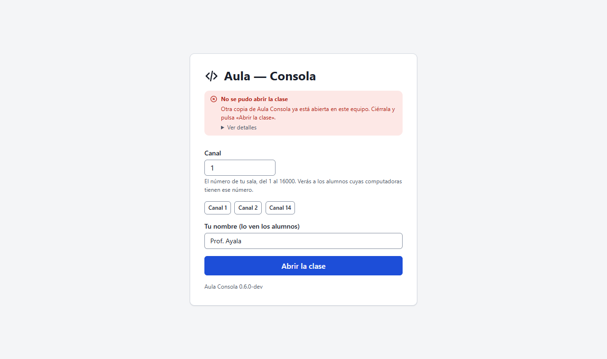 | 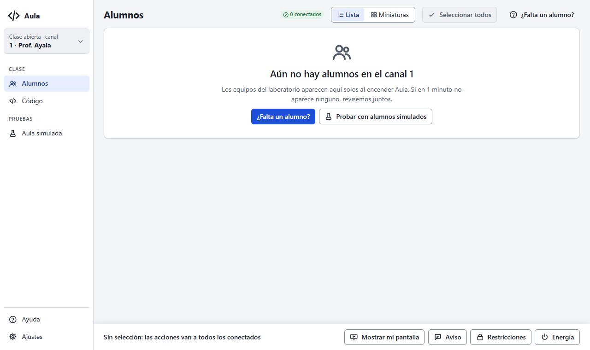 |
| 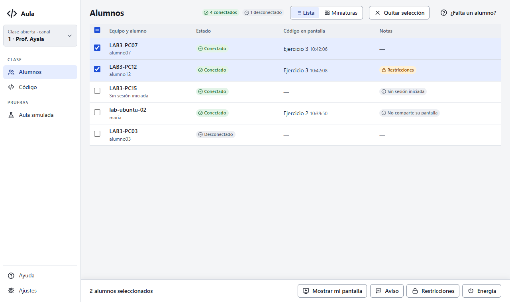 | 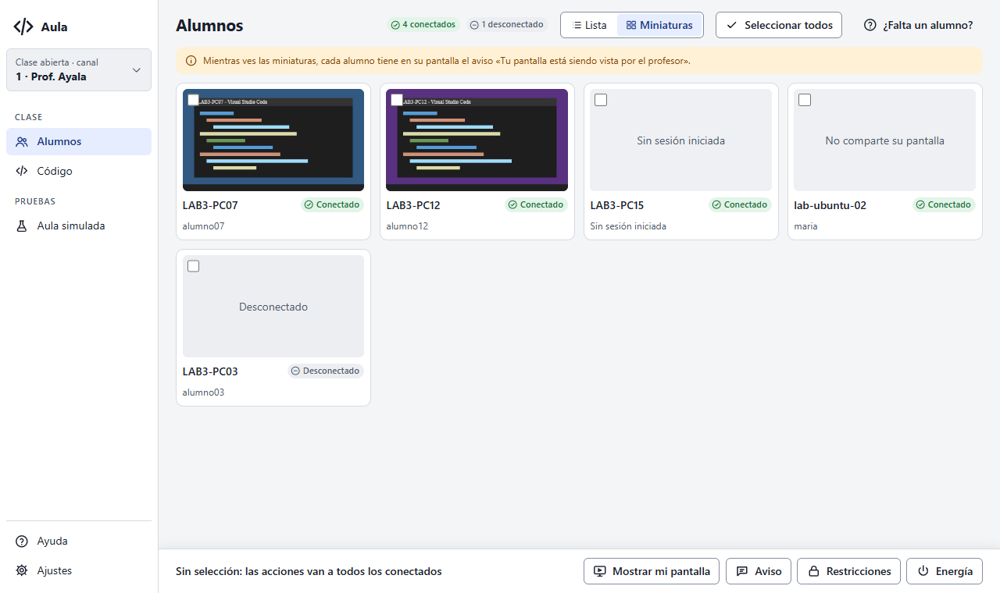 |
| 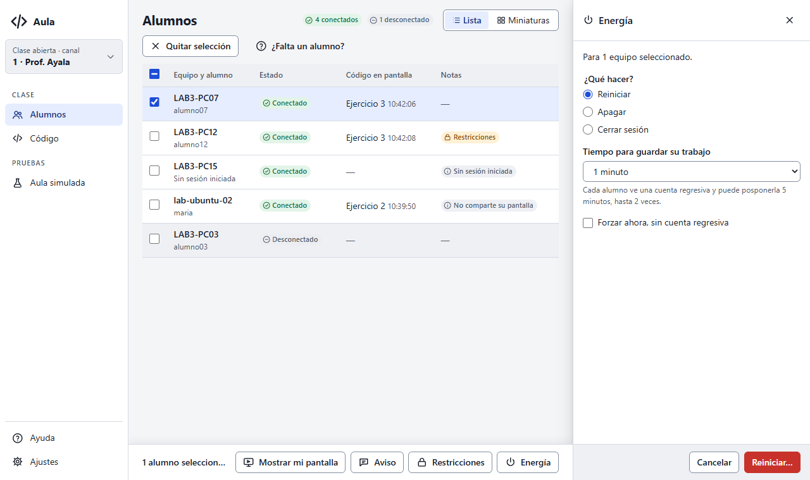 | 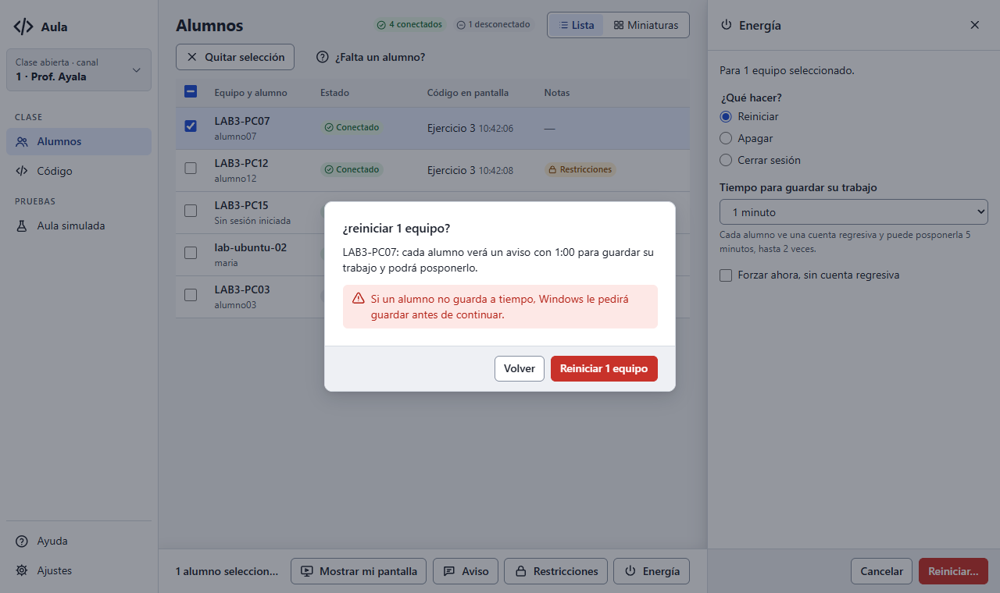 |
| 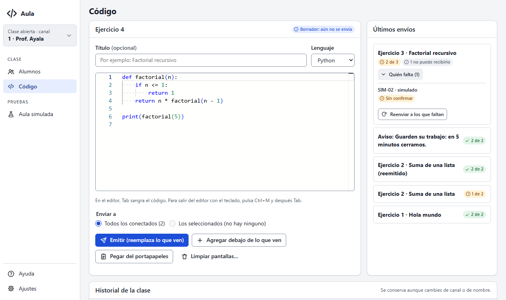 | 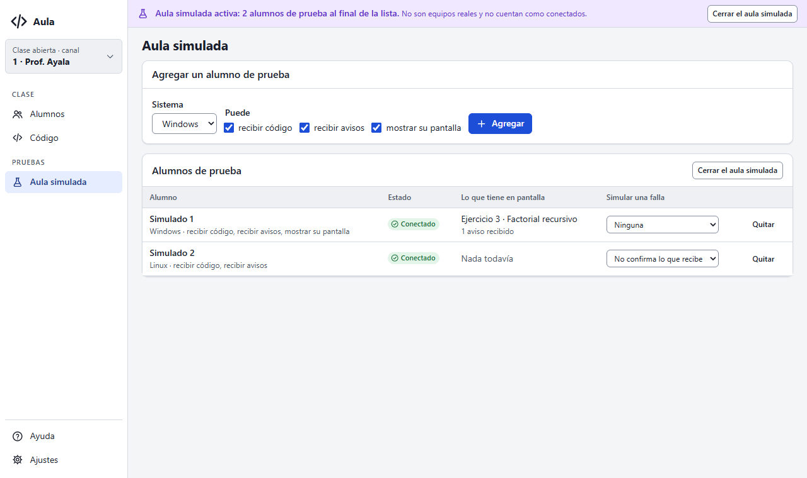 |
| 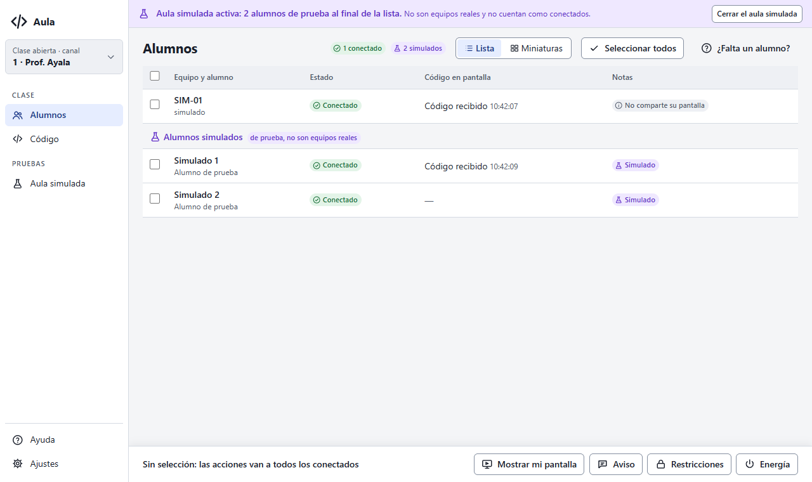 | 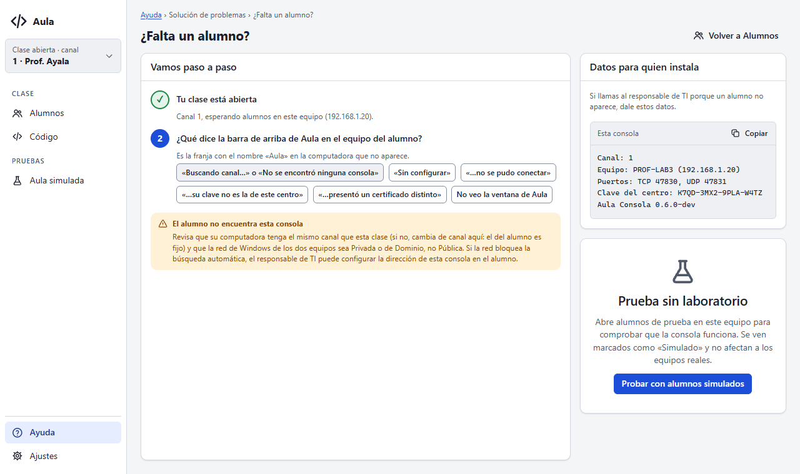 |
| 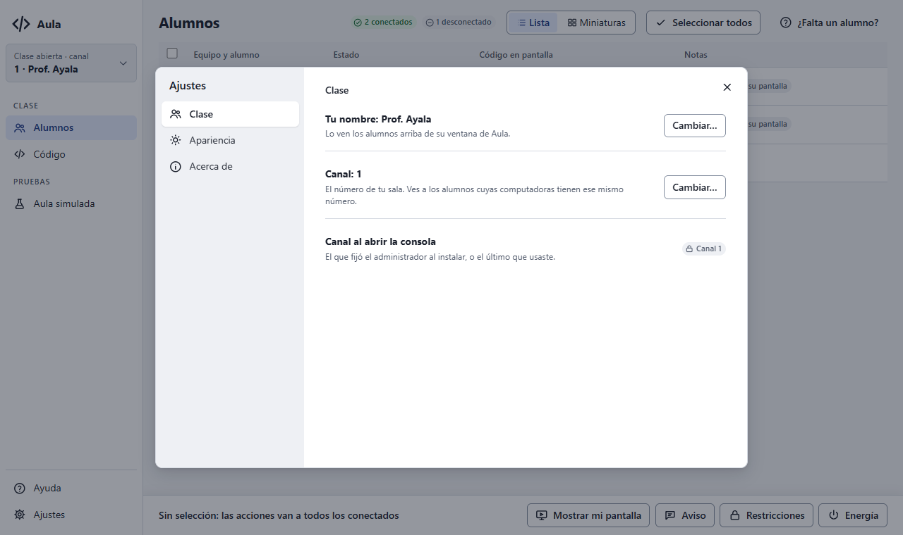 | 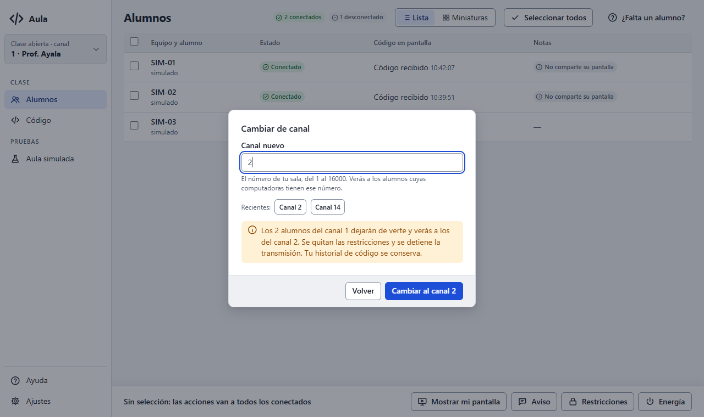 |
| 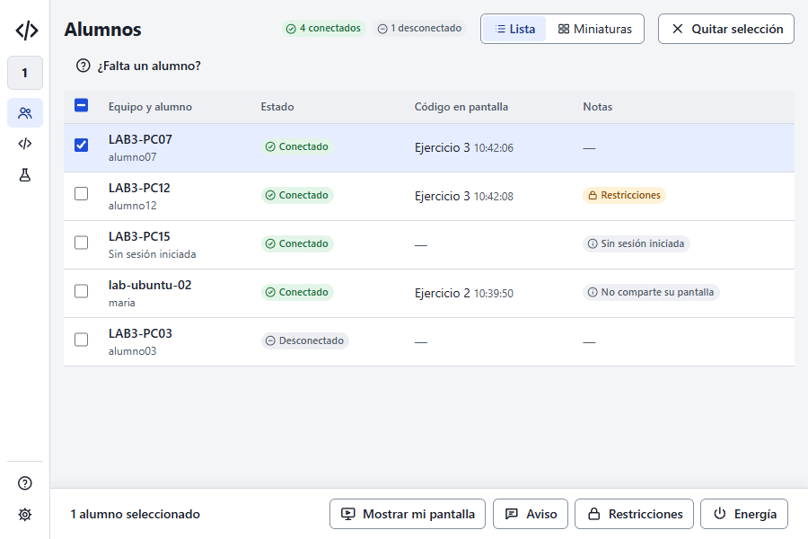 | 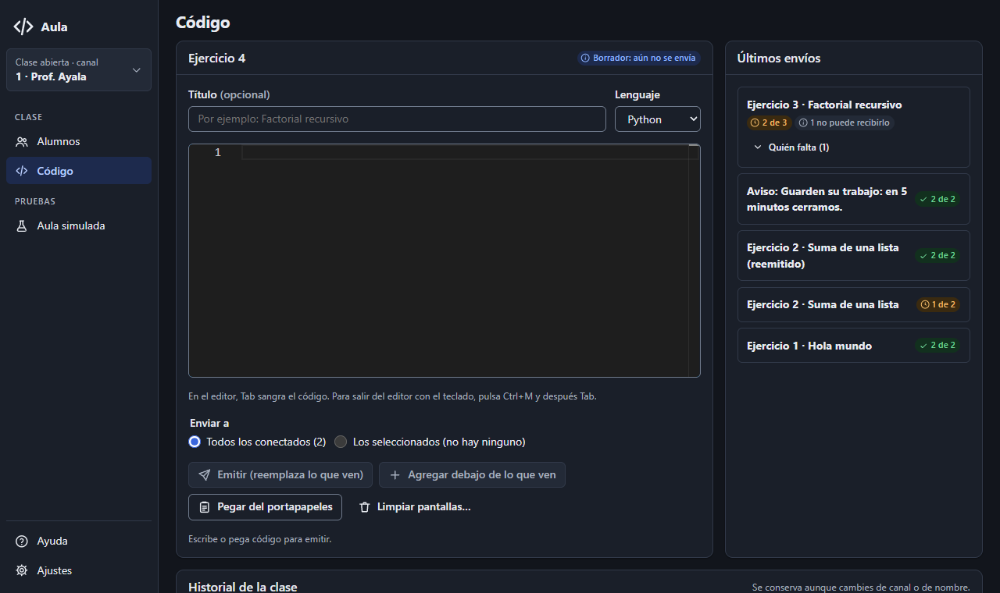 |

## Pendiente

- **E2, completa:** códigos de error estables desde Go. Hoy la interfaz traduce los errores
  conocidos por su texto; los demás se muestran tal cual, con mayúscula y punto.
- El manual (E7), los diagramas dentro de la consola (E8), el comprobador de conexión (6.3) y la
  verificación final con capturas «después» (E10).
