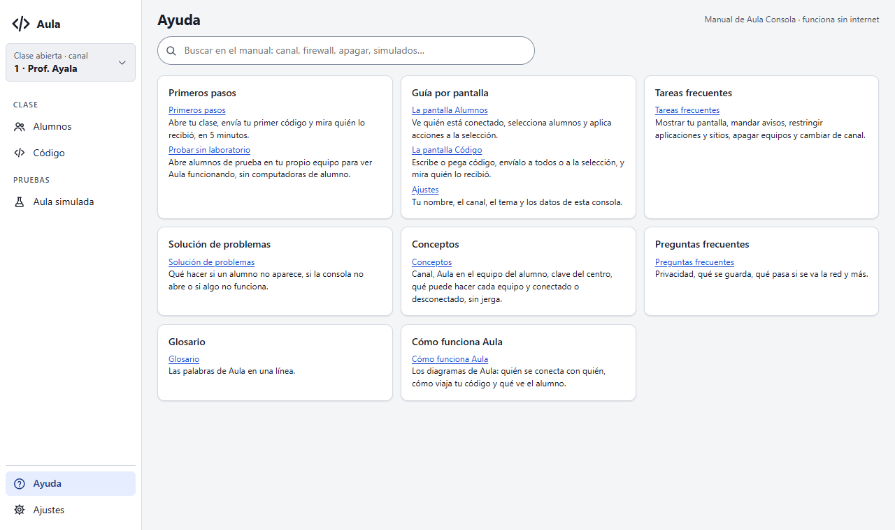
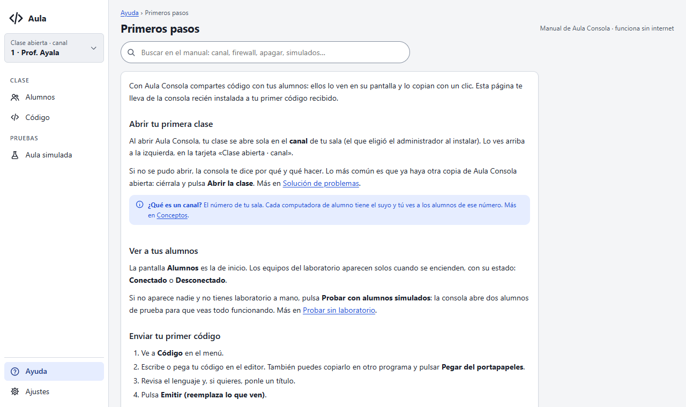
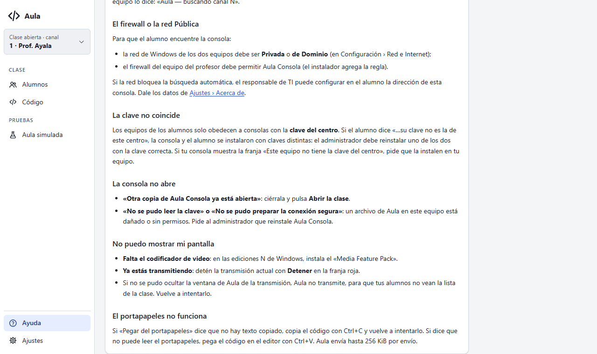
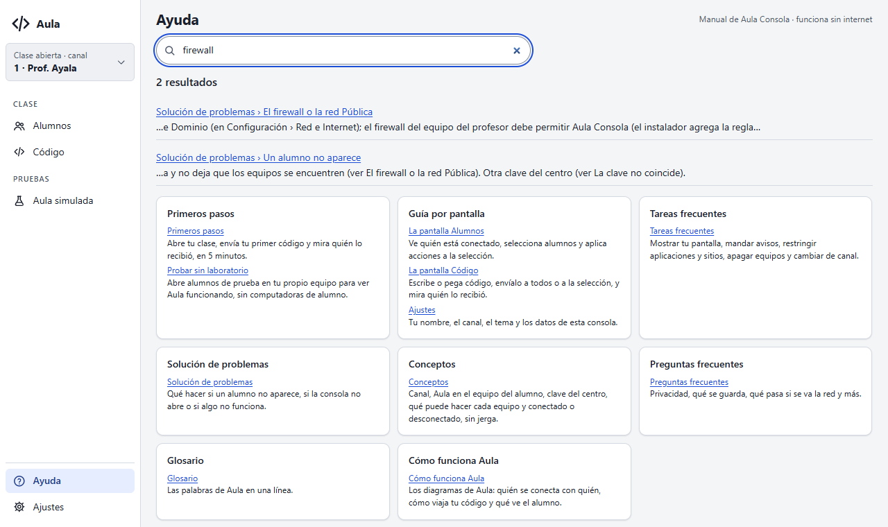
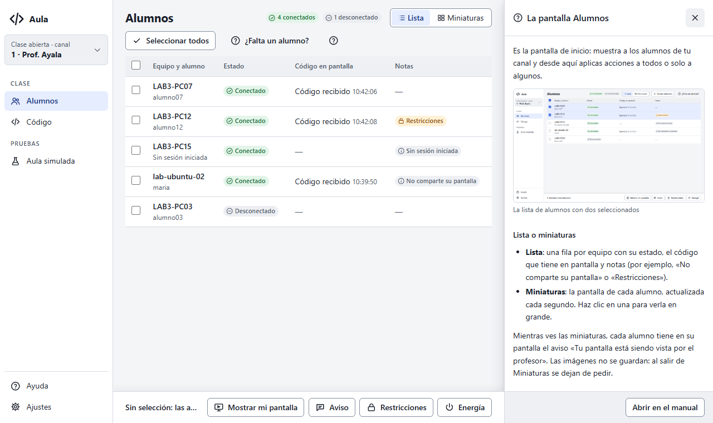
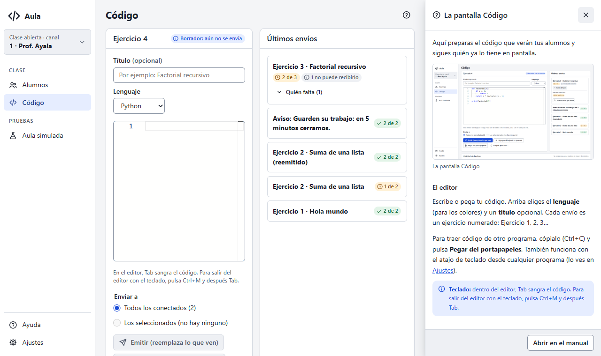
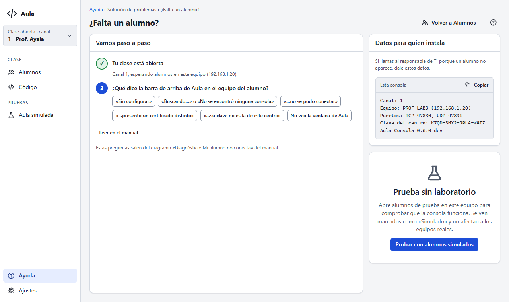
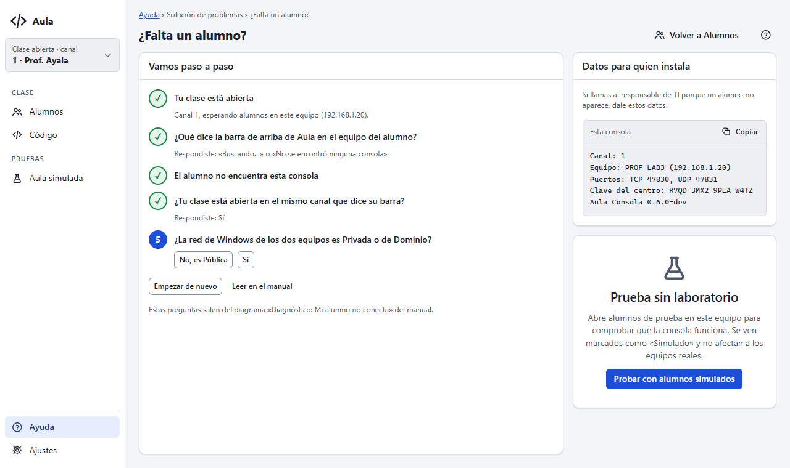
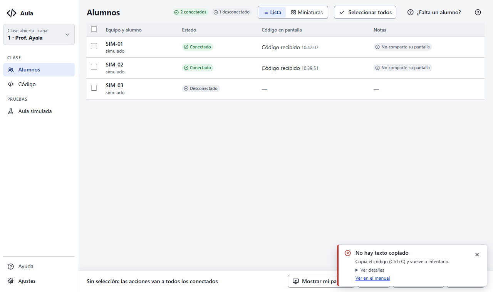
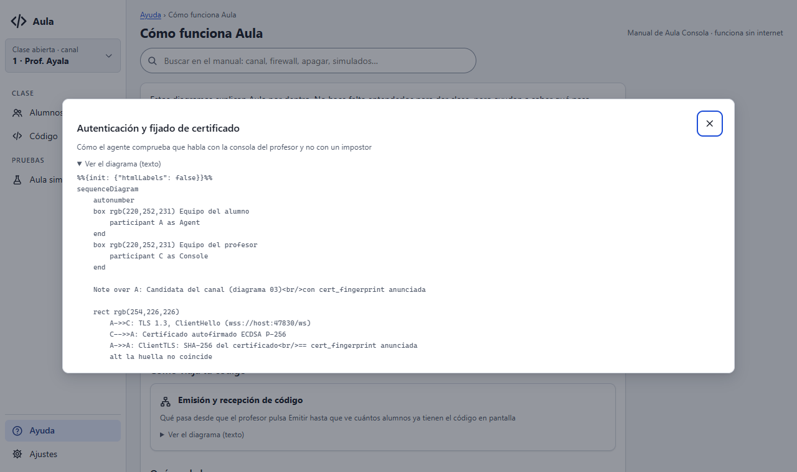

# Entrega E7: el manual dentro de la consola

Estado: **para aprobación**. Pone el manual del profesor dentro de Aula Consola (prompt 18,
Fase 4). Funciona sin internet y sin cambios al protocolo.

## Qué cambió

- **Una sola fuente:** el manual se escribe en Markdown en `docs/v1/administracion/` (11 páginas
  y 3 capturas). El paquete `docs` lo embebe junto con `docs/v1/diagramas/` (`docs.Files()`), y
  la consola lo lee al arrancar. No hay copia en `apps/`.
- **Sanitizado por construcción:** `internal/manual` lee un subconjunto de Markdown (encabezados,
  párrafos, listas, notas, tablas, código, imágenes, enlaces e inclusiones
  `{{diagrama:id}}`) y lo convierte en bloques sin HTML. La interfaz los dibuja con el DOM, sin
  `innerHTML`. El HTML crudo que alguien escriba en el Markdown se muestra como texto.
- **Contenido:**
  - Primeros pasos y Probar sin laboratorio;
  - una página por pantalla (Alumnos, Código y Ajustes);
  - Tareas frecuentes;
  - Solución de problemas;
  - Conceptos, Preguntas frecuentes y Glosario;
  - Cómo funciona Aula, con los diagramas para el profesor.
- **Ayuda:**
  - índice por grupo;
  - página con migas;
  - enlaces a secciones, a pantallas (`pantalla:alumnos`) y a diagramas (`diagrama:04`);
  - búsqueda local sin acentos ni mayúsculas, que también encuentra los títulos y descripciones
    de los diagramas.
- **Ayuda contextual:** botón «?» en Alumnos, Código, Aula simulada y «¿Falta un alumno?», que
  abre en un panel la página de esa pantalla (front-matter `pantallas`), con «Abrir en el manual».
- **«¿Falta un alumno?» sale del diagrama 12:**
  - `manual.ParseTree` lee el flowchart: los rombos son preguntas y las etiquetas de las
    flechas, las respuestas;
  - la consola lo recorre paso a paso, con «Empezar de nuevo» y «Leer en el manual»;
  - si cambia el diagrama, cambia el asistente; `TestDiagnosticTree` comprueba que siga siendo
    un árbol válido.
- **Errores con enlace al manual:** cada código de error (`errorHelp` en
  `apps/teacher/errores.go`) apunta a su sección, y el aviso lleva «Ver en el manual».
- **Diagramas:** por ahora se ven con su título, descripción y el texto Mermaid plegado. El dibujo
  (SVG claro/oscuro) llega en E8.

## Pruebas nuevas

| Prueba | Qué exige |
|---|---|
| `internal/manual` `TestParsePage`, `TestValidate`, `TestSearch`, `TestParseTree` | El lector, la validación, la búsqueda y el árbol, con entradas buenas y malas |
| `docs` `TestManual` | El manual real carga y valida: enlaces, secciones, imágenes con texto alternativo, diagramas incluidos y **una página de ayuda por cada pantalla** de `index.html` |
| `docs` `TestDiagramsKnowTheirManualPages` | Un diagrama incluido en una página la lista en su `secciones_manual` |
| `docs` `TestDiagnosticTree` | El diagrama 12 es un árbol que el asistente puede recorrer |
| `apps/teacher` `TestErrorCodesLinkToTheManual` | Cada código de error tiene texto amable y enlace a una sección que existe |

## Capturas

Chromium headless con el doble de los bindings y el manual real exportado; sin errores de JS ni
violaciones de axe en las 37 capturas del recorrido. Las de esta entrega están en `e7/`:

| | |
|---|---|
|  |  |
|  |  |
|  |  |
|  |  |
|  |  |

## Pendiente

- Probar en la ventana real: casos C-21 a C-25 de `docs/desarrollo/probar-consola-local.md`.
- E8: dibujar los diagramas (SVG con paleta clara y oscura) en lugar del texto Mermaid.
- Las capturas del manual (`docs/v1/administracion/img/`) son las de E3; se rehacen en E10.
