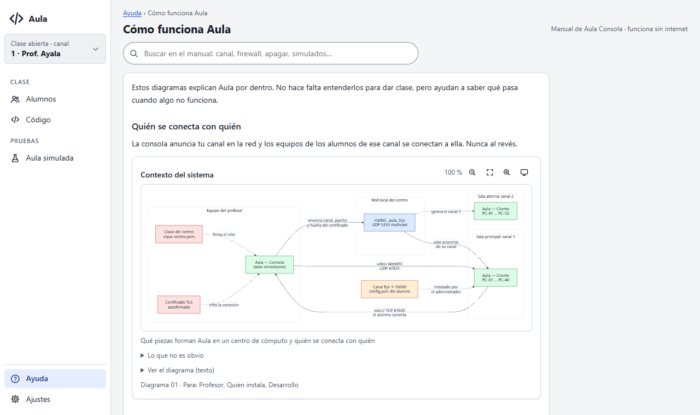
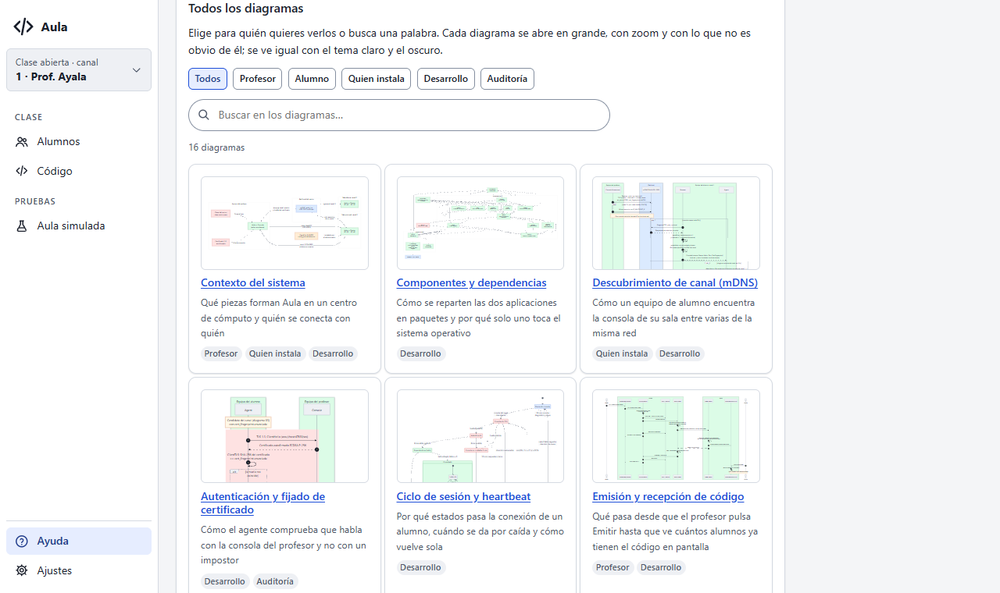
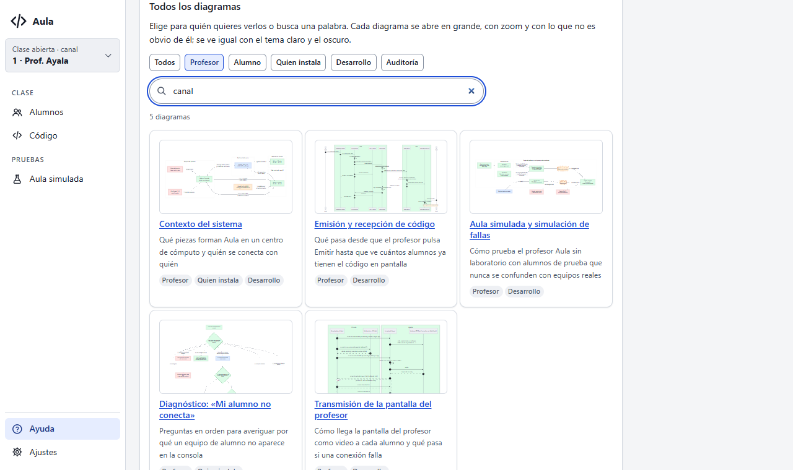
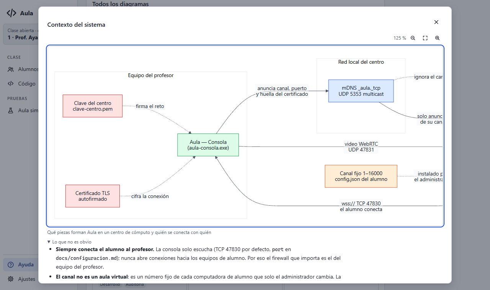
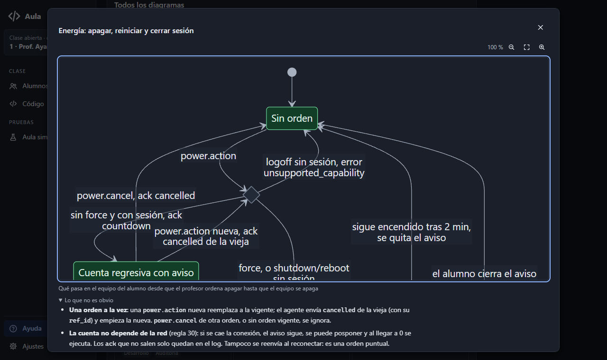
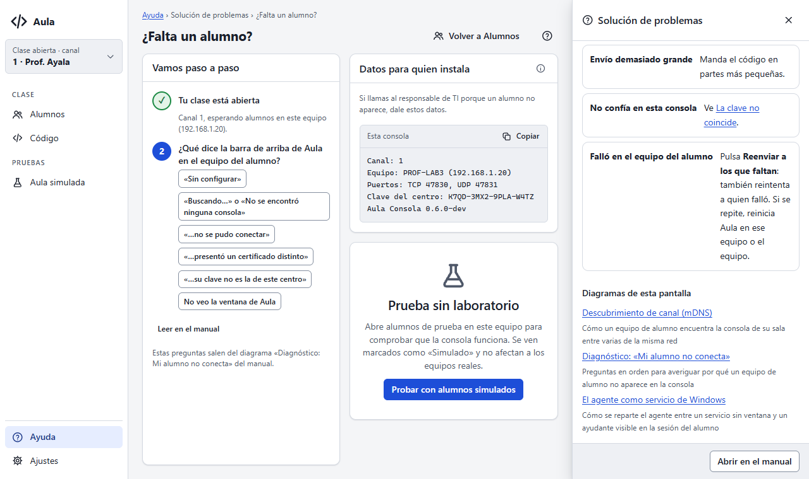

# Entrega E8: los diagramas dibujados en la consola

Estado: **para aprobación**. Cierra la Fase 5 del prompt 18: cualquier diagrama de
`docs/v1/diagramas/` se ve dibujado en la consola, sin internet, en claro y oscuro, y siempre al día
con `docs/`. Sin cambios al protocolo.

## Qué cambió

- **Pipeline** `scripts/docs/generar-diagramas.{sh,ps1}`: Node y `@mermaid-js/mermaid-cli` 11.17.1
  fijo, solo antes del build.
  - Por cada diagrama, un SVG claro y uno oscuro en `docs/v1/diagramas/generados/`. Se versionan
    (decisión del 04/11), así que `go build` no necesita Node.
  - Colores de superficie y texto de los tokens de la consola. En oscuro, una paleta propia para
    las cuatro clases de color y los fondos de `box` y `rect`, sin tocar los `.md`.
  - La letra de la consola (Segoe UI), con la que Mermaid mide el texto. En este equipo, Chromium
    resolvía «Arial» como Times New Roman; por eso el pipeline se niega a generar si no encuentra
    la letra.
  - SVG limpios (sin `script`, `on*`, `foreignObject` ni referencias externas) y siempre iguales
    para el mismo bloque: semilla fija, comprobado con dos corridas idénticas byte a byte.
  - `manifiesto.json` con el hash de cada bloque `mermaid`.
- **Pruebas en `docs/`:**
  - `TestDiagramsAreDrawn`: cada diagrama tiene sus dos SVG y el hash de su bloque coincide; si no,
    falla con «Diagramas desactualizados: ejecuta scripts/docs/generar-diagramas»;
  - `TestDrawingsAreSanitized` revisa cada SVG.

  Comprobé que las dos detectan su caso: un bloque cambiado sin regenerar y un `<script>` metido a
  mano. Comparan el hash del texto Mermaid y no el SVG, así que dan igual en los tres sistemas
  operativos.
- **`internal/manual`:** cada diagrama trae sus SVG (como `data:` para un ``, donde nada se
  ejecuta), su texto alternativo, sus pantallas y «Lo que no es obvio». Un dibujo cuyo hash no
  coincide no se usa: la consola muestra el texto Mermaid, nunca un dibujo viejo. También es nueva
  la inclusión `{{diagramas}}` (la galería), y la búsqueda ahora entra en «Lo que no es obvio».
- **Consola:**
  - **Visor** (el componente `.visor-diagrama` del sistema de diseño):
    - zoom con botones y con + y − del teclado sobre el dibujo;
    - «Ver en grande» en un diálogo que ocupa el ancho;
    - cambia de SVG con el tema;
    - muestra descripción, público, «Lo que no es obvio» y el texto Mermaid plegado.
  - **Galería** en «Cómo funciona Aula», con filtro por público y búsqueda sin acentos.
  - **El «?» de cada vista** agrega «Diagramas de esta pantalla», según el `pantallas` de cada
    diagrama.
- **Arreglos de paso:**
  - el diagrama 03 tenía paréntesis en el título de un `box` con color, y Mermaid mostraba el color
    como texto (también en GitHub);
  - una regla de estilo de la pantalla grande de los alumnos afectaba a todas las imágenes de los
    diálogos;
  - las respuestas largas de «¿Falta un alumno?» se cortaban con un panel abierto.

## Tamaño

El ejecutable de la consola pasa de **25,26 MB a 27,05 MB** (+1,79 MB, +7 %): lo que pesan los 32
SVG (1,78 MB). El análisis de la Fase 1 hablaba de unos 270 KB, pero esa cifra era comprimida
(instalador o zip); `go:embed` guarda los archivos sin comprimir. Si hace falta, se puede reducir
quitando de cada SVG el CSS que Mermaid repite y no usa; queda anotado para E10.

## Capturas

Del arnés (`scripts/ux/recorrido.mjs`): 47 capturas sin errores de JS ni violaciones de axe. Las de
esta entrega están en `e8/`:

| | |
|---|---|
|  |  |
|  |  |
|  |  |

## Pendiente

- Probar en la ventana real: casos C-31 a C-34 de `docs/desarrollo/probar-consola-local.md`.
- En Linux y macOS, sin Segoe UI, el texto de los diagramas puede verse un poco distinto; Windows es
  la plataforma principal.
